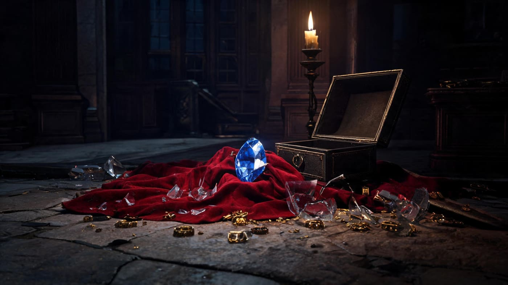
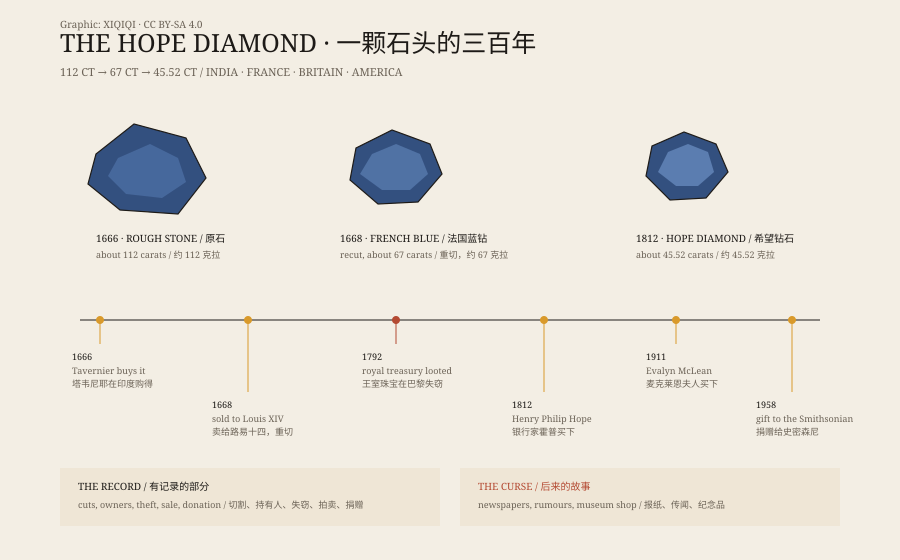

## 1. The blue stone in the glass case

Washington, D.C. The Smithsonian National Museum of Natural History.

Thousands of people walk past it every day. It sits alone in a case, lit from above, a deep blue stone like a piece of frozen sea. The label reads: 45.52 carats, the Hope Diamond.

Guides tell the part everyone wants to hear: the curse. Anyone who owns it suffers misfortune. It was stolen from an Indian temple. Marie Antoinette wore it to the guillotine.

It is a good story. It is not the same thing as the stone's history.

## 2. From India to France

The first reliable record of the Hope Diamond appears in the seventeenth century.

The French merchant Jean-Baptiste Tavernier bought a large blue diamond in India, weighing about 112 carats. He brought it back to Europe and sold it to Louis XIV. Court craftsmen recut it into a 67-carat stone known as the French Blue.

Louis XIV wore it. Louis XV wore it. Louis XVI and Marie Antoinette wore it. Then the French Revolution arrived.

In 1792, the crown jewels were looted in Paris. The French Blue disappeared.

It was a chaotic autumn. In September 1792, thieves broke into the royal storehouse, the Garde-Meuble, in Paris. The guards were few, the windows were not barred, and over several days the crown jewels were carried away in batches. By the time the inventory was checked, the 67-carat blue diamond was no longer in its case.

*Reconstruction: the morning after the 1792 theft in Paris, the blue diamond resting on scattered velvet. Not a historical photograph. Oddity Archive, CC BY-SA 4.0.*

Twenty years later, a 45.52-carat blue diamond appeared in London. No one could prove it was the French Blue, but the cut, colour, and weight matched. In 1812, the British banker Henry Philip Hope bought it. The stone had its modern name.

*Diagram: from a 112-carat rough stone to the 45.52-carat Hope Diamond. Original graphic, CC BY-SA 4.0.*

## 3. How the curse grew

After the Hope family, the stone passed through several owners. One went bankrupt. One was divorced. One died in an accident. Each story was printed in the newspapers, then printed again.

In 1909, the jeweller Pierre Cartier bought the stone from the Hope family. To convince American clients that it was worth a higher price, he strung the misfortunes of its owners into a curse story and let the newspapers tell it louder.

In 1911, the Washington socialite Evalyn Walsh McLean bought it. She was not afraid of the curse; she found it entertaining. She loved jewellery and attention. Her life was genuinely difficult: her son died young, her husband was unfaithful, and the family fortune collapsed. The press put the stone and the misfortunes together, and the curse took shape.

Look closely, though, and many of the “victims” had no connection to the diamond. Some misfortunes happened before they owned it. Some stories were invented by journalists; some were added by dealers to raise the price.

The Hope Diamond's curse is closer to a modern legend: it needs a beautiful object, a few real misfortunes, and enough newspaper space.

## 4. The stone itself

Set the curse aside, and the Hope Diamond is still an unusual stone.

Its blue comes from trace amounts of boron. Boron atoms replace carbon atoms and change the way the diamond absorbs light, producing a deep blue colour. These are Type IIb diamonds, extremely rare in nature.

It may come from the Kollur mine in Andhra Pradesh, India, which produced many famous blue diamonds. The stone formed deep in the mantle, was carried to the surface by volcanic activity, and was dug up, cut, and polished into its present shape.

In 1958, the jeweller Harry Winston donated it to the Smithsonian. Since then it has lain in a glass case, seen by thousands of people every day.

## 5. Which version do you believe

There are two versions of the Hope Diamond.

In one, it carries a curse, and misfortune follows everyone who touches it. This version belongs in dinner parties, documentaries, and museum gift shops.

In the other, it is a rare blue diamond that passed through war, theft, resale, and media hype. This version is less dramatic, but every part of it can be traced.

The two versions are not entirely incompatible. The stone is real. The misfortunes were real. The question is whether we are willing to fill the gap between them with a good story.

---

**Sources and licenses**: the factual sources are listed in the source ledger S1–S3 at the bottom of this entry. Text and reconstruction illustrations are licensed under CC BY-SA 4.0. Reconstruction illustrations are not historical photographs. The “curse” of the Hope Diamond is folklore, not a factual claim.
