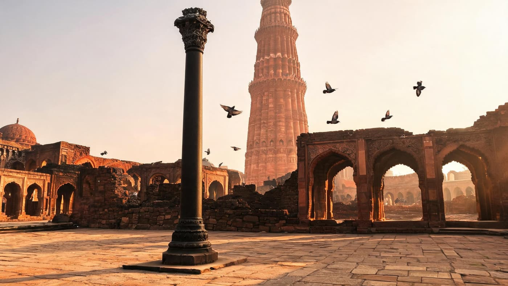
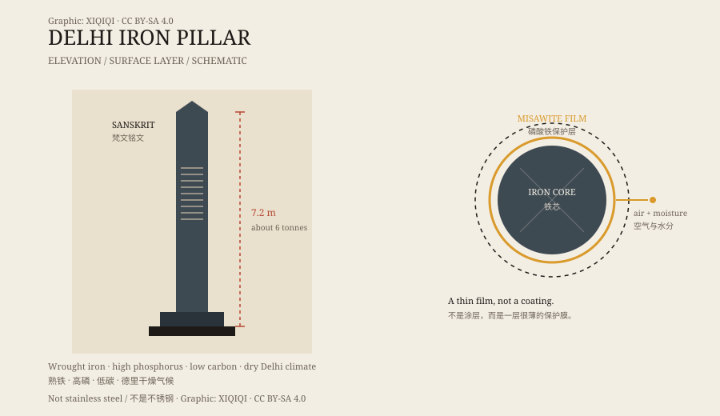

## 1. The pillar in the courtyard

The Qutb complex in south Delhi is dominated by a red sandstone victory tower and a mosque.

To one side of the courtyard stands a dark iron pillar.

It is slimmer than the surrounding stone columns, with a sheen on its surface and the cold feel of metal. The top is decorated, and the shaft carries a raised pattern. It does not look like an object placed behind glass. It looks like a column still standing where it was put, still carrying its own weight.

Late in the day the courtyard sandstone turns orange, and the pillar stays black. It is thinner than the stone columns around it and much darker, a needle inserted into a field of red rock. The lower shaft carries a dark patina worn by generations of hands. Touch it and it is cold; after a moment the metal gives your warmth back.

*Reconstruction: the courtyard of the Qutb complex at dusk, with the Iron Pillar and the victory tower. Not a photograph of the object. XIQIQI Editorial, CC BY-SA 4.0.*

## 2. Size and inscription

The pillar is about 7.2 metres tall, with more than six metres above ground, and weighs around six tonnes.

Six lines of Sanskrit in Gupta script are cut into the shaft. The inscription praises a king called “Chandra,” usually identified as Chandragupta II of the Gupta dynasty, who ruled around the late fourth and early fifth centuries CE.

The text says the pillar was raised in honour of Vishnu. It may originally have been part of a temple or monument, not a lone column.

*Original schematic: the position of the inscription and the surface layer on the Delhi Iron Pillar. Not a photograph of the object. XIQIQI Editorial, CC BY-SA 4.0.*

## 3. Who raised it

Its origin has been debated.

The inscription points to the Gupta period, but the site where it now stands was chosen in the late twelfth century by Qutb al-Din Aibak, who built the mosque and the victory tower. The pillar was kept in the courtyard and became part of the complex.

Exactly where it stood before, and how it was moved, is not fully clear. What is clear is that it is centuries older than the Islamic buildings around it.

## 4. Why it does not rust

Iron rusts. That is the common experience. What surprises people about this pillar is that it has not crumbled into red powder.

Since the twentieth century, metallurgists have taken samples and analysed them repeatedly. They found that the pillar is wrought iron with a very high iron content, low carbon, and a relatively high amount of phosphorus.

In Delhi's dry climate, a thin protective layer forms on the surface, composed mainly of hydrated iron phosphate, sometimes called “misawite.” This film separates the iron from air and moisture and slows corrosion to a nearly invisible rate.

## 5. It is not immune

“Does not rust” is an exaggeration.

The surface still corrodes, only very slowly. It is also not stainless steel: stainless steel relies on chromium, and the pillar has almost none. Its survival depends on the combination of its composition, its environment, and that thin film.

This also means that if it were moved to a damp, salty atmosphere, it might not look the same for long. Part of the credit for its survival belongs to Delhi's weather.

## 6. Now

The pillar is part of the Qutb complex and a classic case in the history of metallurgy.

It is often called a “miracle of ancient Indian metallurgy.” A more accurate description is this: ancient smiths used the technology they had to make an iron pillar with a suitable composition and structure, and Delhi's climate stretched its life into more than a millennium.

A column, standing in the open, without a glass case. It does not need a miracle to make people stop and look.

## Pillar

The Delhi Iron Pillar is in a courtyard in the southern suburbs of Delhi.

It is about 7.2 meters high, about 40 centimeters in diameter and weighs about six tons. The pillars are buried underground, and the above-ground part is about six meters. The capitals are decorated and the columns have inscriptions.

## Inscription

The inscription is in Sanskrit, using the Gupta script.

It says the pillar was erected "in memory of King Chandra". Scholars believe that Chandra is Chandragupta II, the emperor of the Gupta dynasty, who lived around the fourth century.

## Who Established It

There are different opinions on the origin of the pillars.

Some say it was brought from elsewhere and is not native to Delhi. The inscription refers to a king, but the name and age of the king are disputed.

## Stainless

Iron pillars are most famous for being "stainless".

It had been exposed to the outdoors for over a thousand years and had only a thin layer of rust on its surface. The reason is that the iron is of high purity and contains phosphorus, and a dense protective film of iron phosphate is formed on the surface.

## No, It Won't Corrode

Iron pillars are not completely immune to corrosion.

There is rust on its surface, but the rust layer is very thin and stable. In heavily polluted urban air, the rust layer will become thicker. It has not disappeared because of environment and management.

## Now

The Iron Pillar is a monument in Delhi.

Visitors can look, but not touch. The Indian government fenced it off and installed surveillance.

An iron pillar that proves ancient craftsmen could control the purity of iron. It also proves that protecting the environment is harder than creating miracles.

## Metallurgy

The purity of the iron pillar is very high.

Iron smelting in ancient times usually left a lot of slag behind. The iron in the iron pillars has few impurities, indicating that the craftsmen used repeated forging or special smelting methods.

## Phosphoric Acid

There is a layer of iron phosphate on the surface of the iron pillar.

Phosphorus comes from soil or fuel. It combines with iron to form a dense protective film that prevents further corrosion.

## Travel

The Iron Pillar is a tourist attraction in Delhi.

Visitors can look but cannot touch. Some people say that if you stand with your back to an iron pillar, your wish will come true. This is later folk custom, not ancient ritual.

## Science

Iron pillars are an example of materials science.

It illustrates that corrosion resistance does not necessarily require stainless steel. The right ingredients and environment can also preserve iron for a long time.

## Summing Up
Delhi’s iron pillars are not a myth that “won’t rust”.

It has a thin layer of rust, it just rusts slowly. Its purity, phosphorus content and environment all work together to protect it.

An iron pillar proves the height of ancient metallurgy and the influence of the environment on materials.

The iron pillar is still in the yard. The wind blows and the rain falls, it slowly rusts and is slowly remembered.

One pillar stood for over a thousand years, longer than most dynasties. It doesn't beat time, it just sucks a little slower than the stuff around it.

Iron will rot, stones will break, but the story will always stand.

It is just an iron pillar, but it makes time seem less absolute.

---

**Sources and licenses**: the factual sources are listed in the source ledger S1–S3 at the bottom of this entry. Text and original diagrams are licensed under CC BY-SA 4.0. This article separates the inscription, the dating, the metallurgical analysis, and the popular “never rusts” claim; the pillar is not completely immune to corrosion.
