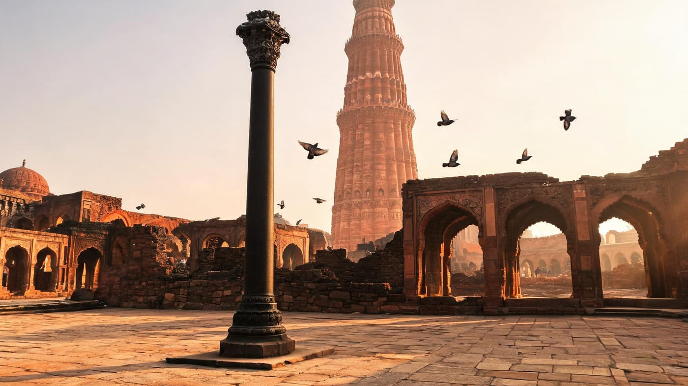
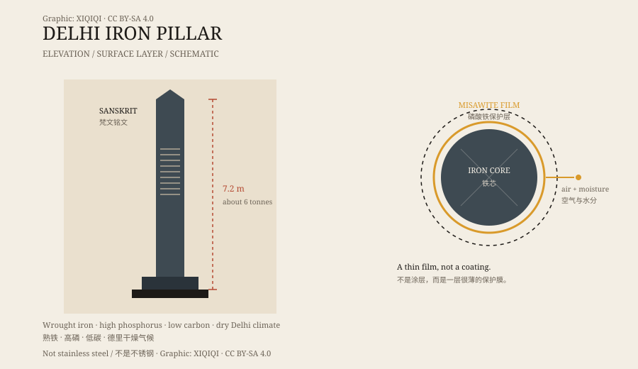

## 1. The pillar in the courtyard

The Qutb complex in south Delhi is dominated by a red sandstone victory tower and a mosque.

To one side of the courtyard stands a dark iron pillar.

It is slimmer than the surrounding stone columns, with a sheen on its surface and the cold feel of metal. The top is decorated, and the shaft carries a raised pattern. It does not look like an object placed behind glass. It looks like a column still standing where it was put, still carrying its own weight.

Late in the day the courtyard sandstone turns orange, and the pillar stays black. It is thinner than the stone columns around it and much darker, a needle inserted into a field of red rock. The lower shaft carries a dark patina worn by generations of hands. Touch it and it is cold; after a moment the metal gives your warmth back.

*Reconstruction: the courtyard of the Qutb complex at dusk, with the Iron Pillar and the victory tower. Not a photograph of the object. Oddity Archive, CC BY-SA 4.0.*

## 2. Size and inscription

The pillar is about 7.2 metres tall, with more than six metres above ground, and weighs around six tonnes.

Six lines of Sanskrit in Gupta script are cut into the shaft. The inscription praises a king called “Chandra,” usually identified as Chandragupta II of the Gupta dynasty, who ruled around the late fourth and early fifth centuries CE.

The text says the pillar was raised in honour of Vishnu. It may originally have been part of a temple or monument, not a lone column.

*Original schematic: the position of the inscription and the surface layer on the Delhi Iron Pillar. Not a photograph of the object. Oddity Archive, CC BY-SA 4.0.*

## 3. Who raised it

Its origin has been debated.

The inscription points to the Gupta period, but the site where it now stands was chosen in the late twelfth century by Qutb al-Din Aibak, who built the mosque and the victory tower. The pillar was kept in the courtyard and became part of the complex.

Exactly where it stood before, and how it was moved, is not fully clear. What is clear is that it is centuries older than the Islamic buildings around it.

## 4. Why it does not rust

Iron rusts. That is the common experience. What surprises people about this pillar is that it has not crumbled into red powder.

Since the twentieth century, metallurgists have taken samples and analysed them repeatedly. They found that the pillar is wrought iron with a very high iron content, low carbon, and a relatively high amount of phosphorus.

In Delhi's dry climate, a thin protective layer forms on the surface, composed mainly of hydrated iron phosphate, sometimes called “misawite.” This film separates the iron from air and moisture and slows corrosion to a nearly invisible rate.

## 5. It is not immune

“Does not rust” is an exaggeration.

The surface still corrodes, only very slowly. It is also not stainless steel: stainless steel relies on chromium, and the pillar has almost none. Its survival depends on the combination of its composition, its environment, and that thin film.

This also means that if it were moved to a damp, salty atmosphere, it might not look the same for long. Part of the credit for its survival belongs to Delhi's weather.

## 6. Now

The pillar is part of the Qutb complex and a classic case in the history of metallurgy.

It is often called a “miracle of ancient Indian metallurgy.” A more accurate description is this: ancient smiths used the technology they had to make an iron pillar with a suitable composition and structure, and Delhi's climate stretched its life into more than a millennium.

A column, standing in the open, without a glass case. It does not need a miracle to make people stop and look.

---

**Sources and licenses**: the factual sources are listed in the source ledger S1–S3 at the bottom of this entry. Text and original diagrams are licensed under CC BY-SA 4.0. This article separates the inscription, the dating, the metallurgical analysis, and the popular “never rusts” claim; the pillar is not completely immune to corrosion.
