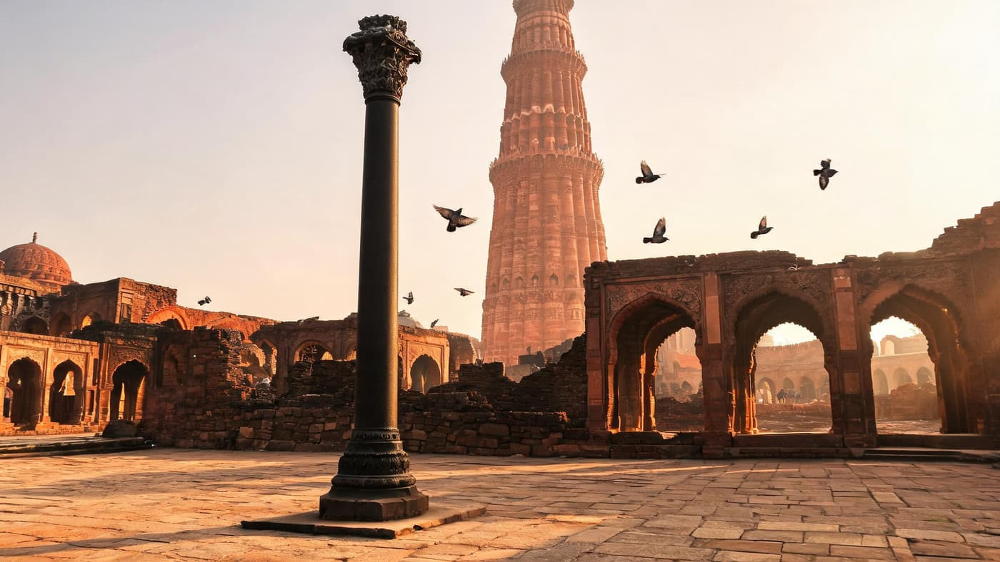
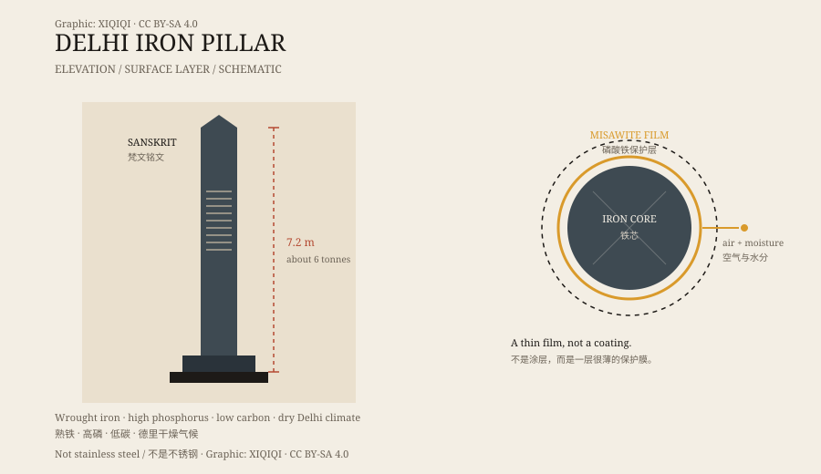

## 一、院子里的柱子

德里南部的库特布建筑群，最显眼的是红砂岩的胜利塔和清真寺。

在院子一侧，立着一根深色的铁柱。

它比周围的石柱细，表面有光泽，摸上去是金属的凉。柱顶有装饰，柱身有一圈凸起的纹样。它不像一件被放在玻璃柜里的文物，更像还站在原地、继续承担自己重量的一根柱子。

傍晚的时候，院子里的红砂岩被照成橘色，铁柱还是黑的。它比周围的石柱细，颜色也深，站在一片红色石头中间，像被谁从别处插进来的一根针。柱身下半段有一圈深色的包浆，是无数只手摸出来的。你把手放上去，先觉得凉，过一会儿，金属把体温还回来一点。

*场景复原：傍晚的库特布建筑群庭院、铁柱与胜利塔。不是文物照片。稀奇奇编辑部，CC BY-SA 4.0。*

## 二、尺寸与铭文

铁柱高约七点二米，地上部分超过六米，重量大约六吨。

柱身上有六行梵文铭文，用笈多字体刻成。铭文赞美一位叫“钱德拉”的国王，通常被认为是笈多王朝的旃陀罗笈多二世，在位时间大约在公元四世纪末到五世纪初。

铭文提到，这根柱子是为了纪念毗湿奴而立的。也就是说，它最初可能不是孤零零一根柱子，而是某个神庙或纪念物的一部分。

*原创示意图：德里铁柱的铭文位置与表面保护层。不是文物照片。稀奇奇编辑部，CC BY-SA 4.0。*

## 三、谁立的

关于它的来历，学界有过不同意见。

铭文指向笈多王朝，但柱子所在的位置，后来被十二世纪末的库特布丁·艾伊拜克选中，建起了清真寺和胜利塔。铁柱被保留在院子里，成为建筑群的一部分。

它原来在哪里、是怎么运到这里的，细节并不完全清楚。能确认的是：它比周围的伊斯兰建筑早了几百年。

## 四、为什么不锈

铁会生锈，这是常识。铁柱最让人意外的地方，就是它没有锈成一堆红色的粉末。

二十世纪以来，冶金学家反复取样分析。他们发现，铁柱的材质是 wrought iron，含铁量很高，碳含量很低，同时含有较多的磷。

在德里干燥的气候里，铁柱表面形成了一层很薄的保护膜，主要成分是磷酸铁水合物，有时被称为“misawite”。这层膜把铁和空气、水分隔开，让腐蚀慢到几乎看不出来。

## 五、不是不会腐蚀

“不会生锈”是一个夸张的说法。

铁柱的表面仍然有腐蚀，只是速度极慢。它也不是不锈钢：不锈钢靠铬，铁柱里几乎没有铬。它靠的是成分、环境和那层薄膜的共同作用。

这也意味着，如果把它搬到潮湿的、含盐的空气里，它未必还能保持现在这个样子。它能站这么久，一部分要归功于德里的天气。

## 六、现在

铁柱是库特布建筑群的一部分，也是冶金史上的一个经典案例。

它常被说成“古代印度的冶金奇迹”。更准确的说法是：古代工匠用当时的技术，造出了一根成分和结构都很合适的铁柱；而德里的气候，帮它把这段时间拉长到了千年以上。

一根柱子，站在露天，没有玻璃罩。它不需要奇迹，也足够让人停下来多看一会儿。

---

**来源与许可**：本文的事实来源见条目底部来源台账 S1–S3。文字与原创示意图采用 CC BY-SA 4.0。文中把铭文、年代、冶金分析与“不会生锈”的流行说法分开叙述；铁柱并非完全不腐蚀。
