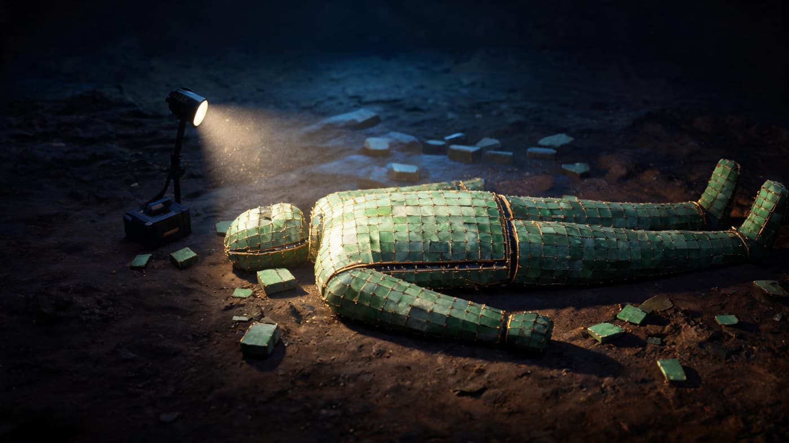
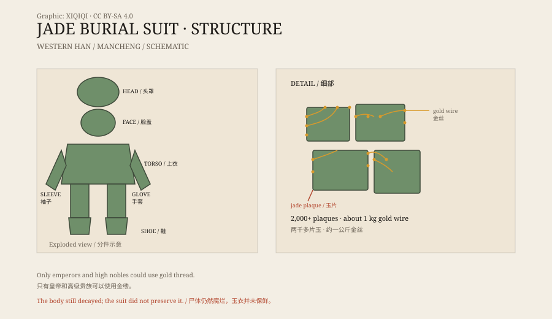

## 1. Mancheng, 1968

In 1968, a construction crew digging an air-raid shelter in Mancheng, Hebei, hit a hard stone wall.

Archaeologists arrived and found a large Western Han tomb. The occupant was Liu Sheng, Prince of Zhongshan, a son of Emperor Jing, who died in 113 BCE. Beside him was the tomb of his wife, Dou Wan.

Neither tomb had been looted. They produced a great quantity of objects, and among them were two burial suits made of jade plaques sewn with gold wire.

When the passage was opened, the air inside was cold. A torch beam swung across the floor and caught something green: jade plaques, thousands of them, damp with soil, lying edge to edge like a spilled game set. Only when the beam lifted did the shape appear — a human figure, flattened on the earth, with nothing inside it.

*Reconstruction: the collapsed jade suit and scattered plaques in the Mancheng tomb, 1968. Not a photograph of the excavation. Oddity Archive, CC BY-SA 4.0.*

Gold wire still linked the plaques. When the light moved, the wire flashed, thin as hair.

## 2. The suit

Liu Sheng's suit used more than two thousand jade plaques and about a kilogram of gold wire.

The plaques are small and varied: square, rectangular, triangular. Each was drilled at the edges and linked with gold wire. The suit was divided into a head covering, face cover, torso, sleeves, gloves, trousers, and shoes, wrapping the body from head to foot.

The face cover has shapes for the eyes, nose, and mouth. The gloves have five fingers. The shoes are made of jade plaques with jade soles. Dou Wan's suit is slightly smaller and also uses more than two thousand plaques.

*Original schematic: the components of a gold-thread jade suit and how the plaques were linked. Not a photograph of the object. Oddity Archive, CC BY-SA 4.0.*

## 3. Who could wear one

Not everyone could have a jade suit.

In the Western Han, emperors and high-ranking nobles could be buried in jade suits. Gold thread was the highest grade; silver and copper thread were used for lower ranks. The materials, the number of plaques, and the method of linking were regulated by status.

Jade plugs were also placed in the body's openings — eyes, ears, nose, mouth, and others. This practice, sometimes called the “nine openings,” was meant to keep the vital essence inside and preserve the body's integrity.

## 4. Why jade

The ancients believed jade had special properties.

It is hard, smooth, and resistant to decay, and was regarded as a concentration of the earth's vital energy. Placing jade on the dead was thought to protect the body and the soul. The jade suit was the extreme version of this idea: not a single piece of jade, but jade wrapping the whole person.

The belief was widespread in the Han period. Jade suits or jade suit plaques have been found in the tombs of kings, marquises, and princesses.

## 5. What happened to the suits

The jade suits did not preserve the bodies.

The remains of Liu Sheng and Dou Wan had long since decayed, leaving only small bone fragments and teeth. Without support, the suits collapsed into piles of plaques; the gold wire was bent and broken. It took archaeologists a long time to clean, number, and restore the pieces.

Each plaque was numbered by its position, then fitted back into the human shape. Some plaques were broken, some wires snapped, and new joins had to be made. In the end the suit stood again, and it was still empty.

In the Three Kingdoms period, Cao Pi ordered an end to jade suits. The reasons were practical: they were enormously expensive and attracted tomb robbers. After that, jade suits gradually disappeared from burials.

## 6. Now

The suits of Liu Sheng and Dou Wan are now in the Hebei Museum.

They sit in climate-controlled cases. Light comes from the side, and the jade plaques glow a pale green. The gold wire is thin, darkened at some joints, but the suits are still intact.

A garment made for “immortality” failed to preserve the body, but it preserved the craftsmanship and beliefs of the Han dynasty in remarkable detail.

---

**Sources and licenses**: the factual sources are listed in the source ledger S1–S3 at the bottom of this entry. Text and original diagrams are licensed under CC BY-SA 4.0. This article separates the excavation record, the jade-suit system, burial beliefs, and the later ban; the suits did not prevent the bodies from decaying.
