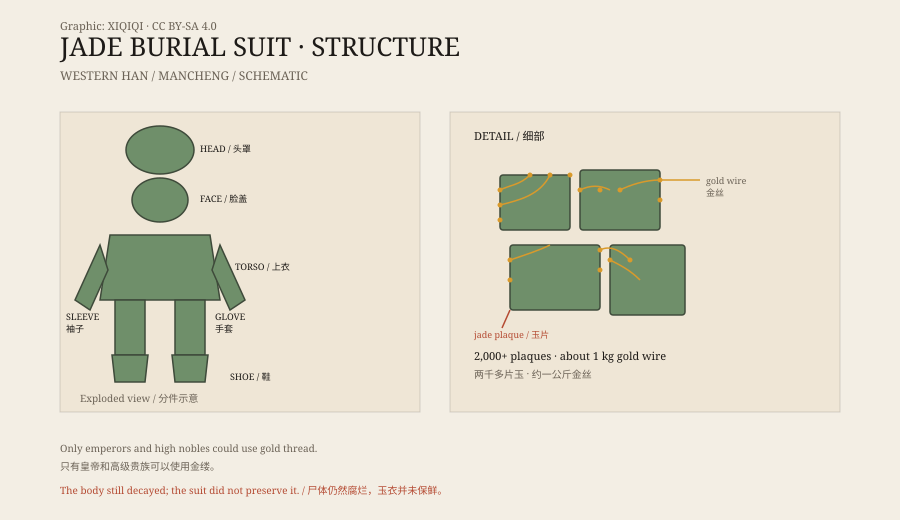

## 一、1968 年的满城

1968 年，河北满城的施工队在挖防空洞时，碰到了坚硬的石壁。

考古人员随后赶到，发现这里是一座西汉大墓。墓主人是中山靖王刘胜，汉景帝的儿子，死于公元前 113 年。旁边还有他的妻子窦绾的墓。

两座墓都没有被盗。墓里出土了大量器物，其中最引人注目的，是两件用玉片和金丝编成的葬服。

## 二、玉衣的样子

刘胜的玉衣，用了两千多片玉，金丝大约一公斤。

玉片很小，形状不同：有方的、长的、三角形的，边缘钻了孔，用金丝一片片连起来。整件衣服分成头罩、脸盖、上衣、袖子、手套、裤子和鞋，把死者从头到脚包住。

脸盖上有眼睛、鼻子和嘴的形状。手套分成五指。鞋是玉片编的，底下还有玉底板。窦绾的玉衣稍小一些，也用两千多片玉。

*原创示意图：金缕玉衣的分件结构与玉片、金丝的编缀方式。不是文物照片。稀奇奇编辑部，CC BY-SA 4.0。*

## 三、谁可以穿

玉衣不是谁都能穿的。

西汉时期，皇帝和高级贵族死后可以使用玉衣。金缕是最高等级，此外还有银缕、铜缕，按身份递减。玉衣的用料、玉片数量和编缀方式，都有等级规定。

除了玉衣，死者身上还会塞玉：眼睛、耳朵、鼻子、嘴等孔窍，用玉塞堵住。这套做法叫“九窍塞”，目的是防止精气外泄，让身体保持完整。

## 四、为什么用玉

古人相信玉有特殊的性质。

玉坚硬、温润、不易腐朽，被看作天地精气的凝结。把玉放在死者身上，可以保护尸体，也可以保护灵魂。玉衣是这种观念的极致版本：不是戴一块玉，而是用玉把整个人包起来。

这套观念在汉代非常流行。诸侯王、列侯、公主的墓里，都出土过玉衣或玉衣片。

## 五、玉衣的下场

玉衣没有让尸体不朽。

刘胜和窦绾的遗体早已腐烂，只剩下少量骨片和牙齿。玉衣失去支撑，塌成一堆玉片；金丝也被压弯、断裂。考古人员花了很多时间，才把玉片一片片清理、编号、修复。

三国时期，曹丕下令禁止使用玉衣。原因很实际：玉衣耗费巨大，而且会引来盗墓。此后的墓葬里，玉衣逐渐消失。

## 六、现在

刘胜和窦绾的玉衣，现在藏在河北博物院。

它们被放在恒温恒湿的展柜里，灯光从侧面打过来，玉片泛出青绿色的光。金丝很细，连接处有些发黑，但整体仍然完整。

一件为“不朽”而做的衣服，最后没有保住尸体，却把汉代的工艺和信仰完整地留了下来。

---

**来源与许可**：本文的事实来源见条目底部来源台账 S1–S3。文字与原创示意图采用 CC BY-SA 4.0。文中把出土记录、玉衣制度、丧葬观念与后世禁令分开叙述；玉衣并未阻止尸体腐烂。
