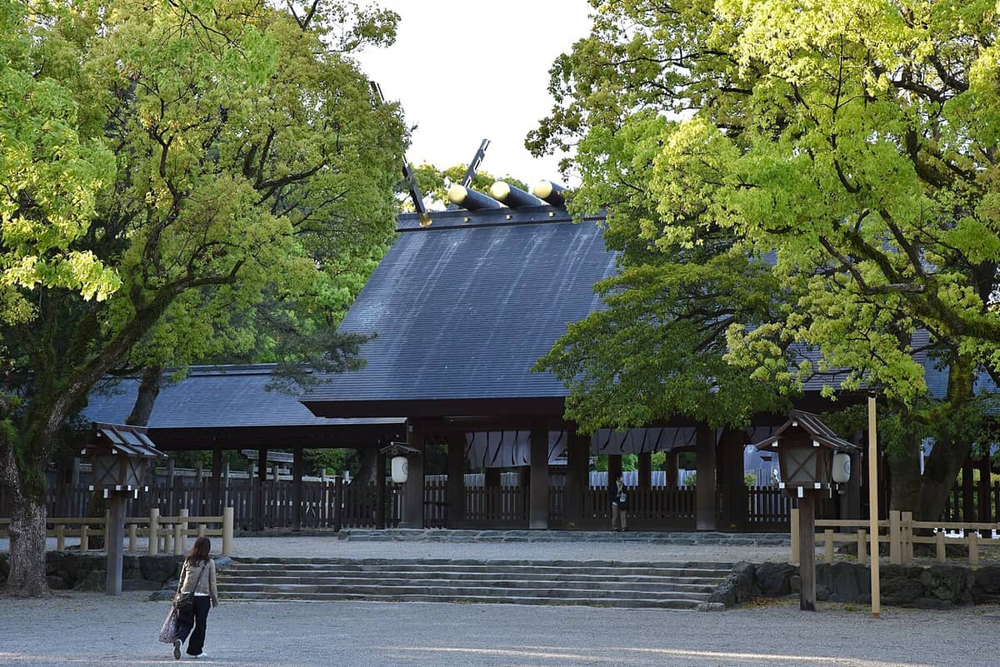
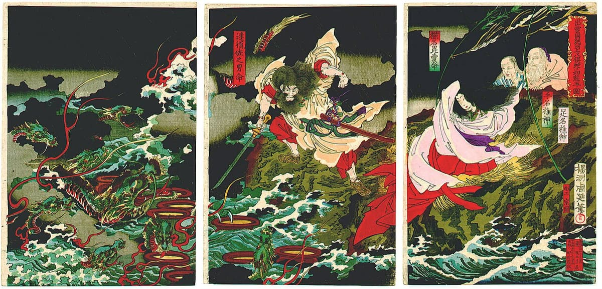
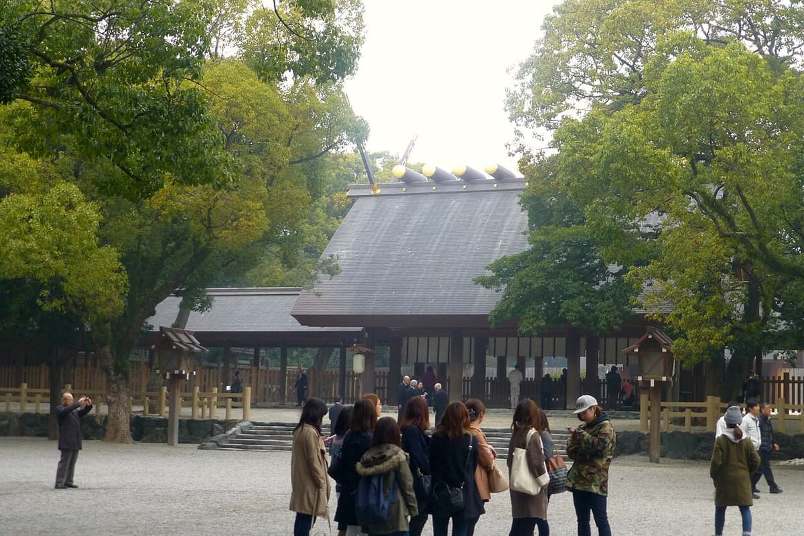
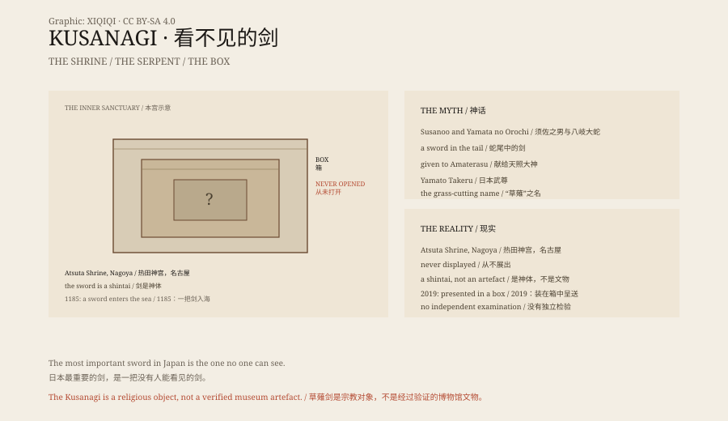

## 1. Atsuta Shrine

Nagoya, Atsuta Shrine. In the innermost sanctuary there is a box, and inside it another box.

The outer one is wooden, wrapped in cloth and tied with cord. There is at least one more layer inside. They stand in the deepest room of the sanctuary, where the light is low and the air smells of old wood and incense. A curtain hangs at the entrance; behind it is the shintai, the body of the kami, and ordinary visitors do not go in.

Inside, it is said, is the Kusanagi sword, one of the three imperial regalia of Japan.

No one has seen it. Not "rarely displayed" — never displayed. Even the shrine's priests have not opened it.

*Site photograph: the main precinct of Atsuta Shrine, 2019. Bariston, CC BY-SA 4.0 (Wikimedia Commons). The sword is kept as a shintai deeper inside, not open to the public.*

## 2. Out of the Serpent's Tail

In the Kojiki and the Nihon Shoki, Susanoo is exiled to Izumo.

He meets an old couple, Ashinazuchi and Tenazuchi. Seven of their eight daughters have been eaten by Yamata no Orochi, the eight-headed serpent, and the eighth, Kushinada-hime, is next.

The serpent has eight heads and eight tails, a body like a mountain, moss and cedars growing on its back. It comes once a year, eats, and leaves.

Susanoo agrees to kill it on condition that he marries Kushinada-hime. He turns her into a comb and puts it in his hair, then has eight vats of sake placed behind eight gates.

The serpent arrives. Each head pushes through a gate and drinks. It gets drunk and collapses.

Susanoo draws his sword, cuts off the eight heads and then the tails. At the fourth tail the blade strikes something hard. He splits the tail open and finds a sword inside.

He presents it to the sun goddess Amaterasu. Later the sword descends to earth and passes into the hands of the emperors.

*Historical print: Yamata no Orochi by Toyohara Chikanobu, c. 1870s. Public domain (Wikimedia Commons). The serpent coils around Susanoo, who stands with his sword.*

## 3. The Name

The sword was first called Ame-no-Murakumo-no-Tsurugi, the sword of the gathering clouds of heaven.

During a campaign, the prince Yamato Takeru is trapped by a grass fire set by his enemies. The wind turns the flames toward him. He cuts down the surrounding grass with the sword and lights a counter-fire, and escapes.

From then on the sword is called Kusanagi — the grass-cutting sword.

The first name came from clouds above a serpent's tail; the second from a fire in a field. Neither came from a palace.

## 4. From the Palace to Atsuta

The Nihon Shoki records that in 688 the sword was removed from the imperial palace and sent to Atsuta Shrine.

The reason given is that the sword was causing trouble: it had made Emperor Tenmu ill.

It is a strange reason. The emperor's sword was sent away because it made the emperor sick. It stayed at Atsuta.

*Site photograph: the honden of Atsuta Shrine, 2014. Nesnad, CC BY-SA 4.0 (Wikimedia Commons). The shintai is kept in the innermost room behind the honden.*

The three regalia have three homes: the mirror at Ise Shrine, the jewel with the emperor, the sword at Atsuta. Traditionally the mirror stands for wisdom, the jewel for benevolence, the sword for valour. That is why the sword is not only a weapon but part of the throne.

## 5. Dan-no-ura

1185, the last naval battle of the Genpei War, at Dan-no-ura.

The Taira are defeated. The child emperor Antoku is taken into the sea by his grandmother, Taira no Tokiko, who also takes two of the three regalia: the jewel and the Kusanagi.

The Tale of the Heike says the sword sank and was lost forever.

But the Tale of the Heike was oral story, written down in 1371, nearly two hundred years after the battle. Its account of the sword is not reliable history. In the same passage the mirror is saved when a lady-in-waiting is stopped at the edge of the sea, and the jewel is later found in a casket floating on the waves. Only the sword is not recovered.

Atsuta Shrine maintains that the sword taken to the sea was a replica and that the true Kusanagi never left the shrine.

That claim cannot be verified either.

Another account says the sword was stolen in the sixth century by a monk from Silla, and that the sword used in enthronement ceremonies is a twelfth-century replica kept in the palace. The claim was made by Shinsuke Takenaka of the Institute of Moralogy, on the grounds that the original had become too fragile to be handled. It shifts the question from "is the sword still there" to "which sword".

## 6. Seen and Unseen

Today the Kusanagi is treated as a shintai, a body of the kami, not as a museum object.

It is wrapped in layers of boxes and kept in the deepest part of the sanctuary. Each year the priests perform rituals around it, but not on it.

In 2019, when Emperor Naruhito ascended the throne, the sword and the jewel were sent to Tokyo, but the sword remained in its box and was not opened. As the procession passed through the streets, the box travelled in a car, and people along the route bowed.

At the enthronement the chamberlain carried the box in, and placed it near the emperor. No one opened it. Afterwards it was returned to Atsuta.

The sword that can be seen at court is a different one: a Kamakura-period blade made by the smiths Nagamitsu and Yukihira, kept near the emperor as a talisman. The crown prince also has an inherited sword, worn at official ceremonies.

The visible sword is a sword. The invisible one is the regalia.

## 7. What It Is

The existence of the Kusanagi cannot be verified by ordinary standards for artefacts.

It may be a real ancient sword, a later replacement, or purely a religious symbol. No one has weighed it, dated it, or seen its blade.

Its power does not depend on being seen. For many people, the fact that it is invisible makes it more divine.

One box, a few layers of cloth, a cord. Thirteen centuries, and no one has opened it.

The shrine does not display it and does not allow it to be copied. What the outside world can see is the buildings of the shrine.

*Original schematic: the Yamata no Orochi myth, the transmission of the sword, Dan-no-ura and the sealed sanctuary at Atsuta. Not a photograph of an artefact. Oddity Archive, CC BY-SA 4.0.*

---

**Sources and licenses**: the factual sources are listed in the source ledger S1–S5 at the bottom of this entry. Text and original diagrams are licensed under CC BY-SA 4.0. This article separates the myth, the Nihon Shoki record, the Tale of the Heike, the Atsuta rituals and the question of whether the sword exists; the Kusanagi has never been independently examined, and its form and date cannot be confirmed. The illustrations are site photographs, a historical print, a reconstruction and a schematic, not photographs of an artefact.
