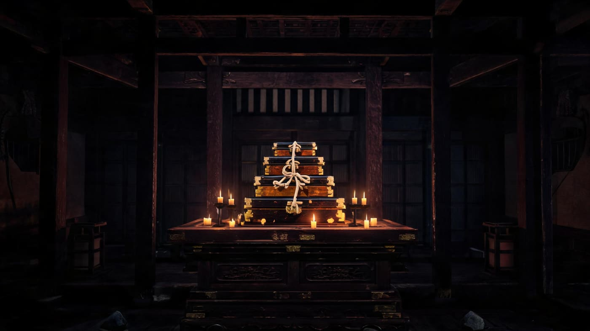
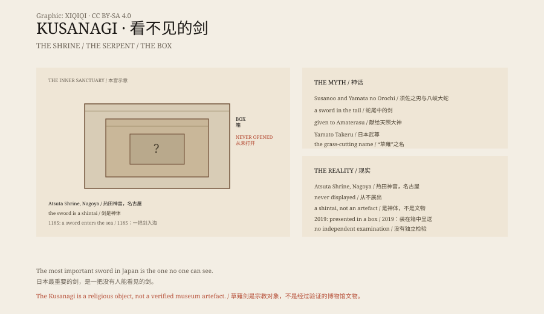

## 1. Atsuta Shrine

Nagoya, Atsuta Shrine. In the innermost sanctuary there is a box, and inside it another box.

The boxes are wooden, wrapped in cloth and tied with cord. They stand in the deepest room of the sanctuary, where the light is low and the air smells of old wood and incense.

Inside, it is said, is the Kusanagi sword, one of the three imperial regalia of Japan.

No one has seen it. Not "rarely displayed" — never displayed. Even the shrine's priests have not opened it.

*Reconstruction: the nested wooden boxes in the innermost sanctuary at Atsuta. Not a photograph of an artefact. Oddity Archive, CC BY-SA 4.0.*

## 2. Out of the Serpent's Tail

In the Kojiki and Nihon Shoki, Susanoo is exiled to Izumo. He meets an old couple whose eight daughters have been eaten by the eight-headed serpent Yamata no Orochi. The ninth is next.

Susanoo sets eight barrels of sake at eight gates. The serpent drinks and falls asleep, and he cuts off its heads. In its tail he finds a sword.

He presents the sword to the sun goddess Amaterasu. Later it descends to earth and is passed to the emperors.

## 3. The Name

The sword was first called Ame-no-Murakumo-no-Tsurugi, the sword of the gathering clouds of heaven.

During a campaign, the prince Yamato Takeru is trapped by a grass fire set by his enemies. He uses the sword to cut down the surrounding grass and lights a counter-fire, escaping.

From then on the sword is called Kusanagi — the grass-cutting sword.

## 4. Dan-no-ura

In 1185, at the naval battle of Dan-no-ura, the Taira clan is defeated. The child emperor Antoku is taken into the sea by his grandmother.

Legend says he took the sword with him.

Atsuta Shrine maintains that the sword taken to the sea was a replica and that the true Kusanagi never left the shrine. The claim cannot be verified.

## 5. Unseen

Today the Kusanagi is treated as a shintai, a body of the kami, not as a museum object.

It is wrapped in layers of boxes and kept in the deepest part of the sanctuary. Each year the priests perform rituals around it, but not on it.

In 2019, when Emperor Naruhito ascended the throne, the sword and the jewel were sent to Tokyo, but the sword remained in its box and was not opened.

As the procession passed through the streets, the box travelled in a car. No one saw the sword, but people along the route bowed.

## 6. What It Is

The existence of the Kusanagi cannot be verified by ordinary standards for artefacts.

It may be a real ancient sword, a later replacement, or purely a religious symbol.

Its power does not depend on being seen. For many people, the fact that it is invisible makes it more divine.

*Original schematic: the Yamata no Orochi myth, the transmission of the sword and the sealed sanctuary at Atsuta. Not a photograph of an artefact. Oddity Archive, CC BY-SA 4.0.*

---

**Sources and licenses**: the factual sources are listed in the source ledger S1–S3 at the bottom of this entry. Text and original diagrams are licensed under CC BY-SA 4.0. This article separates the myth, the historical records, the Atsuta rituals and the question of whether the sword exists; the Kusanagi has never been independently examined, and its form and date cannot be confirmed. The illustration is a scene reconstruction, not a photograph of an artefact.
