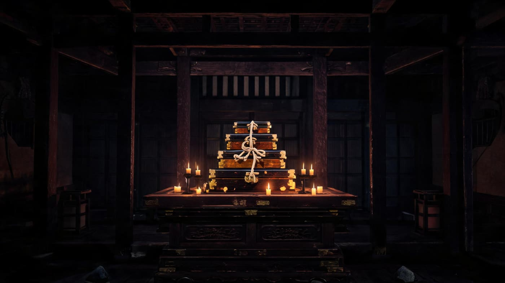
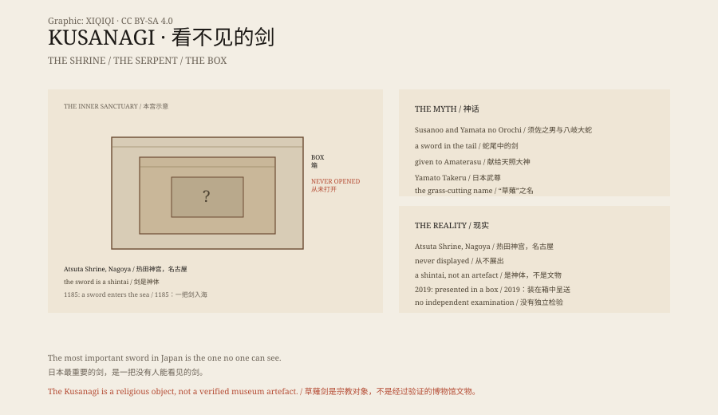

## 一、热田神宫

名古屋，热田神宫。本宫深处，有一只箱子，箱子里还有箱子。

箱子是木头的，外面包着布，布上系着绳。它放在本宫最深处的房间里，光线很暗，空气里有木头和香的味道。

据说，里面是草薙剑，日本三神器之一。

没有人看见过它。不是“很少展出”，是根本不展出。连神宫的神职人员也没有打开过。

*场景复原：热田神宫最深处的多层木箱。不是文物照片。稀奇奇编辑部，CC BY-SA 4.0。*

## 二、从蛇尾里出来

《古事记》和《日本书纪》里，须佐之男被放逐到出云。他遇到一对老夫妇，他们的八个女儿都被八岐大蛇吃掉了，现在轮到第九个。

须佐之男把八桶酒放在八个出口，蛇喝醉，他砍下蛇头。在蛇尾里，他发现一把剑。

他把剑献给天照大神。后来，剑从天上降到人间，传给天皇。

## 三、名字

剑原本叫“天丛云剑”。

日本武尊在东征时，被敌人用火围攻。他用剑割倒周围的草，点燃反向的火，逃了出去。

从此，剑叫“草薙剑”——割草之剑。

## 四、坛之浦

1185 年，源平合战，坛之浦海战。平家战败，幼帝安德天皇被外祖母抱着投海。

传说，他带走了剑。

热田神宫说，被带走的是一把复制品，真剑一直在神宫。这个说法无法验证。

## 五、看不见

今天，草薙剑被当作“神体”，不是博物馆展品。

它被多层箱子包着，放在本宫最深的地方。每年只有神职人员在外围举行仪式。

2019 年，德仁天皇即位。三神器中的剑和勾玉被送到东京，但剑仍然装在箱子里，没有被打开。

车队经过东京的街道时，箱子被放在车里。没有人看见剑，但沿途的人仍然鞠躬。

## 六、它是什么

草薙剑的存在，无法用普通文物标准验证。

它可能是一把真实的古剑，可能是后世制作的替代品，也可能只是一个宗教象征。

但它的力量不依赖于被看见。对很多人来说，看不见，反而更像神。

*原创示意图：八岐大蛇、草薙剑的传承与热田神宫的封存结构。不是文物照片。稀奇奇编辑部，CC BY-SA 4.0。*

---

**来源与许可**：本文的事实来源见条目底部来源台账 S1–S3。文字与原创示意图采用 CC BY-SA 4.0。文中把神话、历史记载、热田神宫的祭祀与“剑是否存在”的问题分开叙述；草薙剑从未被独立检验，其形制与年代无法确认。插图是场景复原，不是文物照片。
