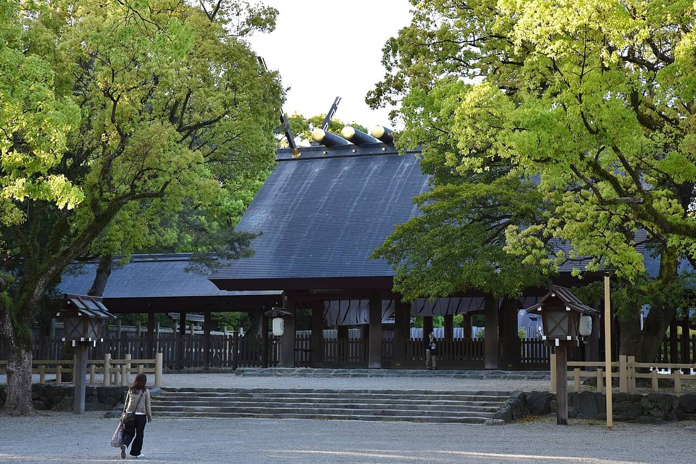
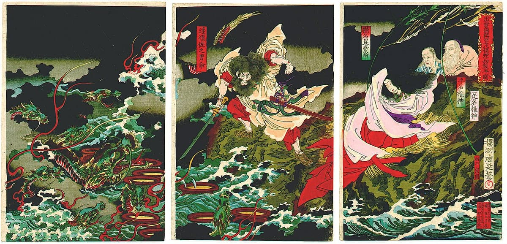
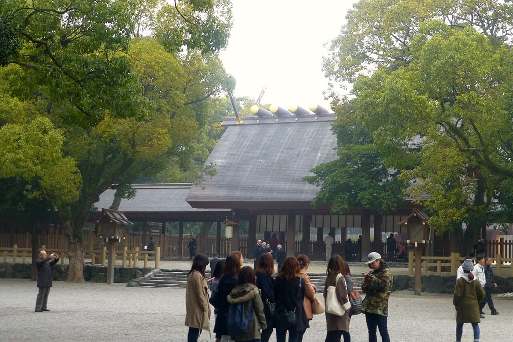
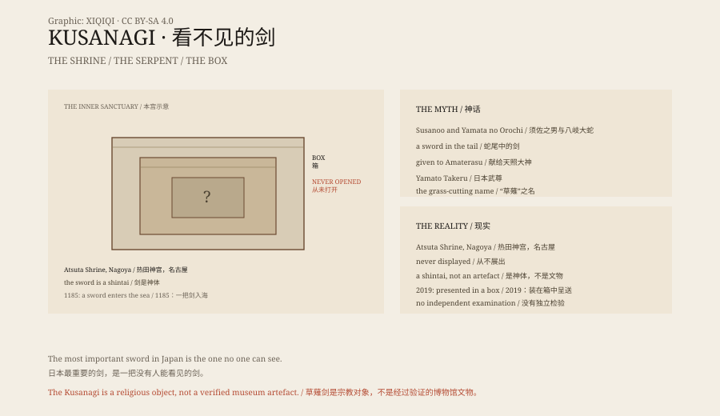

## 一、热田神宫

名古屋，热田神宫。本宫深处，有一只箱子，箱子里还有箱子。

外面是木箱，包着布，系着绳。再里面还有一层。它放在本宫最深的房间里，光线很暗，空气里有旧木头和香的味道。门口挂着帘子，帘子后面是“神体”，普通人不能进去。

据说，里面是草薙剑，日本三神器之一。

没有人看见过它。不是“很少展出”，是根本不展出。连神宫的神职人员也没有打开过。

*现场照片：热田神宫本宫一带，2019 年。Bariston，CC BY-SA 4.0（Wikimedia Commons）。草薙剑作为神体供奉在更深处，不对公众开放。*

## 二、从蛇尾里出来

《古事记》和《日本书纪》里，须佐之男被放逐到出云。

他遇到一对老夫妇，男人叫足名椎，女人叫手名椎。他们有八个女儿，七个已经被八岐大蛇吃掉，现在轮到第八个，名叫栉名田比卖。

八岐大蛇有八个头、八条尾巴，身体像山一样，背上长着青苔和杉树。它每年出现一次，吃完就离开。

须佐之男答应除掉它，条件是娶栉名田比卖。他先把姑娘变成一把梳子，插在自己头上，然后让人造了八个酒桶，放在八道门后面。

蛇来了。八个头分别伸进八道门，喝桶里的酒，喝醉，倒下。

须佐之男拔出十拳剑，砍下八个头，再砍尾巴。砍到第四条尾巴时，剑刃碰到硬物，他剖开蛇尾，里面是一把剑。

他把剑献给天照大神。后来，剑从天上降到人间，传到天皇手里。

*历史画作：丰原周延《八岐大蛇》，约 1870 年代。公有领域（Wikimedia Commons）。画中蛇身盘绕，须佐之男持剑立于中央。*

## 三、名字

剑原本叫“天丛云剑”——天上聚集的云。

日本武尊（倭建命）在东征时，被敌人用火围攻。草被点燃，风把火吹向他。他用剑割倒周围的草，又点燃反向的火，才逃出去。

从此，剑叫“草薙剑”——割草之剑。

这个名字比“天丛云”更常被提起。一个名字来自蛇尾上方的云，一个名字来自一场火。两件事都发生在野外，都不是在宫殿里。

## 四、从皇宫到热田

《日本书纪》记载，686 年（朱鸟元年；维基百科作 688 年），这把剑被移出皇宫，送到热田神宫。

原因是大臣说，剑在宫里作祟，让天武天皇生了病。

这是一个很奇怪的理由：天皇的剑，因为让天皇生病，被送走了。送走之后，它在热田神宫留了下来。

三件神器各有归处：镜在伊势神宫，勾玉在天皇身边，剑在热田神宫。传统上，镜代表智慧，勾玉代表仁慈，剑代表勇。这个对应关系让剑不只是一件兵器，也是皇位的一部分。

*现场照片：热田神宫本殿，2014 年。Nesnad，CC BY-SA 4.0（Wikimedia Commons）。本殿是供奉神体的地方，草薙剑封存在其深处。*

## 五、坛之浦

1185 年，源平合战最后一场海战，坛之浦。

平家战败。幼帝安德天皇由外祖母平时子抱着，投海。平时子还带走了三神器中的两件：八尺琼勾玉和草薙剑。

《平家物语》说，剑从此沉入海底，永远失去。

但《平家物语》是口传故事，1371 年才写成，距离坛之浦已经近两百年。它关于剑下落的说法，可靠性有限。同一段故事里，神镜在宫女要跳海时被抢了回来，勾玉后来从漂浮的匣子里找到，只有剑没有找回来。

热田神宫的说法是：被带下海的是一把复制品，真剑一直在神宫。

这个说法同样无法验证。

另有一种说法：六世纪时，剑曾被来自新罗的僧人偷走；后来宫里用于即位仪式的，是十二世纪制作的复制品。提出这个说法的是伦理研究所的竹中信介（Shinsuke Takenaka），理由是原件已经太脆弱，不能拿出来。这个说法把问题从“剑是否还在”换成了“哪一把剑”。

## 六、看见的和看不见的

今天，草薙剑被当作“神体”，不是博物馆展品。

它被封在多层箱子里，放在本宫最深的地方。每年只有神职人员在外围举行仪式，不打开箱子。

2019 年，德仁天皇即位。三神器中的剑和勾玉被送到东京，但剑仍然装在箱子里，没有被打开。车队经过街道时，箱子放在车里，沿途的人鞠躬。

在即位仪式上，侍从官捧着的“剑”，其实是一个箱子。而天皇身边另一把可以看见的佩剑，是镰仓时代刀匠长光、行平打造的，属于另一套传承。皇太子也有一把代代相传的剑，可以在仪式上佩戴。

看得见的剑，是佩剑；看不见的剑，才是神器。

在即位仪式上，装着草薙剑的箱子由侍从长捧入，放在天皇附近。没有人打开它。仪式结束后，箱子被送回热田。

## 七、它是什么

草薙剑的存在，无法用普通文物标准验证。

它可能是一把真实的古剑，可能是后世制作的替代品，也可能只是一个宗教象征。没有人称过它的重量，没有人测过它的年代，没有人见过它的刃。

但它的力量不依赖于被看见。对很多人来说，看不见，反而更像神。

一只箱子，几层布，一条绳。一千三百年了，没有人打开它。

神宫不展示它，也不允许复制它。本宫的门平时关着，参拜的人站在外面，隔着栅栏和帘子。游客可以参拜，不能进入内殿。外界能看到的，只有神宫的建筑。

*原创示意图：八岐大蛇、草薙剑的传承、坛之浦与热田神宫的封存结构。不是文物照片。稀奇奇编辑部，CC BY-SA 4.0。*

---

**来源与许可**：本文的事实来源见条目底部来源台账 S1–S5。文字与原创示意图采用 CC BY-SA 4.0。文中把神话、《日本书纪》的记载、《平家物语》的叙述、热田神宫的祭祀与“剑是否存在”的问题分开；草薙剑从未被独立检验，其形制与年代无法确认。插图是现场照片、历史画作、场景复原与示意图，不是文物照片。
