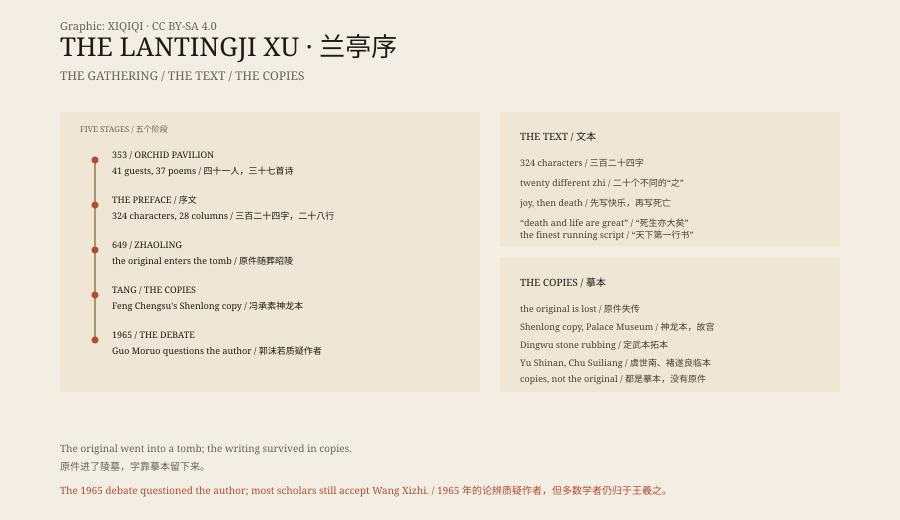

## 1. The Spring of 353

The ninth year of the Yonghe era, the third day of the third month. At the Orchid Pavilion in Shanyin, Kuaiji, a stream ran past a bamboo grove.

Wang Xizhi invited forty-one friends to sit along the banks. Cups of wine were set on wooden trays and floated downstream. Where a cup stopped, the guest had to drink and compose a poem.

By the end of the day they had thirty-seven poems. The poems were collected into a volume, and Wang was asked to write a preface.

He had been drinking. He picked up a brush and wrote directly onto the paper. The preface was short: 324 characters in twenty-eight columns.

## 2. What It Says

It begins with an outing.

"Here there are high mountains and steep ridges, dense woods and tall bamboo, and a clear, rushing stream winding past on either side." The sky is bright, the wind is light, the company is happy.

Then the tone changes.

People live differently, he writes. Some sit indoors and discuss philosophy; some let themselves go. When they encounter something they love, they are delighted and forget that they are growing old. But the things they love pass, and people die.

"Life and death are a great matter. How could it not hurt?"

At the end he says that future readers will look back on this day as we look back on the past, and will feel the same things.

This is not an essay about calligraphy. It is about time and death.

## 3. The Writing

Wang's calligraphy later became known as "the finest running script under heaven".

In the preface there are twenty instances of the character zhi, and no two are written the same way. Some are long, some short, some joined, some broken, some tight, some open.

He is said to have tried dozens of times to write it again when sober. None matched the drunken version. He himself said he could never reproduce it.

## 4. The Original

The original did not survive.

In the early Tang dynasty, Emperor Taizong loved Wang's calligraphy and sent people to search for it. Legend says the preface was held by the monk Biancai, and that the emperor sent an official, Xiao Yi, to befriend him and trick him out of it.

When Taizong died, the preface was said to have been placed under his head and buried with him at Zhaoling.

In the Five Dynasties period, the warlord Wen Tao looted Zhaoling. Some accounts say he took the preface; some say he did not. The original disappears from the record.

## 5. The Copies

What we have are copies.

The most famous is the "Shenlong" copy, made in the Tang dynasty by Feng Chengsu and now in the Palace Museum in Beijing. It was produced by tracing the outline of the original and filling it with ink, preserving even corrections and frayed brushstrokes.

There is also the Dingwu stone rubbing, and copies by Yu Shinan and Chu Suiliang. None is the original, but each preserves the rhythm of the writing.

In 1965 the scholar Guo Moruo argued that the preface might not be by Wang Xizhi at all, setting off the "Lanting debate". Others answered with textual and calligraphic evidence. The argument was never settled, but most scholars still attribute the text to Wang.

## 6. The Writing of That Day

The value of the Lantingji Xu is not only in the brushwork.

It records a man thinking about death at the happiest moment of his life. "The things we once enjoyed, in the space of a bow and a glance, are already traces of the past."

That sentence was written in 353. It still works.

No one knows whether the original lies in Zhaoling. But the 324 characters survived, copy after copy.

*Original schematic: a timeline from the 353 gathering to the Tang copies and the 1965 debate. Not the original calligraphy. Oddity Archive, CC BY-SA 4.0.*

---

**Sources and licenses**: the factual sources are listed in the source ledger S1–S3 at the bottom of this entry. Text and original diagrams are licensed under CC BY-SA 4.0. This article separates the 353 gathering, the text, the fate of the original, the Tang copies and the authenticity debate; the original's fate belongs to records and legend, and everything visible today is a copy or rubbing. The illustration is a scene reconstruction, not the original calligraphy.
