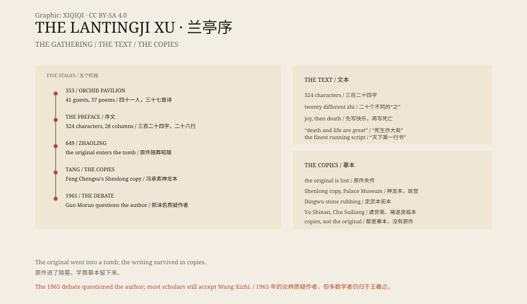

## 一、353 年的春天

永和九年，三月初三。会稽山阴的兰亭，溪水从竹林边流过。

王羲之邀请了四十一位友人，坐在溪流两岸。酒杯放在木盘上，顺水漂下来，停在谁面前，谁就喝酒，再作一首诗。

那天一共写了三十七首诗。大家把诗编成一本集子，请王羲之写一篇序。

他喝了酒，拿起笔，直接写在纸上。序不长，三百二十四个字，二十八行。

## 二、写了什么

开头写的是一场春游。

“此地有崇山峻岭，茂林修竹，又有清流激湍，映带左右。”天朗气清，风很轻，人很快乐。

写到中间，语气变了。

他说，人这一生，有人喜欢在屋里谈玄，有人喜欢放浪形骸。遇到喜欢的东西，会很高兴，会忘记自己正在老去。但喜欢的东西总会过去，人总会死。

“死生亦大矣，岂不痛哉！”

最后他说，后人看今天，也会像今天的人看过去一样。那时候的人读到这篇序，也许会有同样的感慨。

这不是一篇谈书法的文章。它谈的是时间和死。

## 三、字

王羲之的字，后来被称为“天下第一行书”。

整篇里，有二十个“之”字，写法各不相同。有的长，有的短，有的连笔，有的断开，有的收得很紧，有的放得很开。

据说他酒醒以后，又写了几十遍，都比不上醉时那一遍。他自己也说，再也写不出来了。

## 四、原件

原件没有留下来。

唐朝初年，太宗李世民喜欢王羲之的字，派人到处寻找。传说《兰亭序》在辩才和尚手里。唐太宗派萧翼去接近辩才，骗到了字帖。

太宗死后，据说《兰亭序》被枕在他头下，葬进了昭陵。

五代时期，军阀温韬盗掘昭陵。有的记载说他拿走了《兰亭序》，有的说没有。原件从此下落不明。

## 五、摹本

今天看到的是摹本。

最著名的是“神龙本”，唐代冯承素摹，现藏北京故宫博物院。它用双钩填墨的方法，把原迹的轮廓勾下来，再填上墨，连涂改和破锋都保留着。

还有定武本，是石刻的拓本；以及虞世南、褚遂良等人的临本。它们都不是原件，但都能看出那篇字的节奏。

1965 年，郭沫若提出《兰亭序》可能不是王羲之写的，引发了一场“兰亭论辨”。不同意的人举出文献和书法证据。争论没有定论，但今天学界大多仍把它放在王羲之名下。

## 六、那天的字

《兰亭序》的价值不只在字。

它记录了一个人在最快乐的时刻想到死亡。“向之所欣，俯仰之间，已为陈迹。”当时喜欢的东西，一低头一抬头，就成了旧迹。

这句话写在公元 353 年。今天读起来，仍然成立。

原件在不在昭陵，没有人知道。但那三百二十四个字，通过一张张摹本，留了下来。

*原创示意图：《兰亭序》从 353 年雅集到唐代摹本与 1965 年论辨的时间线。不是书法原作。稀奇奇编辑部，CC BY-SA 4.0。*

---

**来源与许可**：本文的事实来源见条目底部来源台账 S1–S3。文字与原创示意图采用 CC BY-SA 4.0。文中把 353 年的雅集、文本内容、原件下落、唐代摹本与真伪争论分开叙述；原件下落属于记载与传说，今天可见的都是摹本或拓本。插图是场景复原，不是书法原作。
