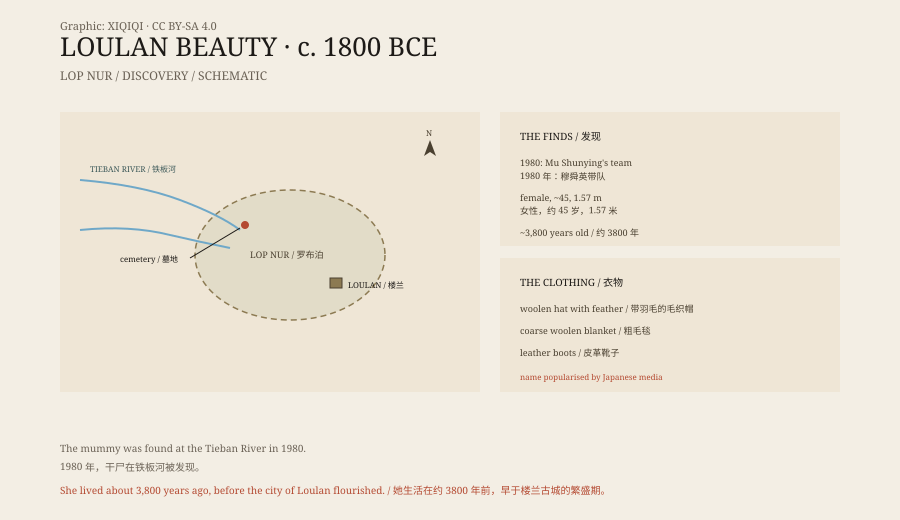

## 1. The Tieban River, 1980

In 1980, a team led by Mu Shunying of the Xinjiang Institute of Archaeology excavated at the Tieban River, at the northern end of Lop Nur.

It is desert. Wind had stripped away the soil and exposed a layer of graves. In one of them the team found a female mummy.

She was wrapped in a woolen blanket, wore a woolen hat, and had leather boots on her feet. The body was well preserved: skin, nails, and hair were still there.

Radiocarbon dating put her at about 3,800 years ago. She was around forty-five when she died, 1.57 metres tall, with blood type O.

The wind never stopped during the excavation. The grave was shallow. When the sand was lifted, the first thing to appear was coarse wool, faded to the colour of dust. The hat lay to one side, pointed, still holding a feather; the boots were placed side by side, soles upward. The body was wrapped in a blanket, and the sand blew back in as fast as the team could clear it.

*Reconstruction: the Tieban River grave during excavation in 1980, with woollen blanket, pointed hat, and leather boots. Not a photograph of the excavation. Oddity Archive, CC BY-SA 4.0.*

## 2. What she looked like

She had long, dark brown hair spread over her shoulders.

Her face was thin, with a high nose, deep-set eyes, and a pointed chin. Her eyelashes and eyebrows were still visible. She wore a pointed woolen hat decorated with a feather, a coarse woolen blanket, and turned-leather boots.

Lice and a bedbug were found in her hair and clothes. They show that life in her time was not clean, and they were preserved along with her.

*Original schematic: the Tieban River site, the chronological scale, and the types of clothing. Not a photograph of the mummy. Oddity Archive, CC BY-SA 4.0.*

## 3. Why “Loulan Beauty”

“Loulan Beauty” is not the formal name in the archaeological report.

Loulan was a kingdom in the Western Regions during the Han dynasty, near Lop Nur, and a key point on the Silk Road. The ancient city of Loulan was discovered in the early twentieth century, yielding Chinese wooden slips, Kharosthi documents, and many artefacts.

The mummy came from the Loulan region. Japanese media used the name “Loulan Beauty” when they reported the discovery. It was memorable and spread quickly, and it became the common name.

## 4. Who she was

She probably did not live in the city of Loulan, and she was not necessarily a “Loulan person”.

She belongs to the late Bronze Age, more than a thousand years before the city of Loulan flourished. In her time, Lop Nur still had water, grass, and livestock; it was not the desert it is today.

Later genetic studies show that Bronze Age populations in Xinjiang had complex origins, with components from Siberia, Central Asia, and East Asia. She is not a representative of some “pure” group, but an individual in a period of movement.

## 5. Preservation

She survived because of the environment.

Lop Nur is extremely dry, with very little rain, and bacteria struggle to multiply. Her grave was not deep, but the salty soil and hot, dry air dehydrated the body quickly, turning it into a mummy.

She was later taken to the Xinjiang Museum. The museum built a special case with controlled temperature and humidity. Her hair, clothes, and skin are still important material for studying ancient populations, costume, and parasites in Xinjiang.

## 6. Now

Today she is on display at the Xinjiang Museum.

“Loulan Beauty” has become a tourist label and a symbol of Xinjiang's ancient history. But for her, she was a middle-aged woman who died in the desert, was buried by sand for three thousand years, and was dug up by an archaeological team.

## Iron River

In 1980, an archaeology team found a female dry body near the Iron River in Robpo.

She's buried in the sand, and the coffin is made of huyang wood. The body is well preserved, and the skin, hair, eyelashes are still there. She's called the "Beauty of the House."

## What did she look like?

She was about a metre and a half tall and was about 40 years old at the time of her death.

Her hair was brown and she had braids. She was wearing a sweater and shoes on her feet. Her face was thin, her nose was high and her eyes were deep.

## Age

Carbon year shows that she lived about 1800 B.C.

This is earlier than the time of Lango City. She's not from the country, but from Robbo. Archaeologists call her "The Iron River Woman," and the media call her "The Blue Woman."

## Save

Dry bodies are preserved because of the environment.

Robpo is extremely dry, the sand contains less water, and the bacteria are difficult to reproduce. The bodies are buried shallowly, the wind blows away the sand, the bodies are exposed and the water evaporates rapidly.

## Who is she?

Her identity, no transcript.

She may be a local herd, farmer, or priest. Her clothes and her funerals indicate her social status, but not necessarily noble.

## Now

She's at the Xinjiang Museum.

The booths are warm and wet, and the lights are dark. The tourists can see her face, but they can't take pictures of her.

A woman who was saved in the desert and named after her by the modern man 3,800 years ago. Her name is not her own.

## Robbo

Robbo's a disappearing lake.

It used to have water, reeds, fishing villages. Later, the river turned, the climate dried and the lake bed turned into salt shells. The building of the city of Langu is in this area.

## Dead bodies

The body of a woman from the Iron River was one of the first inhabitants of Robpo.

She lived around 1800 B.C., hundreds of years earlier than Lango City. She's not a "lander," but her discovery belongs to the Landland area.

## Named

"Beauty of the House" is the name given by the media.

Archaeology report called "The Iron River Woman". The name changed and turned a dry corpse into a cultural symbol.

## Research

The researchers extracted information on diet, health and migration from her hair, teeth and bones.

She eats meat and milk, probably for her grazing. Her DNA shows that she belongs to a mixed population in Eurasia.

## Summing up

A beautiful woman is not a "lander".

She lived in the city of Ramgu, earlier in Robpo. Her name was given to her later.

She saved it not because of spice or technology, but because of the desert. Dry, it's the best preservative.

Her face was saved, her name was not. The desert remembered her body, history forgot her voice.

She was lying in the sand, her hair was still there, her eyelashes were still there. The desert had saved her body for 3,000 years, but not her name.

---

**Sources and licenses**: the factual sources are listed in the source ledger S1–S3 at the bottom of this entry. Text and original diagrams are licensed under CC BY-SA 4.0. This article separates the discovery, her appearance and clothing, the origin of the name, the population question, and the conditions of preservation; her specific ethnic affiliation is still debated and cannot simply be equated with “the people of Loulan”.
