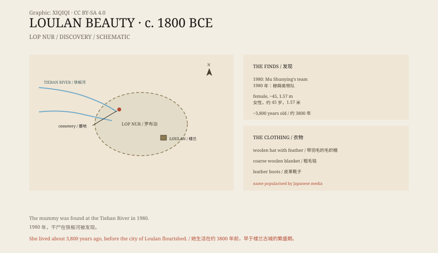

## 一、1980 年的铁板河

1980 年，新疆考古研究所的穆舜英带队，在罗布泊北端的铁板河一带发掘。

那里是荒漠，风把土吹走，露出了一层墓葬。队员在一座墓里发现了一具女性干尸。

她裹着毛毯，戴着毛织帽子，脚上穿着皮革靴子。尸体保存得很好，皮肤、指甲和头发都还在。

碳十四测定显示，她距离今天大约三千八百年。她死时大约四十五岁，身高一米五七，血型 O 型。

## 二、她长什么样

她有一头深褐色的长发，散在肩上。

脸型清瘦，鼻梁高，眼窝深，下巴尖。睫毛和眉毛还在。她戴着一顶尖顶的毛织帽，帽子上有羽毛装饰；身上裹着粗毛毯，脚上是翻毛皮靴。

她的头发里和衣服上发现了虱子和臭虫。这说明她生前的生活并不干净，也说明这些寄生虫跟着她一起被保存了下来。

*原创示意图：铁板河墓地点位、年代标尺与随葬衣物类型。不是干尸照片。稀奇奇编辑部，CC BY-SA 4.0。*

## 三、为什么叫“楼兰美女”

“楼兰美女”这个名字，不是考古报告里的正式名称。

楼兰是汉代西域的一个王国，在罗布泊附近，是丝绸之路上的要冲。楼兰古城在二十世纪初被发现，出土过汉文木简、佉卢文文书和大量器物。

这具干尸出土地点属于楼兰地区，日本媒体在报道时用了“楼兰美女”这个称呼。名字好听，传播得快，后来就成了通称。

## 四、她是谁

她不一定生活在楼兰古城，也不一定是“楼兰人”。

她属于青铜时代晚期，比楼兰古城的繁盛期早了一千多年。她生活的年代，罗布泊还是一个有水、有草、有牛羊的地方，不完全是今天的荒漠。

后来的基因研究显示，青铜时代的新疆人群来源复杂，有来自西伯利亚、中亚和东亚的成分。她不是某个“纯种”的代表，而是那个时代人群流动的一个个体。

## 五、保存

她能保存下来，靠的是环境。

罗布泊极度干燥，降水极少，细菌难以繁殖。尸体埋得不深，但周围的盐碱土和干热空气让尸体迅速脱水，变成了干尸。

她后来被送到新疆博物馆。博物馆为她做了专门的展柜，控制温度和湿度。她的毛发、衣物和皮肤，仍然是研究古代新疆人群、服饰和寄生虫的重要材料。

## 六、现在

今天，她在新疆博物馆展出。

“楼兰美女”成了一个旅游标签，也成了新疆古代历史的一个符号。但对她本人来说，她只是一个死在沙漠里的中年女人，被风沙埋了三千年，又被考古队挖了出来。

---

**来源与许可**：本文的事实来源见条目底部来源台账 S1–S3。文字与原创示意图采用 CC BY-SA 4.0。文中把发现经过、外貌与衣物、名称由来、人群来源与保存条件分开叙述；她的具体族群归属仍有不同研究，不能简单等同于“楼兰人”。
