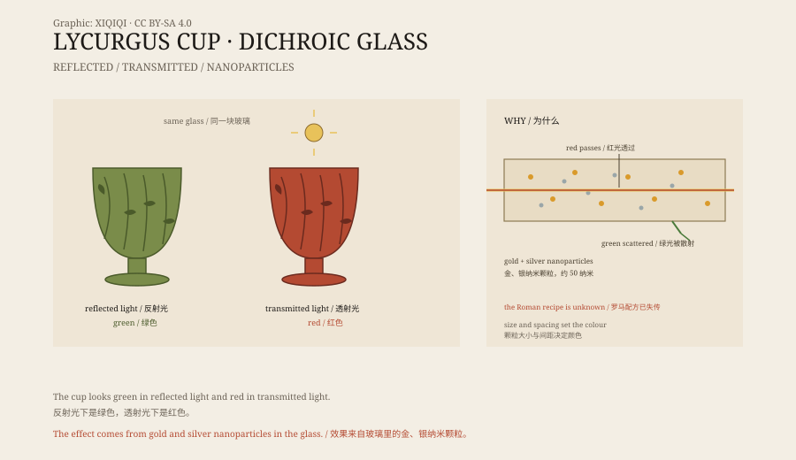

## 1. The cup in the British Museum

London, the British Museum, Room 41.

In a display case stands a glass cup about sixteen centimetres high. Its wall is a lattice: an outer cage carved in openwork, with the actual drinking vessel inside. The technique is called cage cup, and the Romans carved it from a single block of glass.

The cup shows a mythological scene: Lycurgus, king of the Thracians, caught in vines and struggling. He had offended Dionysus and was trapped by the vines. That is where the cup gets its name.

It is the Lycurgus Cup, made in the fourth century CE.

## 2. The colour change

The strangest thing about the cup is its colour.

Under the gallery lights it looks green, with an olive tint. But if light shines through the glass from inside, it turns red, like a heated garnet.

One cup, two colours. Green when seen by reflected light, red when lit from behind.

*Original schematic: the colour of the cup in reflected and transmitted light, and the role of gold and silver nanoparticles. Not a photograph of the object. Oddity Archive, CC BY-SA 4.0.*

## 3. Nanoparticles

The ancients could not explain the effect.

Only in the twentieth century, when scientists examined the glass under an electron microscope, did they find tiny metal particles suspended in it: gold and silver, about fifty nanometres across.

Nanoparticles behave differently from bulk metal. When light hits them, the electrons on their surfaces oscillate together and absorb particular wavelengths. The size, shape, and spacing of the particles determine which colours are absorbed and which pass through.

In the Lycurgus Cup, the gold and silver particles happen to let red light through and scatter or absorb green. So it looks red in transmission and green in reflection.

The Roman craftsmen did not know the word “nano”. They simply mixed gold and silver powder into glass and found the effect by trial and error.

## 4. How it was made

A cage cup is difficult in itself.

The craftsman first blows a thick blank of glass, then carves an openwork pattern into the surface, and finally separates the outer cage from the inner vessel, leaving only a few connecting points. Glass is brittle: cut too deep and it breaks; cut too shallow and the cage does not read. Even with modern tools, copies are not easy.

The Lycurgus Cup is the only complete object of its kind. Other cage cups survive mostly as fragments, and none shows the colour change so clearly.

Its exact place of manufacture is unknown. Some say Rome, some say Alexandria. In the fourth-century Roman world, glassmaking was highly developed, but a cup like this was still a luxury.

## 5. Provenance

The cup's early history is unclear.

It probably surfaced in a European collection during the Renaissance. In the nineteenth century it entered the Rothschild collection. In 1957 the British Museum acquired it.

Some think it was a drinking cup; others think it was a lamp. If it was a lamp, the red transmitted light would have been the point: with a flame inside, the cup would glow like a piece of red glass.

## 6. Now

The Lycurgus Cup is on display in the Roman gallery of the British Museum.

The case lighting is arranged so that visitors can see both the green and the red. The museum has also made replicas that imitate the nanoparticle effect with modern technology, but the colour is still not quite the same.

The Romans made a nanomaterial without knowing what a nanomaterial was. They saw colour; we see the mechanism. The cup has not changed. What changed is the way we look at it.

## Cups

The Lecko cup is a glass.

It is about 16 centimetres tall, and there is a carving on the wall of the cup: a man entangled in vine, with a leopard and a goat. This man is King Thrace Lecko, who is punished for his opposition to the God of Alcohol.

The cup is green in normal light, red in the light. This coloring effect makes it very visible in the museum.

## Two-colored

This effect is called "two-way colour."

The glass is suspended with tiny gold and silver nanoparticles. The size and shape of the particles determine which wavelength light they absorb and scatter. Red is left behind, green is absorbed, green is left behind when light goes through the cups, green is left behind when light reflects and red is absorbed.

## Nami

These particles have only a few dozen nanometers in diameter.

In the 1990s, researchers saw them using electron microscopes. The discovery showed that fourth-century craftsmen had been able to manufacture nanomaterials, although they did not know the word "nami."

The Lekou cups prove that ancient craftsmen control the microstructure of the materials.

They don't know about nano, but they know how to turn glass color. Experience and technology, sometimes earlier than theory.

## Process

The cups may be made from the `impregnated' or `mixed' process.

The craftsmen dissolve gold and silver compounds into glass, heat them up, so that the metal is disassemble into particles. Temperature and time must be controlled well, otherwise the particles will be too large and the glass will become turbid.

## History

The cup was bought by the British Museum in 1958.

It comes from an unknown source. Some say it's from Rome, some say it's from the East. The cup's style, process and inscriptions point to the Mediterranean world in the fourth century.

## Now

The Lecco Cup was displayed at the British Museum.

It's in a special booth where the lights come from behind and the red is visible. The tourists can see it coloring under different lights.

A four-century cup, with modern science to explain. It's not magic, it's technology.

## Glass

The glass process in ancient Rome is well developed.

Crafts can make complex instruments with blow, modeling, cutting, and carving. The Lecco cups are carved behind glass cooling, or are made of molds, and researchers have different views.

## Museums

The exhibition cabinet of the British Museum displays the colouring effects of special lights.

The viewers look green from the side, red from the back. The tablet explains the nanoparticles, but a lot of people just take pictures.

## Summing up

The color of the Lecco cup, not magic.

It's the absorption and dispersion of nanoparticles to light. Four-century craftsmen don't know physics, but they know how to control fire, metal and glass.

A cup that links ancient processes to modern science. It proves that technology has a longer history than we thought.

---

**Sources and licenses**: the factual sources are listed in the source ledger S1–S3 at the bottom of this entry. Text and original diagrams are licensed under CC BY-SA 4.0. This article separates the description of the object, the colour change, the nanoparticle mechanism, the manufacture, and the provenance; the cup's exact origin and function are still debated.
