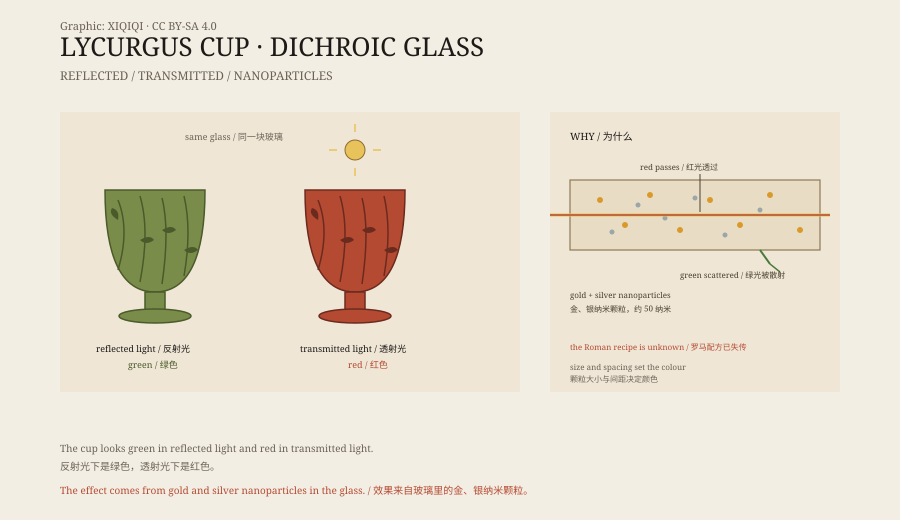

## 1. The cup in the British Museum

London, the British Museum, Room 41.

In a display case stands a glass cup about sixteen centimetres high. Its wall is a lattice: an outer cage carved in openwork, with the actual drinking vessel inside. The technique is called cage cup, and the Romans carved it from a single block of glass.

The cup shows a mythological scene: Lycurgus, king of the Thracians, caught in vines and struggling. He had offended Dionysus and was trapped by the vines. That is where the cup gets its name.

It is the Lycurgus Cup, made in the fourth century CE.

## 2. The colour change

The strangest thing about the cup is its colour.

Under the gallery lights it looks green, with an olive tint. But if light shines through the glass from inside, it turns red, like a heated garnet.

One cup, two colours. Green when seen by reflected light, red when lit from behind.

*Original schematic: the colour of the cup in reflected and transmitted light, and the role of gold and silver nanoparticles. Not a photograph of the object. Oddity Archive, CC BY-SA 4.0.*

## 3. Nanoparticles

The ancients could not explain the effect.

Only in the twentieth century, when scientists examined the glass under an electron microscope, did they find tiny metal particles suspended in it: gold and silver, about fifty nanometres across.

Nanoparticles behave differently from bulk metal. When light hits them, the electrons on their surfaces oscillate together and absorb particular wavelengths. The size, shape, and spacing of the particles determine which colours are absorbed and which pass through.

In the Lycurgus Cup, the gold and silver particles happen to let red light through and scatter or absorb green. So it looks red in transmission and green in reflection.

The Roman craftsmen did not know the word “nano”. They simply mixed gold and silver powder into glass and found the effect by trial and error.

## 4. How it was made

A cage cup is difficult in itself.

The craftsman first blows a thick blank of glass, then carves an openwork pattern into the surface, and finally separates the outer cage from the inner vessel, leaving only a few connecting points. Glass is brittle: cut too deep and it breaks; cut too shallow and the cage does not read. Even with modern tools, copies are not easy.

The Lycurgus Cup is the only complete object of its kind. Other cage cups survive mostly as fragments, and none shows the colour change so clearly.

Its exact place of manufacture is unknown. Some say Rome, some say Alexandria. In the fourth-century Roman world, glassmaking was highly developed, but a cup like this was still a luxury.

## 5. Provenance

The cup's early history is unclear.

It probably surfaced in a European collection during the Renaissance. In the nineteenth century it entered the Rothschild collection. In 1957 the British Museum acquired it.

Some think it was a drinking cup; others think it was a lamp. If it was a lamp, the red transmitted light would have been the point: with a flame inside, the cup would glow like a piece of red glass.

## 6. Now

The Lycurgus Cup is on display in the Roman gallery of the British Museum.

The case lighting is arranged so that visitors can see both the green and the red. The museum has also made replicas that imitate the nanoparticle effect with modern technology, but the colour is still not quite the same.

The Romans made a nanomaterial without knowing what a nanomaterial was. They saw colour; we see the mechanism. The cup has not changed. What changed is the way we look at it.

---

**Sources and licenses**: the factual sources are listed in the source ledger S1–S3 at the bottom of this entry. Text and original diagrams are licensed under CC BY-SA 4.0. This article separates the description of the object, the colour change, the nanoparticle mechanism, the manufacture, and the provenance; the cup's exact origin and function are still debated.
