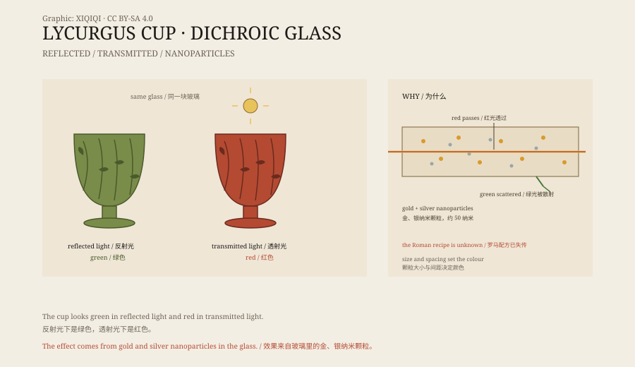

## 一、大英博物馆的杯子

伦敦，大英博物馆，41 号展厅。

展柜里有一只玻璃杯，高约十六厘米，杯壁是网状的：外层雕出一圈镂空的笼子，里面才是真正盛水的杯体。这种工艺叫“笼杯”，古罗马人用一整块玻璃雕出来。

杯子上刻着一个神话场面：色雷斯国王莱库古被葡萄藤缠住，正在挣扎。他因为冒犯了酒神，被藤蔓困住，无法脱身。杯子的名字就是这么来的。

它叫“莱库古杯”，制作于公元四世纪。

## 二、变色

这只杯子最奇怪的地方，是颜色。

在展厅的灯光下，它看起来是绿色的，带一点橄榄色。可如果把光从杯子内部透出来，它会变成红色，像一块烧热的石榴石。

同一只杯子，两种颜色。正面看是绿的，透光看是红的。

*原创示意图：玻璃杯在反射光与透射光下的颜色变化，以及金、银纳米颗粒的作用。不是文物照片。稀奇奇编辑部，CC BY-SA 4.0。*

## 三、纳米颗粒

这个现象，古人解释不了。

直到二十世纪，科学家用电子显微镜观察杯子的玻璃，才发现里面悬浮着极小的金属颗粒：金和银，直径大约五十纳米。

纳米颗粒的光学性质和整块金属不一样。光线照上去，金属表面的电子会集体振动，吸收特定波长的光。颗粒的大小、形状和间距，决定了它吸收什么颜色、透过什么颜色。

莱库古杯的玻璃里，金和银的颗粒恰好让红光透过，让绿光被散射或吸收。所以透光时是红的，反光时是绿的。

古罗马的工匠不知道“纳米”这个词。他们只是把金和银的粉末混进玻璃里，试出了这个效果。

## 四、怎么做

笼杯本身就难做。

工匠要先吹出一个厚玻璃坯，再在表面雕出镂空的图案，最后把外层和内层分离，只留下几处连接。玻璃脆，雕深了会断，雕浅了看不出笼子。今天用现代工具复制，也不容易。

莱库古杯是同类器物中唯一完整的一件。其他笼杯大多是碎片，颜色也没有它这么明显。

它的确切产地不清楚。有人说是罗马，有人说是亚历山大港。四世纪的罗马世界，玻璃工艺已经很发达，但这样的杯子仍然是奢侈品。

## 五、来历

这只杯子的早期历史不清楚。

它很可能在文艺复兴时期出现在欧洲的收藏里。十九世纪，它进入罗斯柴尔德家族的收藏。1957 年，大英博物馆买下了它。

有人说它是一只酒杯，有人说它是灯罩。如果是灯罩，透光时的红色就有用处：灯光从内部透出来，杯子会像一块发光的红玻璃。

## 六、现在

莱库古杯现在放在大英博物馆的罗马展厅里。

展柜的灯光经过设计，让观众能同时看到绿色和红色。博物馆也做过复制品，用现代技术模仿纳米颗粒的效果，但颜色还是差一点。

古罗马人做出了一个纳米材料的东西，却不知道自己在做纳米材料。他们看到的是颜色，我们看到的是原理。杯子本身没有变，变的是我们看它的方式。

---

**来源与许可**：本文的事实来源见条目底部来源台账 S1–S3。文字与原创示意图采用 CC BY-SA 4.0。文中把器物描述、变色现象、纳米原理与制作、流传分开叙述；杯子的确切产地和用途仍有不同说法。
