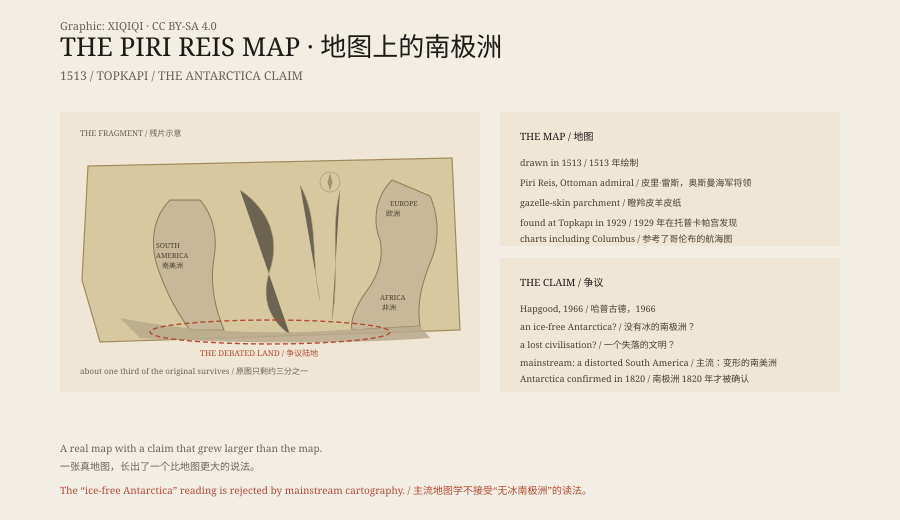

## 1. 1513

In 1513 Piri Reis was an Ottoman naval officer and a cartographer.

He drew a world map on gazelle-skin parchment. It had no modern grid of latitude and longitude; coastlines, ports and islands were arranged the way a sailor would use them, like a portolan chart.

In 1517 the Ottoman Empire conquered Egypt. Piri Reis presented the map to Sultan Selim I.

## 2. What the Map Shows

Only a fragment survives, about one third of the original.

It shows the Iberian Peninsula and the West African coast on the east, the Atlantic and the Caribbean in the middle, and the eastern coast of South America on the west. The coastline is drawn in detail, with place names and notes.

In the map's legends Piri Reis wrote that he had consulted about twenty charts, including charts by Columbus and some "charts of the ancients".

That sentence became the starting point of every later argument.

## 3. 1929

In 1929, while Topkapı Palace was being reorganised as a museum, the map was found among its collections.

It was sent to European scholars. The German theologian Gustav Adolf Deissmann studied it and published an article. The Ottoman Turkish notes, the coastlines and the place names attracted attention.

What made it famous, though, was the landmass extending south at the bottom of the map.

## 4. Hapgood

In 1966 the American professor Charles Hapgood published a book called Maps of the Ancient Sea Kings.

He argued that the land at the bottom of the Piri Reis map was the coast of Antarctica, and that it showed the continent without ice. He said this meant that a lost civilisation had surveyed Antarctica long before the modern age.

The idea was compelling. It linked a sixteenth-century Ottoman map to the notion of a prehistoric advanced civilisation. Later popular books, documentaries and websites repeated the claim.

## 5. The Rebuttal

Mainstream cartographers and historians disagree.

They point out that the southern landmass is more likely the eastern coast of South America, stretched, rotated and distorted. Sixteenth-century maps had no modern projection; their makers worked from sailing experience and copied sketches, and coastlines were often wrong in scale and direction.

The map's own notes support this: Piri Reis describes the land as hot, with parrots and snakes, which fits South America better than Antarctica.

Antarctica was not confirmed to exist until 1820. A map of 1513 could not have drawn its ice-free coastline.

## 6. What It Is

The Piri Reis map is a genuine artefact and a very typical sixteenth-century sea chart.

It is valuable not because it shows Antarctica, but because it records the geographical knowledge of its age: Columbus's discoveries, Ottoman sea power, and the exchange of maps between Europe and the Islamic world.

Piri Reis continued as a naval commander and was executed in 1553 after a campaign. His map became part of the collections of the Topkapı Palace Museum in Istanbul.

Some people still say the southern landmass is Antarctica. It is more likely South America, drawn wrong by a sixteenth-century hand.

*Original schematic: the area covered by the surviving fragment, Hapgood's Antarctica hypothesis and the mainstream rebuttal. Not a photograph of the artefact. Oddity Archive, CC BY-SA 4.0.*

---

**Sources and licenses**: the factual sources are listed in the source ledger S1–S3 at the bottom of this entry. Text and original diagrams are licensed under CC BY-SA 4.0. This article separates the 1513 drawing, the map's contents, the 1929 discovery, Hapgood's hypothesis and the mainstream rebuttal; the map is a genuine artefact, and the "ice-free Antarctica" claim is not supported by mainstream cartography. The illustration is a scene reconstruction, not a photograph of the artefact.
