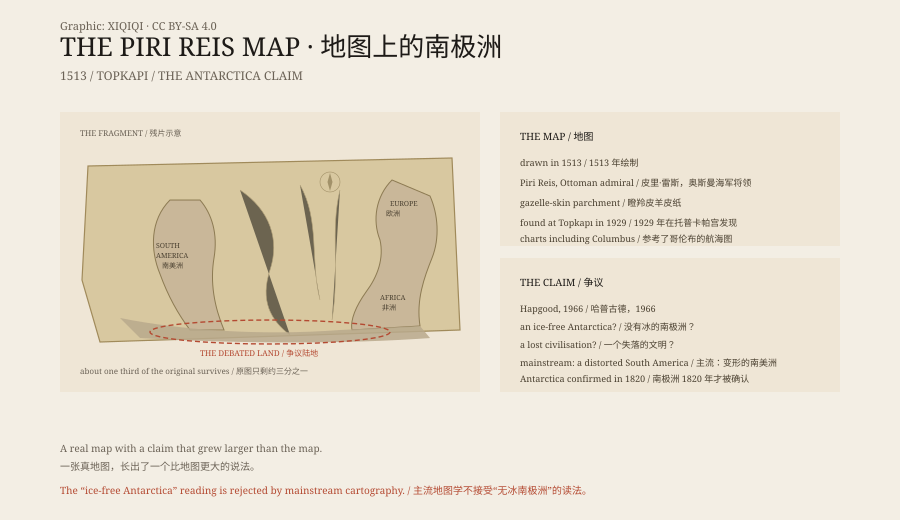

## 1. 1513

In 1513 Piri Reis was an Ottoman naval officer and a cartographer.

He drew a world map on gazelle-skin parchment. It had no modern grid of latitude and longitude; coastlines, ports and islands were arranged the way a sailor would use them, like a portolan chart.

In 1517 the Ottoman Empire conquered Egypt. Piri Reis presented the map to Sultan Selim I.

## 2. What the Map Shows

Only a fragment survives, about one third of the original.

It shows the Iberian Peninsula and the West African coast on the east, the Atlantic and the Caribbean in the middle, and the eastern coast of South America on the west. The coastline is drawn in detail, with place names and notes.

In the map's legends Piri Reis wrote that he had consulted about twenty charts, including charts by Columbus and some "charts of the ancients".

That sentence became the starting point of every later argument.

## 3. 1929

In 1929, while Topkapı Palace was being reorganised as a museum, the map was found among its collections.

It was sent to European scholars. The German theologian Gustav Adolf Deissmann studied it and published an article. The Ottoman Turkish notes, the coastlines and the place names attracted attention.

What made it famous, though, was the landmass extending south at the bottom of the map.

## 4. Hapgood

In 1966 the American professor Charles Hapgood published a book called Maps of the Ancient Sea Kings.

He argued that the land at the bottom of the Piri Reis map was the coast of Antarctica, and that it showed the continent without ice. He said this meant that a lost civilisation had surveyed Antarctica long before the modern age.

The idea was compelling. It linked a sixteenth-century Ottoman map to the notion of a prehistoric advanced civilisation. Later popular books, documentaries and websites repeated the claim.

## 5. The Rebuttal

Mainstream cartographers and historians disagree.

They point out that the southern landmass is more likely the eastern coast of South America, stretched, rotated and distorted. Sixteenth-century maps had no modern projection; their makers worked from sailing experience and copied sketches, and coastlines were often wrong in scale and direction.

The map's own notes support this: Piri Reis describes the land as hot, with parrots and snakes, which fits South America better than Antarctica.

Antarctica was not confirmed to exist until 1820. A map of 1513 could not have drawn its ice-free coastline.

## 6. What It Is

The Piri Reis map is a genuine artefact and a very typical sixteenth-century sea chart.

It is valuable not because it shows Antarctica, but because it records the geographical knowledge of its age: Columbus's discoveries, Ottoman sea power, and the exchange of maps between Europe and the Islamic world.

Piri Reis continued as a naval commander and was executed in 1553 after a campaign. His map became part of the collections of the Topkapı Palace Museum in Istanbul.

Some people still say the southern landmass is Antarctica. It is more likely South America, drawn wrong by a sixteenth-century hand.

*Original schematic: the area covered by the surviving fragment, Hapgood's Antarctica hypothesis and the mainstream rebuttal. Not a photograph of the artefact. XIQIQI Editorial, CC BY-SA 4.0.*

## Map

Piri Reis Map, an Ottoman map from 1513.

It is painted on chamois skin and measures approximately 90 x 63 cm. The map shows parts of the Atlantic Ocean, Europe, Africa, America and Asia. It has lines of longitude and latitude, coastlines, islands and decorative patterns.

## Piri Reis

Piri Reis was an Ottoman admiral.

He participated in naval battles and wrote navigation books. He said in the book that the map was drawn from multiple sources, including Columbus's maps, Arabic maps and Greek maps.

## 1929

In 1929, the map was discovered in Topkapı Palace.

It was sent to Germany for expert appraisal. Experts identified it as an original from 1513. Maps of the American coast, more accurate than European maps of the time, aroused interest.

## Antarctica

Some people say that the coast of Antarctica is drawn on the map.

This statement comes from Charles Hapgood. He believed that the southern landmass on the map was Antarctica, drawn when there was no ice. This hypothesis was later used to support "ancient civilizations" or "alien maps".

## Refute

"Antarctica" on the map is more likely the southern part of South America.

The projection, coastline and shape of the map are closer to Patagonia and Tierra del Fuego in South America. Maps of the sixteenth century often showed unknown landmass in large dimensions, with coastlines connected together.

## What is It

The Piri Reis Map is a sixteenth-century world map.

It used the best sources available at the time, and included errors and imagination. It was not painted by aliens, nor is it a legacy of an ancient civilization. It is a navigational tool and an image of an era.

## Projection

The map uses a variety of projections.

The shape of the coastline and the distance between longitude and latitude lines are not completely uniform. This shows that Piri Reis put together maps from different sources without a unified projection.

## Sources
Map of the western coast, possibly from Columbus.

Piri Reis mentions Columbus's map in his book. He did not say all the sources, nor did he say who painted each section of the coast.

## Heritage

The map is now in the Topkapı Palace Museum.

It is not often on display because the parchment is sensitive to light. The digitized version can be viewed online.

A map connecting the Atlantic Ocean, the Americas and the Ottoman Empire. It is a product of the Age of Sail, not a legacy of aliens.

## Summing Up
The Piri Reis map is not an "alien map".

It is a sixteenth-century navigational instrument, using the best sources of the time, as well as errors and imagination.

The value of the map is not that it depicts Antarctica, but that it shows how the Ottoman Empire viewed the world.

A map depicts the coast and leaves behind the times.

The map cannot speak. It simply drew the coastline, leaving on the parchment both what the mapper knew and what he didn't know. When people look at it today, they see the imagination of the sixteenth century, not the secrets of Antarctica.

---

**Sources and licenses**: the factual sources are listed in the source ledger S1–S3 at the bottom of this entry. Text and original diagrams are licensed under CC BY-SA 4.0. This article separates the 1513 drawing, the map's contents, the 1929 discovery, Hapgood's hypothesis and the mainstream rebuttal; the map is a genuine artefact, and the "ice-free Antarctica" claim is not supported by mainstream cartography. The illustration is a scene reconstruction, not a photograph of the artefact.
