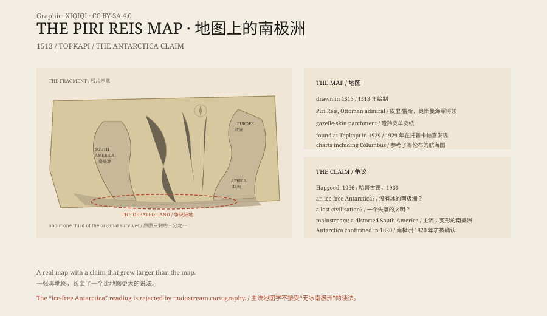

## 一、1513 年

1513 年，皮里·雷斯是奥斯曼帝国的一名海军将领，也是一个地图学家。

他画了一张世界地图，画在瞪羚皮做的羊皮纸上。地图上没有现代经纬网，海岸线、港口和岛屿用另一种方式排列：像一张给水手看的航海图。

1517 年，奥斯曼帝国征服埃及。皮里·雷斯把这张地图献给了苏丹塞利姆一世。

## 二、地图上有什么

今天能看到的只是残片，大约占原图的三分之一。

残片上，西边是伊比利亚半岛和西非海岸，中间是大西洋和加勒比海，西边是南美洲的东海岸。海岸线画得很细，旁边写满了地名和说明。

皮里·雷斯在地图的说明里写，他参考了大约二十张图，其中包括哥伦布的航海图，还有一些“古代人的图”。

这句话，成了后来所有争论的起点。

## 三、1929 年

1929 年，托普卡帕宫在整理藏品、准备改成博物馆时，发现了这张地图。

它被送到欧洲学者手里。德国神学家古斯塔夫·阿道夫·戴斯曼研究了它，随后发表文章。地图上的奥斯曼土耳其文、海岸线和地名，很快引起了关注。

真正让它出名的，是地图下方那块向南延伸的陆地。

## 四、哈普古德

1966 年，美国教授查尔斯·哈普古德出版了一本书，叫《古代海王的地图》。

他提出，皮里·雷斯地图最下方的那块陆地，是南极洲的海岸线，而且是没有冰的南极洲。他说，这意味着在很久以前，有一批人已经测绘过南极，只是后来失传了。

这个说法很有吸引力。它把一张 16 世纪的奥斯曼地图，和“史前高级文明”连在了一起。后来的畅销书、纪录片和网络文章，不断重复这个说法。

## 五、反驳

主流地图学家和历史学家不同意。

他们指出，那块向南延伸的陆地，更可能是被拉长、旋转和变形后的南美洲东海岸。16 世纪的地图没有现代投影，绘制者靠的是航海经验和抄来的草图，海岸线的比例和方向常常不准。

地图上的说明也支持这一点：皮里·雷斯写到那片土地“炎热”、有鹦鹉和蛇，这些描述更像南美洲，而不是南极洲。

南极洲的存在，直到 1820 年才被人类确认。1513 年的地图不可能画出它的无冰海岸线。

## 六、它是什么

皮里·雷斯地图是一件真实的文物，也是一件很典型的 16 世纪航海图。

它珍贵，不是因为画出了南极洲，而是因为它记录了那个时代的地理知识：哥伦布的发现、奥斯曼的海上势力、欧洲和伊斯兰世界之间的地图交流。

皮里·雷斯后来继续做海军将领，1553 年在一次战役后被处死。他留下的这张地图，成了伊斯坦布尔托普卡帕宫博物馆的藏品。

地图上的那块陆地，仍然有人说是南极洲。但它更可能只是南美洲，被一个 16 世纪的人画歪了。

*原创示意图：皮里·雷斯地图残片覆盖的范围、哈普古德的南极洲假说与主流反驳。不是文物照片。稀奇奇编辑部，CC BY-SA 4.0。*

---

**来源与许可**：本文的事实来源见条目底部来源台账 S1–S3。文字与原创示意图采用 CC BY-SA 4.0。文中把 1513 年的绘制、地图内容、1929 年发现、哈普古德假说与主流反驳分开叙述；地图本身是真实文物，“无冰南极洲”说法没有得到主流地图学支持。插图是场景复原，不是文物照片。
