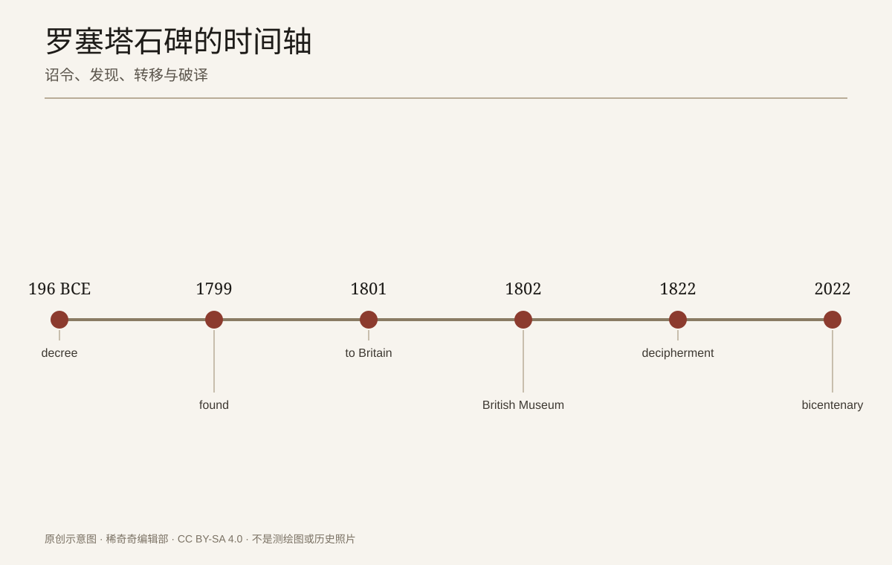
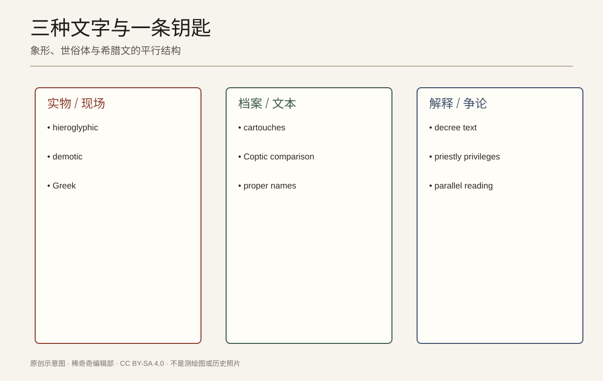

## 1. A stone found in a fort

In 1799, during Napoleon's Egyptian campaign, French soldiers building fortifications near Rashid (Rosetta) in the Nile Delta found a slab of black basalt while dismantling an old wall. It was taken to Cairo, then shipped to London as a prize after the French surrender to the British in 1801, and displayed in the British Museum from 1802. The stone is about 112 centimetres high and 76 centimetres wide, with both top and bottom missing. It is not a complete stele but a fragment of a decree stone.

## 2. Three scripts, one decree

The stone carries three texts: ancient Egyptian hieroglyphs at the top, demotic script in the middle, and Greek at the bottom. The three versions are broadly the same: a decree issued at Memphis in 196 BCE by a synod of priests in honour of Ptolemy V. Greek provided a readable entry point, demotic was the Egyptian script of daily use, and hieroglyphs were the formal script of temples and monuments. Their coexistence let scholars compare a known language with unknown scripts for the first time.

*Original diagram: the Rosetta Stone from the decree to the bicentenary of decipherment. Not a survey drawing. XIQIQI Editorial, CC BY-SA 4.0.*

## 3. Young, Champollion, and the breakthrough

The British scholar Thomas Young worked on the stone in the 1810s, identifying signs in royal cartouches with Greek names and suggesting that some hieroglyphs might be phonetic. The French scholar Jean-François Champollion began from Coptic, comparing Egyptian vocabulary and grammar with Coptic; in 1822, in his Lettre à M. Dacier, he announced that hieroglyphs combined ideographic and phonetic elements. This was not one person's sudden flash but the accumulation of years of correspondence, papyrus study, and rivalry.

## 4. What the decree says

The decree's core is the confirmation of Ptolemy V's rule and priestly privileges: tax reductions, amnesty for prisoners, offerings to temples, rules for priestly dress and ritual, and an order that the decree be inscribed in three scripts and set up in various places. It is not literature or philosophy but a political-religious administrative document. Precisely because its content is repetitive and its format formal, it suited use as a parallel-language sample. Its value lies not in mystery but in parallelism.

*Original diagram: the three scripts of the Rosetta Stone and the route to decipherment. Not a survey drawing. XIQIQI Editorial, CC BY-SA 4.0.*

## 5. Colonial acquisition and return requests

The stone was a war trophy of Napoleon's expedition and was later taken by Britain. Egypt has long requested its return, arguing that it is a product of colonial looting; the British Museum stresses its place in global Egyptology and the idea of a 'universal museum'. Similar arguments surround the Benin Bronzes and the Parthenon sculptures. Whatever the position, the chain of discovery, transfer, and display is itself part of the colonial archive; the decipherment success cannot be told without the manner of acquisition.

## 6. The stone as archive and metaphor

Today the stone's text has been fully translated, while scholars still study the decree's administrative details, the stone's manufacture, and the provenance of the fragment. CT and 3D scanning make the internal structure and surface cuts clearer, and replicas let more visitors see it. 'Rosetta Stone' has also become a general metaphor for anything that provides a key comparison and opens an unknown field. The metaphor is convenient but tends to obscure the fact that the stone supplied only a limited parallel text; actual decipherment depended on generations of papyrus, inscription, and grammar research.

## Timeline

- **196 BCE**: decree issued at Memphis
- **1799**: French soldiers find the stone at Rashid
- **1801**: French surrender; stone transferred to Britain
- **1802**: enters the British Museum
- **1822**: Champollion announces decipherment
- **2022**: bicentenary exhibitions and research

## Sources and evidence

The checkable material in this entry rests mainly on S1 and S2: S1 supplies the official site or object record and basic chronology, while S2 supplies independent research or archival context. S3 covers the editorial cover and diagrams; it is visual explanation, not historical evidence. Dates, quantities, places, and attributions in the text are traced back to specific S1/S2 pages wherever possible. Claims that cannot be tied to a page are flagged under 'Limits of the record'.

The cover is an AI-assisted reconstruction, not a site photograph. The two inline figures are original diagrams, not survey drawings. Image types and licences are recorded row by row in `research/image-audit.csv`.

## Archive location

The stone's archive is mainly at the British Museum: accession registers, the 1801 transfer papers, and exhibition and conservation records are available. The key material for the decipherment story is in France: Champollion's correspondence, papyrus notes, and the 1822 Lettre à M. Dacier are held in Paris and Grenoble institutions, while Young's papers and notes remain in Britain. Egyptian institutions hold local Rashid records and return-request files. The numbering and transliteration across these sets do not match, and early sources even differ on the exact find spot. This entry uses only checkable object data and the public history of decipherment, not later national narratives as if they were a 1799 field record.

## Limits of the record

The discovery, transfer, and early decipherment of the stone are well documented, but 'who decoded it first' is often reduced to a single-hero story. In fact Young's work on cartouches and papyri, Champollion's comparison with Coptic, and correspondence among contemporaries together produced the breakthrough. The stone itself is a fragmentary decree, not a complete language textbook; it offers three scripts in parallel, not a word-by-word translation. This entry separates the readable text from its later symbolic meaning.

---

**Sources and licenses**: the factual claims above are traced to S1 and S2 in the source ledger; S3 covers the AI-assisted cover and the two original diagrams. Text and original diagrams are licensed CC BY-SA 4.0. This entry separates the documented record from reconstruction and marks remaining uncertainty under 'Limits of the record'. Where the archive is silent, the text says so rather than filling the gap with narrative. Dates and figures follow the cited pages; interpretations are identified as interpretations, and no hypothesis is presented as a settled fact.
