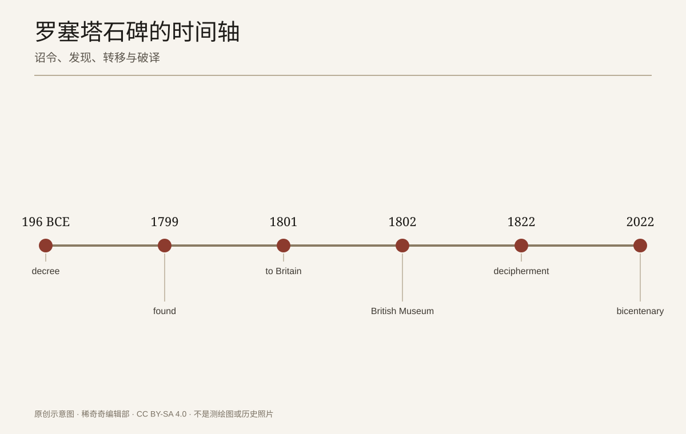
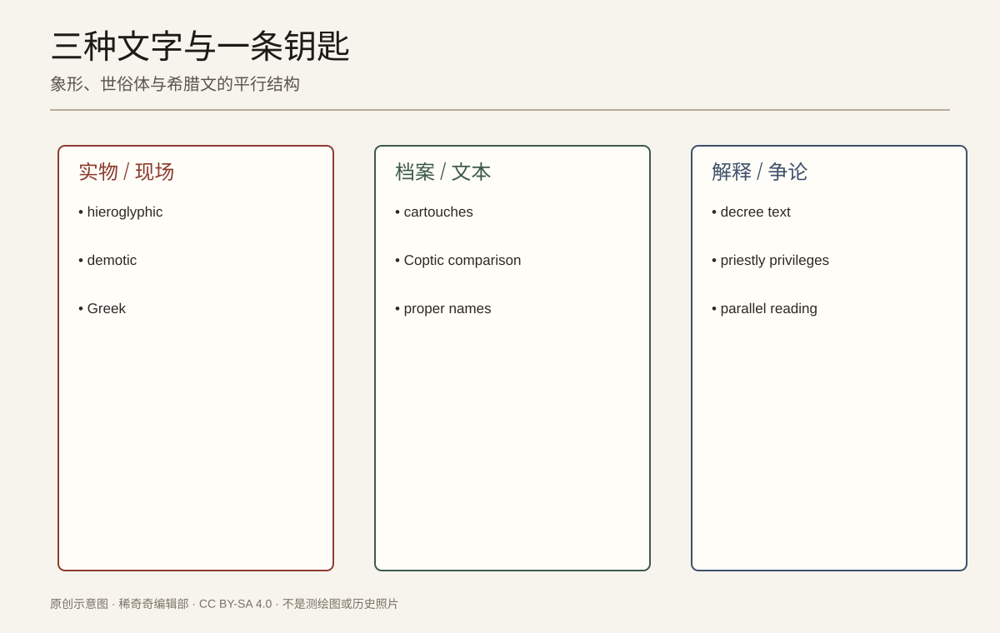

## 一、堡垒里的石头

1799 年，拿破仑埃及远征期间，法国士兵在尼罗河三角洲的拉希德（罗塞塔）附近修筑工事，拆用旧墙时发现一块黑色玄武岩板。它被运到开罗，随后在 1801 年法军向英军投降后，作为战利品运往伦敦，1802 年起在大英博物馆展出。石碑高约 112 厘米、宽约 76 厘米，顶部和底部都已残缺。它不是一座完整的碑，而是一块诏令石的残段。

## 二、三种文字，一份诏令

石碑表面刻着三段文字：上面是古埃及象形文字，中间是世俗体（demotic），下面是古希腊文。三段内容大致相同，是公元前 196 年孟菲斯祭司会议为托勒密五世颁布的诏令。希腊文提供了可读的入口，世俗体是当时日常使用的埃及文字，象形文字则是神庙与纪念性文本的正式书写。三段的并存，使学者第一次能用已知语言去对照未知文字。

*原创示意图：罗塞塔石碑从诏令颁布到破译二百周年的时间轴。不是测绘图。稀奇奇编辑部，CC BY-SA 4.0。*

## 三、Young、Champollion 与突破

英国学者 Thomas Young 在 1810 年代研究石碑，确认王名圈中的符号可以对应希腊文人名，并提出部分象形符号的表音可能。法国学者 Jean-François Champollion 从科普特语入手，比较埃及文字与科普特语的词汇和语法；1822 年，他在《致 Dacier 先生的信》中宣布象形文字既有表意也有表音成分。这不是一个人的“灵光一现”，而是多年通信、纸草研究和同行竞争的累积。

## 四、诏令说了什么

诏令的核心是确认托勒密五世的王权与祭司特权：减免部分税收、赦免囚犯、向神庙献纳、规定祭司的服饰与仪式，并命令把诏令用三种文字刻在石碑上，分置各地。它不是文学作品，也不是哲学论文，而是一份政治—宗教行政文件。正因为内容重复、格式正式，它才适合作为语言对照的样本。石碑的价值不在“神秘”，而在“平行”。

*原创示意图：罗塞塔石碑的三种文字与释读路径。不是测绘图。稀奇奇编辑部，CC BY-SA 4.0。*

## 五、殖民取得与归还讨论

石碑是拿破仑远征的战争收获，后由英国取得。埃及长期要求归还，认为它是殖民掠夺的产物；大英博物馆则以“世界博物馆”与普世保存为由，强调其在全球埃及学中的位置。类似的争论也围绕贝宁青铜、帕特农雕塑展开。无论立场如何，石碑的“发现—转移—展示”链条本身就是殖民时代档案的一部分，不能只讲释读成功而不讲取得方式。

## 六、作为档案与隐喻

今天，石碑的文本已经被完整翻译，学者仍在研究诏令的行政细节、石碑的制作工艺和残段来源。CT 与 3D 扫描让内部结构和表面刻痕更清楚，复制品则让更多观众看到它。 “罗塞塔石碑”也成了通用隐喻，指任何提供关键对照、打开未知领域的事物。这个隐喻很方便，却容易让人忘记：石碑只提供了一段有限的对照文本，真正的破译靠的是此后几代人的纸草、铭文和语法研究。

封面是「罗塞塔石碑：三种文字与一把钥匙」的 AI 辅助场景复原，不是现场照片；两张插图为原创示意图，不是测绘图。图片类型与许可逐行记录在 research/image-audit.csv。

## 档案位置

石碑的档案主要在大英博物馆：入藏登记、1801 年转移文件、历次展览与修复记录都可查。释读史的关键材料则在法国：Champollion 的通信、纸草笔记与 1822 年《致 Dacier 先生的信》保存在巴黎与格勒诺布尔的机构中；Young 的论文与笔记留在英国。埃及方面则保存拉希德地区的历史记录与归还请求文件。三套档案的编号和地名转写并不一致，石碑的“发现地点”在早期文献中也有不同说法。本文只使用可核对的原件信息与公开释读史，不把后来的民族叙事当作 1799 年的现场记录。

## 档案空白

石碑的发现过程、转移过程和早期释读，都有清楚的档案，但“谁第一个破译”常被简化为单人英雄故事。事实上，Young 的纸草与王名圈研究、Champollion 的科普特语比较和同时代学者的通信，共同构成了突破。石碑本身是一块残缺的诏令石，不是完整的语言教材；它提供的是三种文字并列的对照，而不是逐词翻译。本文把“可读的文本”和“后来的象征意义”分开。

---

**来源与许可**：本文的事实来源见条目底部来源台账 S1–S3。文字与原创示意图采用 CC BY-SA 4.0。
