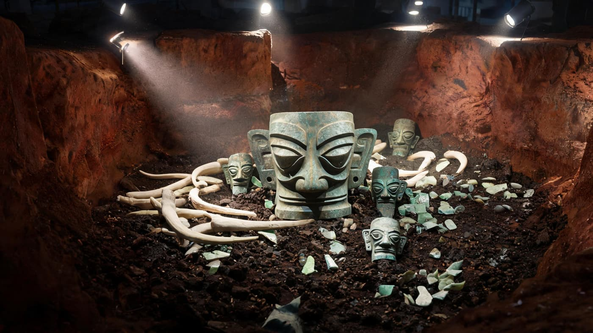
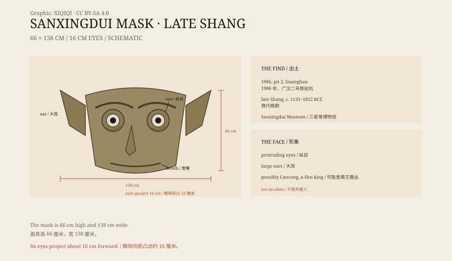

## 1. The pit of 1986

1986, Guanghan, Sichuan, Sanxingdui.

Workers at a local brick factory were digging for clay when they hit jade and bronze. Archaeologists then excavated two sacrificial pits filled with ivory, jade, bronze, and gold.

The pits were shallow but densely packed. Ivory lay in blackened layers; bronze heads were scattered among them, some with only half a face left. As the workers cleared the soil, an ear emerged first, large and pierced at the edge. Then came the eyes, projecting from the earth. It took several days to lift the whole mask out.

*Reconstruction: the bronze mask among ivory, jade, and bronze objects in Sanxingdui pit 2, 1986. Not a photograph of the excavation. Oddity Archive, CC BY-SA 4.0.*

In pit 2, they found a huge bronze mask.

It was not made to be worn; it is too large. It was more likely mounted on a wooden frame as a divine image, or used in ritual.

## 2. The size

The mask is 66 centimetres high and 138 centimetres wide.

The strangest part is the eyes: two eyeballs shaped like cylinders project about 16 centimetres forward. The eyebrows sweep upward, the ears are large and pointed and flare out to the sides, and the mouth is wide and thin, with the corners slightly raised.

Because of the huge eyes and ears, some call it “a thousand-mile eye and a favourable-wind ear” — a thing that can see and hear at a great distance.

*Original schematic: the mask's dimensions, the structure of the eyes and ears, and the context of the Sanxingdui pits. Not a photograph of the object. Oddity Archive, CC BY-SA 4.0.*

## 3. Whose face

The face does not look human.

Many people's first reaction is “alien”. Archaeologists do not see it that way. Sanxingdui is not an alien civilisation; it is part of the ancient Shu culture, with links to the Shang civilisation of the Central Plains and its own distinctive features.

The “protruding eyes” may be connected to a Shu legend. The first king of Shu was said to be Cancong, whose eyes were “protruding”. The mask may represent Cancong, or a god, or a deified ancestor.

## 4. Sanxingdui

The Sanxingdui site lies in the north of the Chengdu Plain and covers a large area.

Besides the mask, it has produced bronze trees, a standing bronze figure, gold masks, jade blades, ivory, and cowrie shells. The bronze tree is nearly four metres high, with birds on its branches and fruit hanging from them. The gold masks were attached to bronze heads and are as thin as paper.

These objects show that the ancient Shu had a complex ritual system. They used bronze, gold, and ivory to communicate with the gods, and they obtained cowrie shells and jade through trade.

Recent dating places the burial of the pits between 1131 and 1012 BCE, in the late Shang period.

## 5. How it was made

The mask is cast bronze, with thin walls.

The craftsmen made a clay model, then moulds, cast it in sections, and finally joined the eyes, ears, and face. The cylindrical eyes are hollow, and the edges of the ears have holes, probably for attaching ornaments.

Bronze shrinks as it cools, and large thin-walled objects distort easily. Producing such a complete surface shows that Shu bronze casting was already highly developed.

## 6. Now

The mask is in the Sanxingdui Museum.

It is one of the most famous objects from the site and the source of the “alien” stories. Standing in front of it, visitors feel that it is looking at them: two cylindrical eyes passing through the crowd and staring into the distance.

It is not an alien. It is a god imagined by people three thousand years ago.

---

**Sources and licenses**: the factual sources are listed in the source ledger S1–S3 at the bottom of this entry. Text and original diagrams are licensed under CC BY-SA 4.0. This article separates the excavation, the dimensions, the interpretation of the face, the site's context, and the casting technique; the link between the “protruding eyes” and Cancong is one interpretation, not a settled conclusion.
