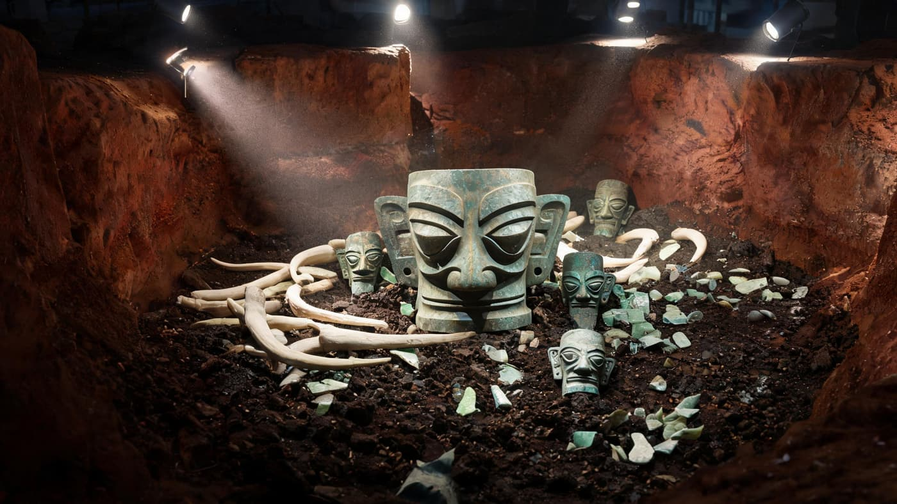
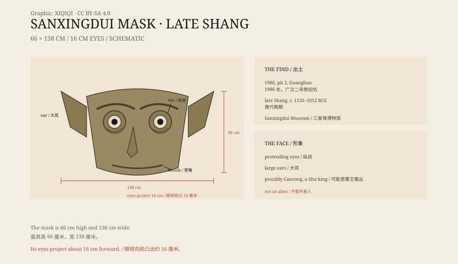

## 一、1986 年的祭祀坑

1986 年，四川广汉，三星堆。

当地砖厂工人在取土时，挖到了玉器和青铜器。考古队随后发掘了两个祭祀坑，坑里堆满了象牙、玉器、青铜器和金器。

坑不深，但东西压得很密。象牙一层层叠着，已经发黑，青铜人头像散在中间，有的只剩半张脸。工人往下清土的时候，先露出一只耳朵，很大，边缘带孔。再往下，是一双凸出来的眼睛。整个面具从土里出来，用了好几天。

*场景复原：1986 年三星堆二号祭祀坑中，青铜面具与象牙、玉器一同出土的状态。不是出土现场照片。稀奇奇编辑部，CC BY-SA 4.0。*

二号坑里，出土了一件巨大的青铜面具。

它不是戴在人脸上的，尺寸太大。它更像一个挂在木架上的神像，或者一个祭祀用的面具。

## 二、尺寸

这件面具高 66 厘米，宽 138 厘米。

它的眼睛最奇怪：两个眼球呈圆柱形，向前伸出约 16 厘米。眉毛向上挑起，耳朵又大又尖，向两边张开，嘴巴宽而薄，嘴角微微上翘。

因为它的大眼睛和大耳朵，有人叫它“千里眼、顺风耳”。

*原创示意图：面具的尺寸、眼部与耳部结构，以及三星堆祭祀坑的背景。不是文物照片。稀奇奇编辑部，CC BY-SA 4.0。*

## 三、谁的脸

这张脸不像真人。

有人看到它的第一反应是“外星人”。但考古学家不这么看。三星堆不是外星文明，它是古蜀文化的一部分，和中原的商文明有交流，也有自己的特点。

“纵目”可能和古蜀的传说有关。传说中，蜀国的第一位王叫蚕丛，他的眼睛是“纵目”，也就是凸出来的眼睛。面具可能表现的是蚕丛，也可能是某位神祇，或者是一个被神化的祖先。

## 四、三星堆

三星堆遗址在成都平原北部，面积很大。

除了面具，这里还出土了青铜神树、青铜立人、金面罩、玉璋、象牙和海贝。神树高近四米，树上站着鸟，树枝上挂着果实。金面罩贴在青铜人头像上，薄得像纸。

这些东西说明，古蜀人有一套复杂的祭祀系统。他们用青铜器、金器和象牙与神沟通，也通过贸易获得海贝和玉石。

最新的测年显示，祭祀坑的埋藏时间集中在公元前 1131 年到公元前 1012 年，属于商代晚期。

## 五、怎么做

面具是青铜铸的，壁很薄。

工匠先做泥模，再翻范，分块铸造，最后把眼睛、耳朵和面部拼接起来。眼睛的圆柱是空心的，耳朵的边缘有穿孔，可能用来固定附件。

青铜在铸造时会收缩，薄壁大型器物容易变形。能做出这么完整的面积，说明古蜀的铸造技术已经很成熟。

## 六、现在

这件面具收藏在三星堆博物馆。

它是三星堆最有名的展品之一，也是“外星人”传说的源头。游客站在它面前，会觉得它在看自己——两根圆柱一样的眼睛，穿过人群，看向很远的地方。

它不是外星人。它是三千年前的人，想象出来的神。

---

**来源与许可**：本文的事实来源见条目底部来源台账 S1–S3。文字与原创示意图采用 CC BY-SA 4.0。文中把出土、尺寸、形象解释、遗址背景与铸造工艺分开叙述；“纵目”与蚕丛的联系是研究中的一种解释，不是定论。
