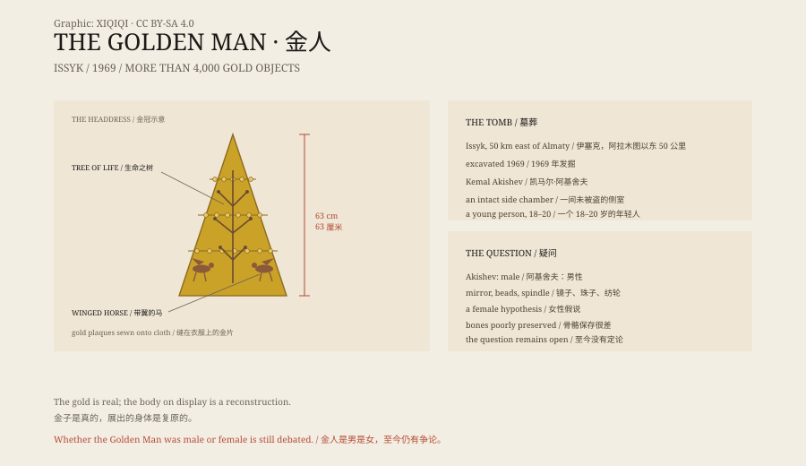

## 1. 1969

1969, beside the Issyk River in Kazakhstan, fifty kilometres east of Almaty.

A team led by the archaeologist Kemal Akishev opened a burial mound. Beneath it was a chamber built from Tien Shan spruce logs.

The main chamber had been looted. A side chamber had not.

In the side chamber lay a person covered in thousands of gold ornaments.

## 2. The Golden Man

The burial was that of a young person, about eighteen to twenty years old.

The body wore a garment sewn with gold plaques and a conical gold headdress sixty-three centimetres tall. The headdress was decorated with snow leopards, winged horses and the tree of life.

Gold plaques also covered the belt, boots, scabbard and dagger. More than four thousand gold objects came from the tomb.

Because the body was covered in gold, the archaeologists called it the Golden Man.

## 3. Who Was He?

The burial dates to about the fourth century BCE. The deceased belonged to the Saka, a branch of the Scythian peoples.

The Saka were nomads who moved across the steppe between the Black Sea and the Tien Shan. They left no writing of their own, but a great quantity of gold, weapons and horse gear.

The tomb also contained a sword, a dagger, a mirror and pottery. The assemblage points to high status: a prince, a chieftain, or an important priest.

After Kazakhstan became independent, the Golden Man became a national symbol. His image appeared on monuments, banknotes and museum displays.

## 4. Male or Female?

Akishev identified the remains as male, based on the skull and jaw.

But the tomb also contained a mirror, beads, a spindle whorl and a scoop. In steppe burials these objects are often associated with women.

Some researchers have therefore argued that the Golden Man may have been a young woman, perhaps one of the "steppe Amazons".

The bones were poorly preserved, and DNA analysis has not produced a definitive answer. The question remains open.

Kazakhstan usually calls the figure the "Golden Man" or the "Golden Warrior", avoiding the issue of sex.

## 5. The Meaning of Gold

The Saka believed that gold does not decay. They sewed it onto clothing, wore it on their heads and placed it in tombs, hoping it would protect the dead in the next world.

The snow leopards and winged horses on the headdress were not random decoration. They stood for power, speed and contact with the sky.

The same motifs appear in other steppe burials from the Black Sea to Mongolia. They show that, more than two thousand years ago, the Eurasian steppe already shared a visual language.

## 6. Now

The Golden Man on display in a museum is a reconstruction.

The gold is real; the body is not. Archaeologists removed the plaques from the soil, cleaned and numbered them, and sewed them back onto a human-shaped armature according to their find spots. The pose and proportions are partly a modern judgement.

The gold objects are held in museums in Kazakhstan and have travelled abroad for exhibitions.

The Issyk kurgan has been backfilled, and the mound no longer looks as it did.

The image survives. It has become one of the ways the country tells its own history.

Whether the person was male or female, a prince or a princess, a warrior or a priest, is still unknown. The gold remained. The person did not.

*Original schematic: the main motifs of the headdress, the side chamber at Issyk and the 1969 discovery. Not a photograph of an artefact. Oddity Archive, CC BY-SA 4.0.*

---

**Sources and licenses**: the factual sources are listed in the source ledger S1–S3 at the bottom of this entry. Text and original diagrams are licensed under CC BY-SA 4.0. This article separates the 1969 excavation, the gold and the tomb, the debate over identity and sex, and the national symbol; the gold and the burial are archaeological evidence, while the sex of the deceased remains disputed. The illustration is a scene reconstruction, not a photograph of an artefact.
