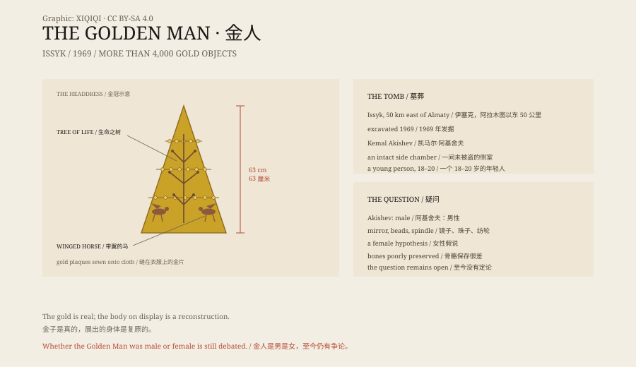

## 一、1969 年

1969 年，哈萨克斯坦，阿拉木图以东 50 公里，伊塞克河边。

考古学家凯马尔·阿基舍夫带领的团队挖开了一座土丘。土丘下面是一座用天山云杉木搭成的墓室。

墓室已经被盗过，但旁边的一个侧室没有被发现。

侧室里，躺着一个人，身上覆盖着几千片金饰。

## 二、金人

墓主人是一个年轻人，大约 18 到 20 岁。

他穿着一件由金片缝成的衣服，头上戴着一顶 63 厘米高的圆锥形金冠。金冠上装饰着雪豹、带翼的马和生命之树。

他的腰带、靴子、剑鞘和匕首上，也镶着金片。整座墓里出土了四千多件金器。

因为全身都是金色，考古学家叫他“金人”。

## 三、他是谁

金人生活的年代，大约是公元前 4 世纪。他是斯基泰人的一支——塞克人。

塞克人是游牧民族，活动在从黑海到天山之间的草原上。他们没有留下自己的文字，但留下了大量的金器、武器和马具。

金人的墓里还有一把剑、一把匕首、一面镜子和一些陶器。这些物品说明他地位很高，可能是一位王子、部落首领，或者一位重要的祭司。

哈萨克斯坦独立后，金人成了国家象征。他的形象出现在纪念碑、纸币和博物馆里。

## 四、他是男是女

阿基舍夫认为墓主人是男性，依据是头骨和下颌的特征。

但墓里同时出土了镜子、珠子、纺轮和勺子。这些物品在草原墓葬里，常常与女性一起出现。

一些研究者因此提出，金人可能是一位年轻的女性，甚至是传说中的“草原亚马逊”。

骨骼保存得不好，DNA 研究也没有给出确定的结论。直到今天，这个问题仍然没有定论。

哈萨克斯坦官方通常称他为“金人”或“金武士”，避开性别。

## 五、金子的意义

塞克人相信，金子不会腐烂。他们把金子缝在衣服上，戴在头上，放进墓里，希望它在另一个世界继续保护死者。

金人的金冠上，雪豹和带翼的马不是随便的装饰。它们是力量、速度和通天的象征。

这些图案也出现在其他草原墓葬里，从黑海到蒙古。它们说明，在两千多年前，欧亚草原上已经有一套共享的视觉语言。

## 六、现在

今天在博物馆里看到的“金人”，是一个复原像。

金器是真的，人不是。考古学家把金片从泥土里取出，清理、编号，再按照出土位置，重新缝到一个人形支架上。我们看到的姿态和比例，有一部分是后人的判断。

金人的金器保存在哈萨克斯坦的博物馆里，也参加过出国展览。

伊塞克古墓已经回填，土丘不再是从前的样子。

但金人的形象还在。他成了这个国家讲述自己历史的一种方式。

至于他是男是女，是王子还是公主，是战士还是祭司，这些问题还没有答案。金子留下来了，人没有。

*原创示意图：金人金冠的主要纹样、伊塞克古墓侧室与 1969 年发现经过。不是文物照片。稀奇奇编辑部，CC BY-SA 4.0。*

---

**来源与许可**：本文的事实来源见条目底部来源台账 S1–S3。文字与原创示意图采用 CC BY-SA 4.0。文中把 1969 年的发掘、金器与墓葬、身份与性别争论、国家象征分开叙述；金器与墓葬有考古依据，墓主人的性别仍有争议。插图是场景复原，不是文物照片。
