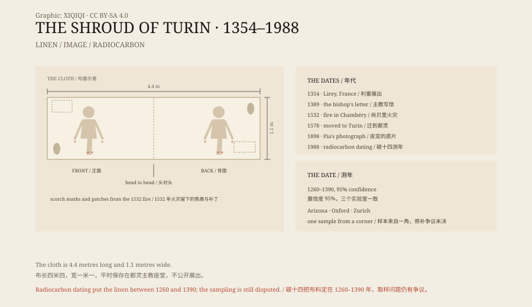

## 1. A piece of cloth

The cloth is 4.4 metres long and 1.1 metres wide. Linen, herringbone weave, yellowed with age.

On it is the image of a man. One image on the front, one on the back, head to head, as if the cloth had been folded over a body. He has long hair and a beard. There are marks of whipping, wounds at the wrists and feet, a gash in the side, and marks around the head consistent with a crown of thorns.

This is the Shroud of Turin. It is kept in a chapel of Turin Cathedral and is normally not on display.

## 2. The negative of 1898

In 1898 the Italian photographer Secondo Pia was allowed to photograph the shroud.

In the darkroom, as he developed the glass plate, he saw the faint face on the cloth turn into a clear positive image. Light and shadow were reversed, and the wounds, the bridge of the nose and the eyebrows came forward.

From that day the face began to circulate. Some said that a medieval painter could not have produced such a negative.

## 3. Lirey

The documented history begins in France.

Around 1354, the knight Geoffroi de Charny exhibited the cloth in the village of Lirey, in Champagne. He founded a small collegiate church to house it.

In 1389 Pierre d'Arcis, bishop of Troyes, wrote to Pope Clement VII. He said the cloth was a painting. A previous bishop, he wrote, had found the artist, who had confessed. He asked for the exhibition to be stopped.

The pope did not ban it outright, but he required it to be shown as a representation rather than as a relic.

## 4. Fire

In 1453 the Charny family transferred the cloth to the House of Savoy.

In December 1532 the chapel in Chambéry where it was kept caught fire. The silver reliquary melted, and a drop of molten silver burned through the folded layers, leaving symmetrical scorch marks. Poor Clare nuns sewed patches around the burns.

In 1578 the cloth was moved to Turin, where it has remained.

In 1997 Turin Cathedral caught fire again, and a firefighter dragged the shroud out of the building.

## 5. 1988

In 1988 the Vatican agreed to radiocarbon dating.

A sample was cut from one corner of the cloth and divided into three. It went to the University of Arizona, the University of Oxford and ETH Zurich. Each laboratory tested its piece without knowing the others' results.

They agreed. The linen dated to between 1260 and 1390, with 95 per cent confidence.

On 13 October 1988 the Cardinal of Turin announced the result at a press conference.

If the result holds, the cloth is more than a thousand years younger than Jesus. It appeared in the record at almost exactly the date the laboratories gave.

## 6. The objections

The objections began immediately and have not stopped.

The most common concerns the sample. It came from a corner of the cloth, and that corner may have been repaired after the 1532 fire, or rewoven in the Middle Ages. If the laboratories dated a patch, they dated the patch, not the whole cloth.

In 2005 the chemist Ray Rogers published a paper arguing that fibres near the sample were chemically different from the main cloth. Other researchers have suggested that fire and microorganisms could have altered the carbon in the sample.

Those who accept the dating reply that none of these claims has been independently reproduced. Three laboratories, one method, one result — that is the strongest evidence there is.

*Original schematic: the front and back image, the dimensions, and the key dates from 1354 to 1988. Not a photograph of the relic. Oddity Archive, CC BY-SA 4.0.*

## 7. The image

The image itself is also unresolved.

Some say it was painted, with some medieval pigment. But there are no obvious brushstrokes, and the colour is very faint. Some say it is a contact imprint, left by wrapping the cloth around a body. But why there are two images, front and back, and why they line up so precisely, has no generally accepted explanation.

Pollen, dust and iron particles have been found on the cloth. Each has been used by different people to argue different conclusions.

## 8. Now

The Church has not declared the shroud authentic, and has not declared it a fake. It is kept and venerated as an icon.

One cloth, one face, one date. Put the three together and they still do not add up to an answer everyone accepts.

---

**Sources and licenses**: the factual sources are listed in the source ledger S1–S4 at the bottom of this entry. Text and original diagrams are licensed under CC BY-SA 4.0. This article separates the description of the cloth, the historical record, the 1988 dating, the objections, and the study of the image; the radiocarbon result supports a date of 1260–1390, but the sampling and repair questions remain disputed, and the Church has made no formal ruling on authenticity. The illustration is a scene reconstruction, not a photograph of the relic.
