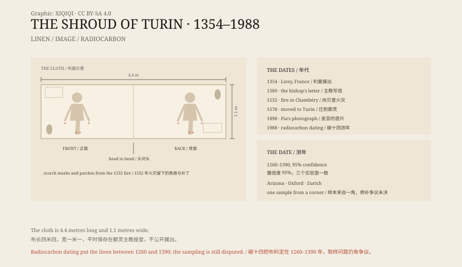

## 一、一块布

布长四米四，宽一米一。亚麻，斜纹，颜色发黄。

布上有一个男人的像。正面一个，背面一个，头对头躺着。他留着长发和胡须，身上有鞭打的痕迹，手腕和脚上有伤，肋旁有一道口子，头上像戴过一顶刺冠。

这就是都灵裹尸布。它保存在都灵主教座堂的礼拜堂里，平时不展出。

## 二、1898 年的底片

1898 年，意大利摄影师 Secondo Pia 获准为裹尸布拍照。

他在暗房里冲洗玻璃底片，看到布上那张模糊的脸，在底片上变成了一个清晰的正像。明暗反了过来，伤痕、鼻梁、眉毛都浮了出来。

从那天起，这张脸开始流传。有人说，中世纪的画师画不出这样的底片效果。

## 三、利雷

有记载的历史从法国开始。

1354 年前后，骑士若弗鲁瓦·德·沙尔尼在法国香槟地区的利雷村，展出了这块布。他建了一座小教堂，专门用来放它。

1389 年，特鲁瓦主教皮埃尔·达尔西给教宗克雷芒七世写了一封信。他说，这块布是一幅画，前任主教曾找到画它的画家，画家承认了。他要求禁止展出。

教宗没有完全禁止，但要求把它当作一幅“画像”来展示，而不是圣物。

## 四、火

1453 年，沙尔尼家族把布转让给了萨伏依家族。

1532 年 12 月，存放裹尸布的尚贝里礼拜堂失火。银制圣物箱被烧化，一滴银液穿过折叠的布层，在布上留下对称的焦痕。贫穷修女会的修女在焦痕周围缝了补丁。

1578 年，布被移到都灵。此后一直留在那里。

1997 年，都灵主教座堂又着了一次火，一名消防员把裹尸布从火里拖了出来。

## 五、1988 年

1988 年，梵蒂冈同意做碳十四测年。

样本从布的一角剪下，分成三份，送往亚利桑那大学、牛津大学和苏黎世联邦理工学院。三个实验室各自测试，互不知道对方的结果。

结论一致：布料的年代在公元 1260 年到 1390 年之间，置信度 95%。

1988 年 10 月 13 日，都灵枢机主教在新闻发布会上公布了结果。

如果这个结果成立，这块布比耶稣晚了一千多年。它正好出现在它第一次有记载的年代。

## 六、反驳

测年结果公布后，质疑一直没有停。

最常被提到的一点是取样位置。样本来自布的一角，而那一角可能在 1532 年火灾后修补过，也可能在中世纪被重新织补。如果测的是补丁，测出的就是补丁的年代，不是整块布的年代。

2005 年，化学家雷·罗杰斯发表论文，说他分析过样本附近的纤维，认为取样处与主体布料在化学上不同。也有研究者指出，火灾和微生物可能改变了碳的分布。

支持测年结果的人则认为，这些说法都没有经过独立重复验证。三个实验室、同一种方法、同一个结果，这是目前最硬的证据。

*原创示意图：布面正反面人像的布局、尺寸与 1354–1988 年的关键节点。不是文物照片。稀奇奇编辑部，CC BY-SA 4.0。*

## 七、图像

图像本身也没有定论。

有人说它是画上去的，用的是某种中世纪颜料。但布上看不到明显的笔触，颜色也很浅。有人说它是某种接触印痕，像把布盖在尸体上留下的。但为什么正反面都有，而且位置对得这么准，还没有一个被普遍接受的解释。

布上还检出过花粉、灰尘和铁元素。每一项都被不同的人拿来做不同的论证。

## 八、现在

教会没有正式宣布它是真品，也没有宣布它是假的。它被当作一幅圣像来保存和瞻仰。

一块布，一张脸，一个日期。三样东西放在一起，仍然拼不出一个所有人都同意的答案。

---

**来源与许可**：本文的事实来源见条目底部来源台账 S1–S4。文字与原创示意图采用 CC BY-SA 4.0。文中把布面描述、历史记载、1988 年测年、质疑意见与图像研究分开叙述；碳十四结果支持 1260–1390 年，但取样与修补问题仍有争议，教会未对真伪作出正式裁定。插图是场景复原，不是文物照片。
