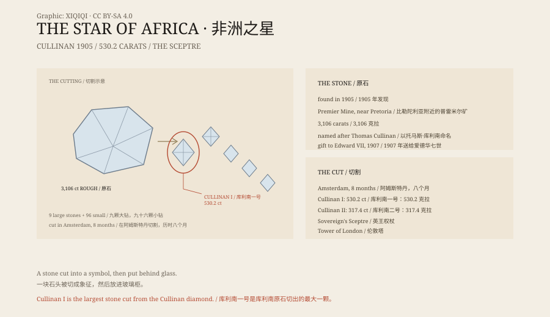

## 1. 1905

In 1905, at the Premier Mine near Pretoria, South Africa, miners found an enormous diamond in the rock.

It weighed 3,106 carats, the largest gem-quality diamond ever found at the time. It was named the Cullinan, after the mine's chairman, Thomas Cullinan.

## 2. The Gift

In 1907 the government of the Transvaal gave the uncut diamond to King Edward VII as a gift for his 66th birthday.

It was shipped to London. Accounts of the journey differ: some say it was sent in an ordinary parcel, others that a fake diamond was used as a decoy. The full procedure was never recorded.

## 3. The Cutting

The cutting took place in Amsterdam. Three polishers worked fourteen-hour days for eight months.

The rough stone was cut into nine large stones and ninety-six smaller ones.

The largest was named Cullinan I. It weighs 530.2 carats and is known as the Star of Africa.

## 4. The Sceptre

Cullinan I was set in the Sovereign's Sceptre with Cross.

The sceptre was made in 1661, and with the diamond it became part of the British royal regalia.

Cullinan II weighs 317.4 carats and is known as the Lesser Star of Africa. It was set in the Imperial State Crown.

## 5. Today

The diamonds are kept in the Jewel House at the Tower of London and displayed to the public.

They are part of the British Crown Jewels and part of South Africa's colonial history. In recent years some South Africans have called for their return.

## 6. A Stone

Cullinan I is a stone. It does not shine unless someone gives it light.

It was cut, polished, set in a sceptre and placed in a glass case. Thousands of people walk past it every day.

It once belonged to a mine, then to a king, and now to a museum.

It does not know any of this.

*Original schematic: the cutting plan of the Cullinan, Cullinan I and the Sovereign's Sceptre. Not a photograph of an artefact. Oddity Archive, CC BY-SA 4.0.*

---

**Sources and licenses**: the factual sources are listed in the source ledger S1–S4 at the bottom of this entry. Text and original diagrams are licensed under CC BY-SA 4.0. This article separates the 1905 discovery, the 1907 gift, the cutting, the Crown Jewels and the repatriation debate; the weights, cutting and settings are a matter of public record. The illustration is a scene reconstruction, not a photograph of an artefact.
