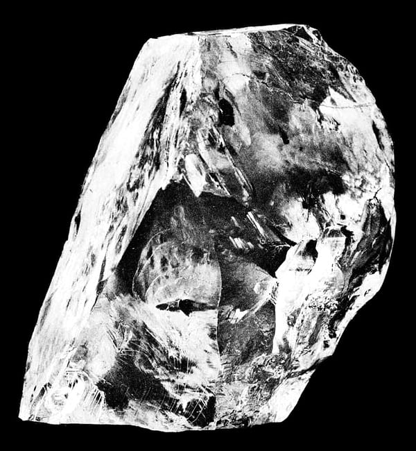
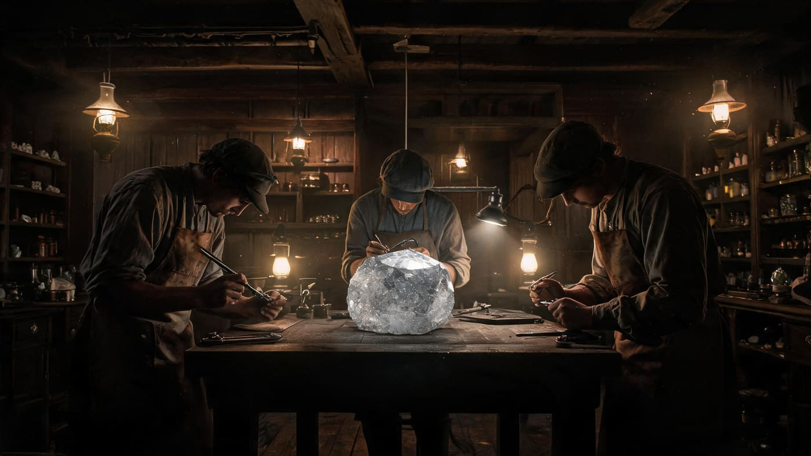
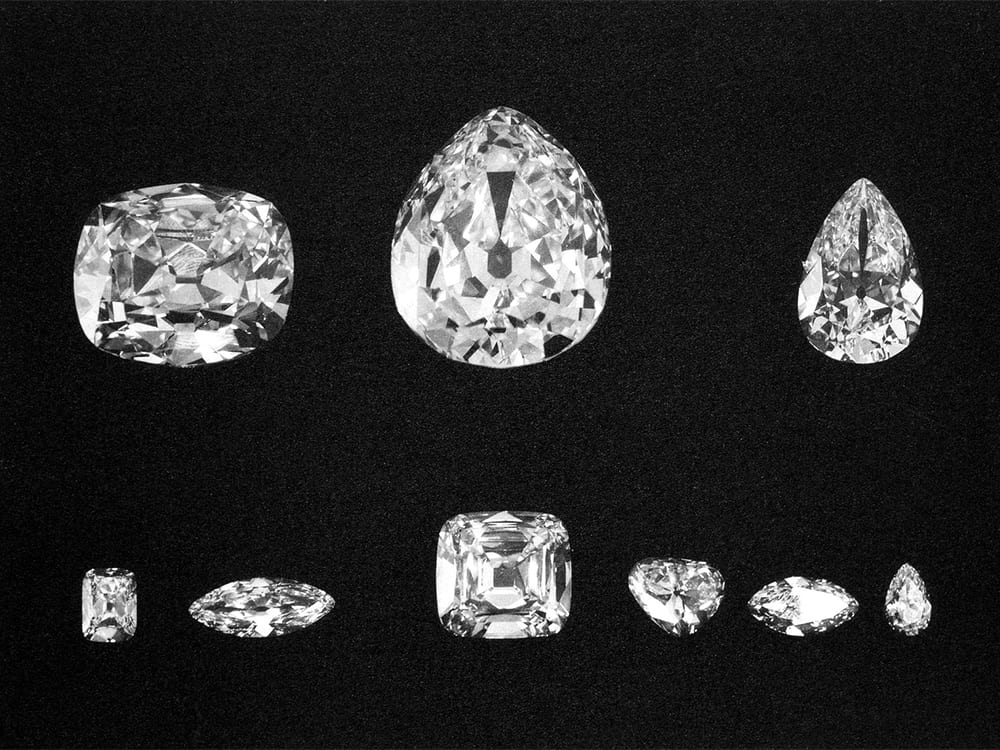
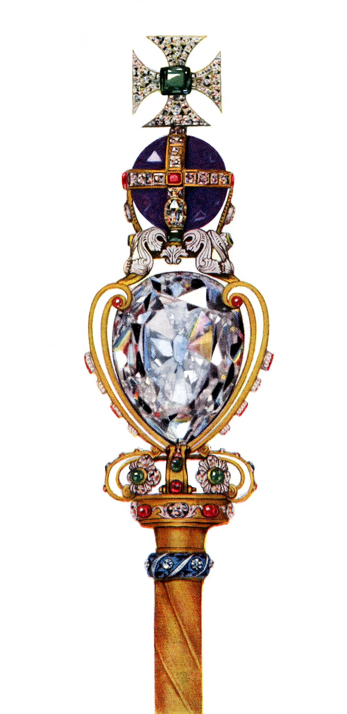
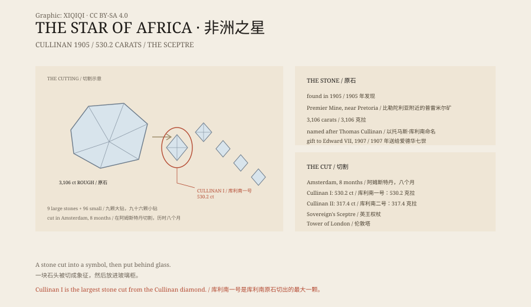

## 1. 26 January 1905

26 January 1905, the Premier Mine near Pretoria, South Africa.

Frederick Wells, the mine's surface manager, saw a gleam in the rock not far below the surface. He thought it was a piece of glass. He prised it out with a knife, and a crystal the size of a fist came free.

It weighed 3,106 carats, the largest gem-quality rough diamond ever found. It had a blue-white hue. Four of its eight surfaces were smooth, which suggested that it had once been part of a much larger stone broken up by natural forces. Inside was a small pocket of air that, at certain angles, threw a rainbow or Newton's rings.

It was named the Cullinan, after Thomas Cullinan, who had opened the mine in 1902.

Shortly after the discovery it went on public display at the Standard Bank in Johannesburg. An estimated eight to nine thousand people came to see it.

*Historical photograph: the rough Cullinan diamond, c. 1905. Public domain (Wikimedia Commons). The 3,106-carat stone shows natural cleavage and fracture surfaces.*

## 2. From the Mine to London

In April 1905 the rough stone was deposited with Premier Mining's London sales agent, S. Neumann & Co.

How it travelled became a story of its own. It was rumoured that the diamond would sail on the RMS Kenilworth Castle. Detectives were assigned to the ship; a parcel was ceremoniously locked in the captain's safe and guarded for the whole voyage. It was a decoy. The stone on that ship was fake, meant to draw anyone who wanted to steal the real one.

The real Cullinan was sent to the United Kingdom in a plain box by registered post. On arrival in London it was taken to Buckingham Palace for inspection by King Edward VII.

It remained in London for two years. There was plenty of interest and no buyer. The price was too high, the risk too great.

## 3. Buying and Giving

In August 1907 the Legislative Council of the Transvaal Colony voted on the stone's fate. The motion authorising its purchase passed by 42 votes to 19.

Henry Campbell-Bannerman, then British prime minister, had advised the king to decline the offer. He later changed his mind, and left Edward VII to decide. The man who finally persuaded the king to accept was Winston Churchill, then Colonial Under-Secretary. Churchill was later sent a replica, which he liked to show guests on a silver plate.

On 17 October 1907 the Transvaal government bought the Cullinan for £150,000. Because mining profits were taxed at 60 per cent, part of the money came back to the British Treasury through the Premier Diamond Mining Company.

On 9 November 1907, at Sandringham House, the colony's Agent-General, Sir Richard Solomon, presented the diamond to the king. It was Edward VII's sixty-sixth birthday. Among the guests were the Queen of Sweden, the Queen of Spain, the Duke of Westminster and Lord Revelstoke.

The king asked his colonial secretary, Lord Elgin, to announce that he accepted the gift "for myself and my successors" and would ensure "this great and unique diamond be kept and preserved among the historic jewels which form the heirlooms of the Crown".

After the ceremony the king returned to the Netherlands by train and ferry, with the diamond in his coat pocket.

## 4. Cutting

On 10 February 1908 the rough stone was split in half by Joseph Asscher at his diamond-cutting factory in Amsterdam.

The cutters had planned for weeks. The technology of the time could not guarantee the quality of a modern cut, and the operation was both expensive and dangerous. They first cut a deep incision into the stone; that alone took four days, and a steel knife broke on the first attempt.

Then Asscher cleaved it with a single blow. The splitting and cutting took eight months in all, with three people working fourteen hours a day.

A famous detail surrounds that blow: that Asscher fainted after splitting the stone. Ian Balfour, in his book Famous Diamonds, dismisses the story and suggests Asscher more likely celebrated by opening a bottle of champagne.

*Reconstruction: the diamond-cutting workshop in Amsterdam in 1908, with polishers around the rough Cullinan. Not a historical photograph. XIQIQI Editorial, CC BY-SA 4.0.*

The rough was eventually cut into nine major stones, ninety-six minor brilliants and a number of unpolished fragments. All but the two largest, Cullinans I and II, remained in Amsterdam by arrangement, as Asscher's fee.

## 5. The Nine Stones

Cullinan I, the Great Star of Africa, is a pendeloque-cut brilliant weighing 530.2 carats, with 74 facets.

Cullinan II, the Second Star of Africa, is a cushion-cut brilliant weighing 317.4 carats, with 66 facets.

Cullinan III and IV were later worn together by Elizabeth II as a brooch. III has also been used as a pendant on the Coronation Necklace, where it occasionally replaced the Lahore Diamond. Cullinan V is heart-shaped and set in the centre of a platinum brooch. VI and VII are marquise-cut. VIII is oblong-cut. IX is pear-shaped.

The nine stones, with the smaller brilliants, were dispersed among the Crown Jewels, private collections and museums. Their combined weight is far less than that of the rough. What was lost in cutting and polishing became powder, and the powder went nowhere anyone can trace.

## 6. Sceptre and Crown

Cullinan I is set at the top of the Sovereign's Sceptre with Cross.

The sceptre was made in 1661. It had to be redesigned in 1910 to take the diamond. The stone is held in a gold setting and can be removed: taken out, it can be worn as a pendant, or with Cullinan II as a brooch. Queen Mary often wore it that way.

Cullinan II is set in the front of the Imperial State Crown.

In the 1980s gemologists at the Tower of London examined both stones and graded them colourless type IIa. Type IIa diamonds contain almost no nitrogen and are usually unusually transparent.

Until 1992 Cullinan I was the largest cut diamond in the world. That year it was surpassed by the 545.67-carat brown Golden Jubilee Diamond. Cullinan I remains the largest colourless cut diamond.

*Historical photograph: the nine major stones cut from the Cullinan, 1908. Public domain (Wikimedia Commons). Top row: Cullinans II, I and III; bottom row: the other six.*

## 7. The Call to Return

The stones are part of the Crown Jewels and part of South Africa's colonial history.

In recent years South Africans have called for their return. The argument is direct: the rough came out of a South African mine, and in 1907 the Transvaal government gave it to the British king. The Transvaal was a British colony. A "gift" made then, the argument goes, cannot commit South Africa today.

The British response is usually careful: the diamonds belong to the Crown Jewels, held in trust by the monarchy; the question of return involves law and history, and is not settled by saying yes or no.

The argument has no conclusion. The diamonds are still in the Tower of London.

*Historical illustration: the Sovereign's Sceptre with Cross set with Cullinan I, 1919. Public domain (Wikimedia Commons). The sceptre was made in 1661 and redesigned in 1910 for the diamond.*

## 8. A Stone

Cullinan I is a stone. It does not shine unless someone gives it light.

It was split, polished, set into a sceptre and put in a glass case. Several thousand people pass in front of it every day, look at it for a moment, and move on to the next exhibit.

It once belonged to a mine, then to a king, now to a museum. It knows none of this.

It knows light. Whichever way the light comes from, it sends it back.

*Original schematic: the cutting plan for the rough Cullinan, Cullinan I and the Sovereign's Sceptre. Not a photograph of the object. XIQIQI Editorial, CC BY-SA 4.0.*

---

**Sources and licenses**: sources are listed in the ledger S1–S6 at the foot of this entry. Text and original diagrams are CC BY-SA 4.0. The article keeps apart the 1905 discovery, the 1907 purchase and presentation, the 1908 cutting, the dispersal of the nine stones and the Crown Jewels, and the argument over return; the weights, cuts and settings are on the public record. The illustrations are historical photographs, a reconstruction and a schematic, not site photographs.
