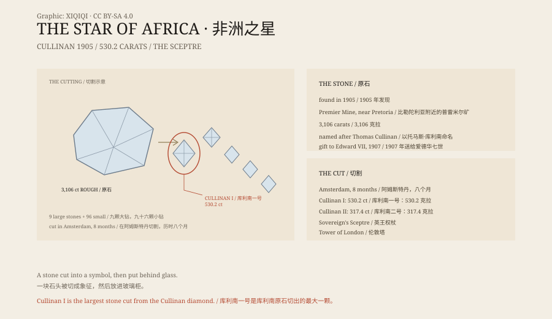

## 一、1905 年

1905 年，南非比勒陀利亚附近的普雷米尔矿。矿工在岩层里发现了一块巨大的钻石。

它重 3,106 克拉，是当时发现的最大的宝石级钻石。它被命名为“库利南”，以矿主托马斯·库利南命名。

## 二、礼物

1907 年，德兰士瓦政府把这块未切割的钻石送给英国国王爱德华七世，作为他 66 岁生日的礼物。

它被运到伦敦。怎么运的，有不同说法：有人说用普通邮包寄的，有人说用假钻石做诱饵。真实过程没有完整记录。

## 三、切割

切割在阿姆斯特丹进行。三个抛光师每天工作 14 小时，干了八个月。

原石被切成 9 颗大钻和 96 颗小钻。

最大的那颗叫“库利南一号”，重 530.2 克拉，被称为“非洲之星”。

## 四、权杖

库利南一号被镶进英王权杖。

权杖是 1661 年制作的，镶上钻石后，它成了英国王权象征的一部分。

库利南二号重 317.4 克拉，被称为“小非洲之星”，被镶进帝国皇冠。

## 五、今天

这些钻石保存在伦敦塔的珠宝馆里，对公众展出。

它们是英国王室珠宝的一部分，也是南非殖民历史的一部分。近年来，南非有人要求归还这些钻石。

## 六、一块石头

库利南一号是一块石头。它不发光，除非有人给它光。

它被切开、打磨、镶进权杖，然后被放进玻璃柜里。每天有几千人从它面前走过。

它曾经属于一座矿山，后来属于一个国王，现在属于一个博物馆。

它自己不知道这些。

*原创示意图：库利南原石的切割方案、库利南一号与英王权杖。不是文物照片。稀奇奇编辑部，CC BY-SA 4.0。*

---

**来源与许可**：本文的事实来源见条目底部来源台账 S1–S4。文字与原创示意图采用 CC BY-SA 4.0。文中把 1905 年发现、1907 年赠送、切割过程、王室珠宝与归还争议分开叙述；钻石的重量、切割与镶嵌位置有公开记录。插图是场景复原，不是文物照片。
