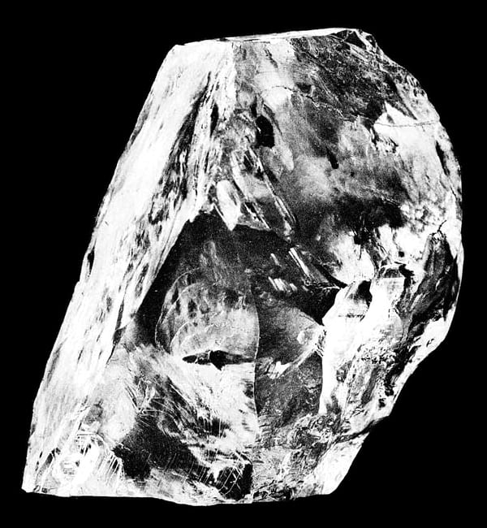
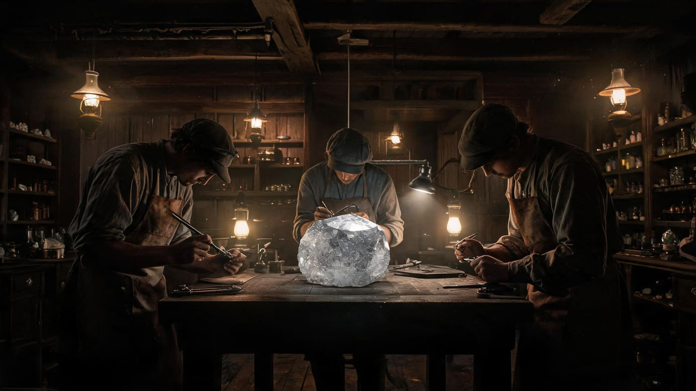
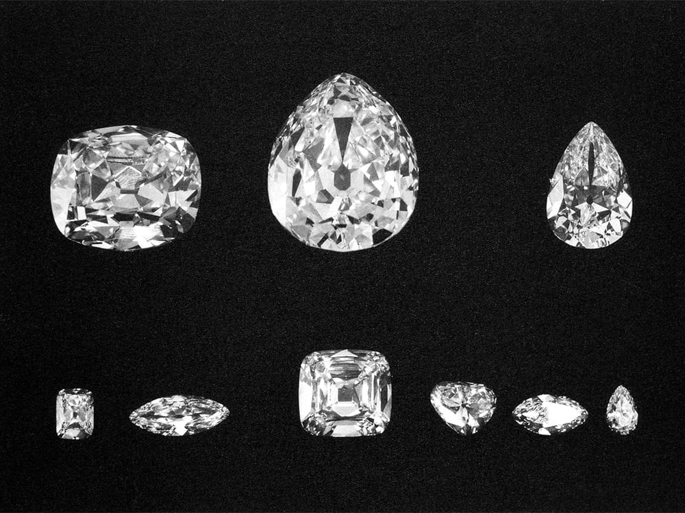
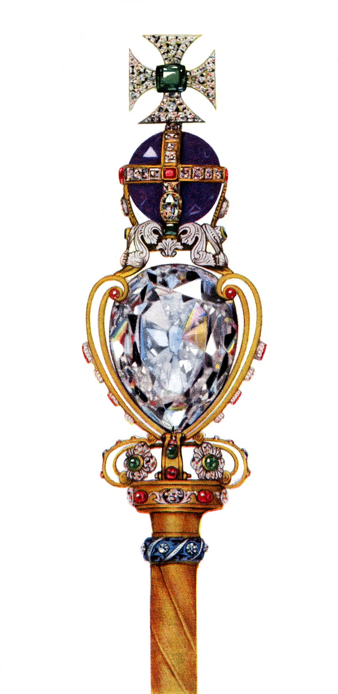
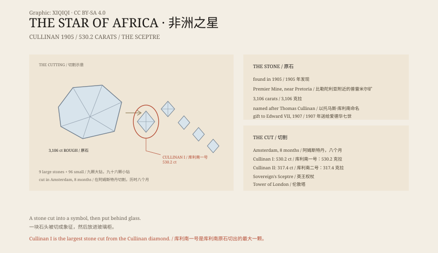

## 一、1905 年 1 月 26 日

1905 年 1 月 26 日，南非比勒陀利亚附近的普雷米尔矿（Premier Mine）。

矿井的地表经理弗雷德里克·威尔斯（Frederick Wells）在地表以下不深的岩层里看见一处反光。他以为是一块玻璃，用刀一挑，挑出一块拳头大的晶体。

它重 3,106 克拉，是当时发现的最大的宝石级钻石。它有蓝白色的色调，八个表面里有四个是光滑的，说明它原本属于一块更大的石头，被自然的力量掰了下来。晶体内部有一个小气泡，在某些角度会折出彩虹一样的光环。

它被命名为“库利南”，以矿主托马斯·库利南（Thomas Cullinan）命名。库利南在 1902 年开了这座矿。

发现之后，它被送到约翰内斯堡的标准银行公开展出。来看的人估计有八千到九千。

*历史照片：库利南原石，约 1905 年。公有领域（Wikimedia Commons）。原石重 3,106 克拉，表面可见天然的解理与断口。*

## 二、从矿到伦敦

1905 年 4 月，原石被交给普雷米尔矿业公司的伦敦销售代理 S. Neumann & Co.。

怎么运的，后来成了一个故事。当时有传闻说，宝石将搭乘 RMS Kenilworth Castle 号；侦探被派上船，一只包裹在船长室保险柜里隆重地上锁，全程有人看守。那是个诱饵：船上的石头是假的，专门引开想偷它的人。

真正的库利南被装进一只普通盒子，通过挂号邮件寄到英国。到了伦敦，它被送进白金汉宫，给国王爱德华七世过目。

它在伦敦放了两年，有兴趣的买家不少，但没人买。价格太高，风险太大。

## 三、买下与赠送

1907 年 8 月，德兰士瓦立法委员会就这块石头的命运投票，以 42 票赞成、19 票反对，通过了授权购买的动议。

当时的英国首相亨利·坎贝尔-班纳曼曾建议国王拒绝这份礼物；后来他改变主意，让爱德华七世自己决定。最终说服国王接受的，是当时的殖民地副大臣温斯顿·丘吉尔。丘吉尔后来收到一枚复制品，他喜欢把它放在银盘上给客人看。

1907 年 10 月 17 日，德兰士瓦政府以 15 万英镑买下库利南。因为矿业利润要交 60% 的税，其中一部分钱又通过普雷米尔矿业公司回到了英国财政部。

1907 年 11 月 9 日，在桑德灵厄姆宫，殖民地总代理理查德·所罗门爵士（Sir Richard Solomon）把钻石交给国王。那天是爱德华七世 66 岁生日。在场的客人里有瑞典王后、西班牙王后、威斯敏斯特公爵和雷弗尔斯托克勋爵。

国王让殖民地大臣埃尔金勋爵宣布，他“为自己和继承人”接受这份礼物，并会确保“这颗伟大而独特的钻石被保存在王冠的历史珠宝之中”。

仪式之后，国王坐火车和渡轮回荷兰，钻石放在他的大衣口袋里。

## 四、切割

1908 年 2 月 10 日，原石在阿姆斯特丹的约瑟夫·阿舍尔（Joseph Asscher）钻石切割厂被劈成两半。

在那之前，切割师们计划了几个星期。当时的技术还不能保证现代意义上的切割质量，这一刀既贵又危险。他们先在石头上开出一道深槽，仅开槽就花了四天；第一次尝试时，一把钢刀断了。

最后，阿舍尔用一刀把石头劈开。整个劈开和切割过程持续了八个月，三个人每天工作 14 小时。

关于这一刀，有一个流传很广的细节：阿舍尔劈开石头后当场晕倒。伊恩·巴尔弗（Ian Balfour）在《Famous Diamonds》里否定了这个说法，认为他更可能开了一瓶香槟庆祝。

*场景复原：1908 年阿姆斯特丹的钻石切割作坊，抛光师围着库利南原石工作。不是历史照片。稀奇奇编辑部，CC BY-SA 4.0。*

原石最终被切成 9 颗大钻和 96 颗小钻，还有一些未抛光的碎片。除了最大的两颗——库利南一号和二号——其余的都按约定留在阿姆斯特丹，作为阿舍尔的加工费。

## 五、九颗石头

库利南一号，也叫“非洲之星”（Great Star of Africa），是一颗梨形（pendeloque）明亮式切割钻石，重 530.2 克拉，有 74 个刻面。

库利南二号，也叫“小非洲之星”（Second Star of Africa），是一颗垫形（cushion）明亮式切割钻石，重 317.4 克拉，有 66 个刻面。

库利南三号和四号，后来被伊丽莎白二世经常一起佩戴，做成一枚胸针。三号还曾作为吊坠挂在加冕项链上，替代原来的拉合尔钻石。五号是心形，镶在一枚铂金胸针中央。六号和七号是马眼形。八号是长圆形。九号是水滴形。

这九颗石头，加上那些小钻，后来分散在英国王室珠宝、私人收藏和博物馆里。它们的总重量，比原石少了很多——切割和抛光过程中损耗的部分，变成了粉末，不知去向。

## 六、权杖与皇冠

库利南一号被镶在“带十字架的君主权杖”（Sovereign's Sceptre with Cross）的顶端。

这根权杖制作于 1661 年。为了安放这颗钻石，它在 1910 年被重新设计。钻石用金托固定，可以取下来：取下来之后，它能和库利南二号一起，作为吊坠和胸针佩戴。玛丽王后经常这样戴。

库利南二号被镶在帝国皇冠（Imperial State Crown）正面。

1980 年代，伦敦塔的宝石学家检查了这两颗钻石，都评为无色 IIa 型。IIa 型是钻石里含氮极少的一类，通常透明度很高。

库利南一号在 1992 年之前一直是世界上最大的切割钻石；那一年，重 545.67 克拉的棕色“金禧钻石”（Golden Jubilee Diamond）超过了它。但库利南一号仍然是无色切割钻石里最大的一颗。

*历史照片：从库利南原石切出的九颗主钻，1908 年。公有领域（Wikimedia Commons）。上排为库利南二号、一号、三号；下排为其余六颗。*

## 七、回归的呼声

这些钻石是英国王室珠宝的一部分，也是南非殖民历史的一部分。

近年来，南非国内有人要求英国归还这些钻石。理由很直接：原石产自南非，1907 年是德兰士瓦政府把它送给英国国王的；当时的德兰士瓦是英国殖民地，这份“礼物”不能代表今天的南非。

英国方面的回应通常很谨慎：这些钻石属于王室珠宝，由王室收藏；归还问题涉及法律与历史，不是一句“还”或“不还”能解决的。

这场争论没有结果。钻石还在伦敦塔。

*历史画作：镶有库利南一号的“带十字架的君主权杖”，1919 年。公有领域（Wikimedia Commons）。权杖制作于 1661 年，1910 年为安放钻石重新设计。*

## 八、一块石头

库利南一号是一块石头。它不发光，除非有人给它光。

它被切开、打磨、镶进权杖，然后被放进玻璃柜里。每天有几千人从它面前走过，看它一眼，然后去看下一件展品。

它曾经属于一座矿山，后来属于一个国王，现在属于一个博物馆。它自己不知道这些。

它只知道光。光从哪个方向来，它就把光送回哪个方向。

*原创示意图：库利南原石的切割方案、库利南一号与英王权杖。不是文物照片。稀奇奇编辑部，CC BY-SA 4.0。*

---

**来源与许可**：事实来源见条目底部来源台账 S1–S4。文字与原创示意图采用 CC BY-SA 4.0。文中把 1905 年发现、1907 年购买与赠送、1908 年切割、九颗主钻的去向、王室珠宝与归还争议分开叙述；钻石的重量、切割与镶嵌位置有公开记录。插图是历史照片、场景复原与示意图，不是现场照片。
