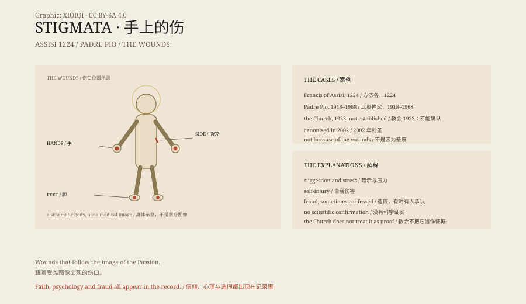

## 1. 1224

On a mountain near Assisi, Italy, Francis was praying.

It was early morning. The rock was cold, mist rose from the valley, and he had been kneeling with his arms raised for a long time.

He said he saw a six-winged seraph, like Christ on the cross.

Then wounds appeared on his hands and feet, like the marks of nails, and a wound in his side.

These are the earliest widely recorded stigmata.

*Reconstruction: Francis praying at La Verna in 1224. Not a historical photograph or a medical photograph. Oddity Archive, CC BY-SA 4.0.*

## 2. What Stigmata Are

Stigmata are wounds resembling the Passion of Christ: on the hands, feet and side, sometimes also marks on the head from the crown of thorns.

Catholic tradition treats them as a mysterious grace. But the Church has never treated them as proof of sanctity.

## 3. Padre Pio

The most famous modern case is Padre Pio of Italy.

In 1918 wounds appeared on his hands. They remained for fifty years.

Doctors examined him and disagreed. Some said the wounds could not be explained; some said they were produced by suggestion; some suspected he maintained them with iodine.

Padre Pio rarely let people see the wounds. He wore gloves and wrapped his hands in cloth. To believers this was humility; to sceptics, concealment.

In 1923 the Church declared that the supernatural character of the wounds was not established. In 2002 he was canonised on the basis of his virtues and reported miracles, not the stigmata.

## 4. Medicine

Modern medicine offers several explanations.

Extreme religious absorption, suggestion and psychological stress can produce skin reactions. Some people injure themselves without being fully aware of it.

There is also outright fraud: the sixteenth-century Spanish nun Magdalena de la Cruz confessed that her stigmata were fake.

## 5. Why

Stigmata may persist not only because of faith.

In a culture where the Passion is a central image, the body can become a language for pain.

A wound is a statement: I am here, I saw, I took part in his suffering.

## 6. Hands

Stigmata are still reported today.

The Church investigates cautiously, and medicine remains sceptical.

Francis later developed pad-like tissue on his hands. He had difficulty walking and was almost blind.

He died still bearing the wounds.

*Original schematic: Francis, Padre Pio and the layers of medical explanation. Not a medical photograph. Oddity Archive, CC BY-SA 4.0.*

---

**Sources and licenses**: the factual sources are listed in the source ledger S1–S4 at the bottom of this entry. Text and original diagrams are licensed under CC BY-SA 4.0. This article separates the religious tradition, individual case records, the Church's position and medical explanations; stigmata have not been scientifically confirmed as supernatural. The illustration is a scene reconstruction, not a medical photograph.
