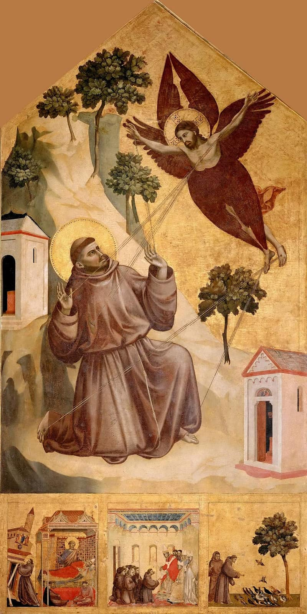
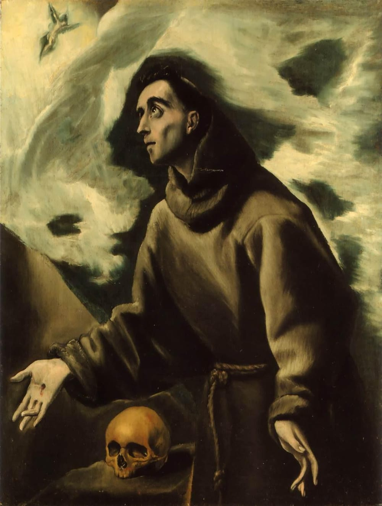
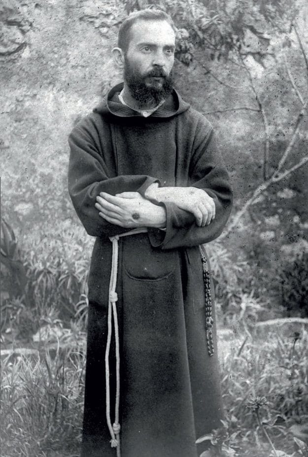
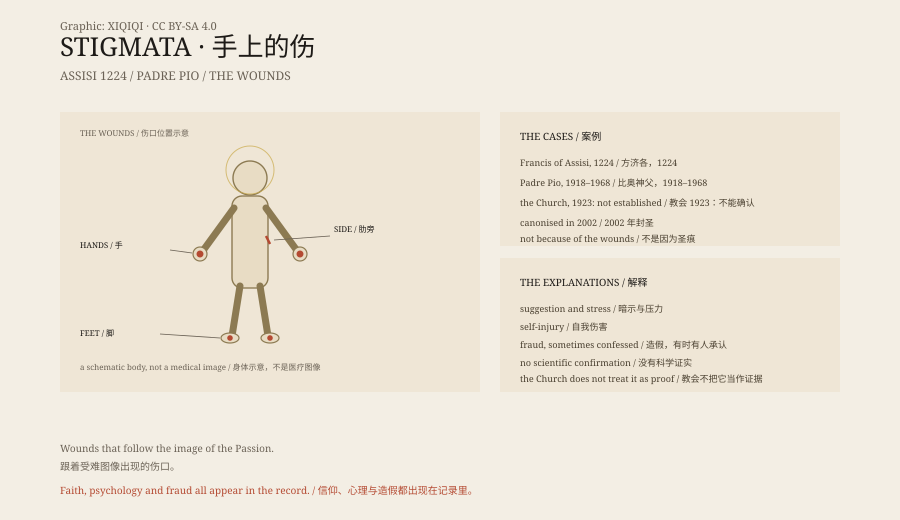

## 1. 1224

La Verna, a mountain near Assisi, Italy. Francis is praying.

He is forty-two, back from the Holy Land a few years earlier, and has come up the mountain for a forty-day fast. The rock is bare, the fog rises from the valley.

One morning, near the feast of the Exaltation of the Cross, he sees a six-winged angel. The angel's wings are spread, and the angel is fixed to a cross, like Christ crucified.

Francis is filled with joy and terror. When the angel leaves, wounds appear in his hands and feet, like nail marks; his side has a wound as if pierced by a lance.

This is the first widely recorded case of stigmata in Christian history.

*Historical painting: Giotto, Saint Francis Receiving the Stigmata, c. 1295–1300, Louvre. Public domain (Wikimedia Commons). The six-winged seraph appears; the wounds appear on Francis's hands, feet and side.*

## 2. What Stigmata Are

"Stigmata" is the plural of the Greek stigma, a mark or brand.

In Roman Catholicism it means wounds on the body matching the crucifixion of Christ: nails in the wrists and feet, a lance in the side, sometimes the crown of thorns on the forehead, scourging on the back. Some cases report tears of blood or sweating blood.

It is not one medical diagnosis but a set of phenomena. The location, shape, duration and bleeding differ from case to case.

The earliest candidate is St Ansbert of Rouen, who died in 695; witnesses after his death said he bore wounds, and an anonymous monk wrote this into his biography in the mid-eighth century. But the concept of stigmata was not yet fixed. Francis is usually called the first widely recorded stigmatic.

One statistic is often forgotten: most stigmatics are women. In the nineteenth century the French physician Antoine Imbert-Goubeyre compiled a census from the thirteenth century to his own time: 280 women and 41 men, 87 per cent female. A University of Antwerp database published in 2019 lists 244 stigmatics, 92 per cent of them women.

## 3. Francis

Francis's wounds were seen by many people in the two days after his death.

His first biographer, Thomas of Celano, wrote in the First Life of St Francis (1230) that nail-like marks appeared in his hands and feet; on the palms they were round, on the other side elongated; small pieces of flesh stood out like bent nail-heads. His right side had a large wound that often bled, soaking his tunic and trousers.

Francis was not a healthy man. His eyes were bad, and he later went nearly blind; he also had malaria and recurring fever. In 1935 the physician Edward Frederick Hartung suggested that Francis had trachoma and quartan malaria, and that the purpura caused by malaria may have been scratched open, producing wounds like the stigmata.

In 1987 another medical hypothesis proposed leprosy.

None of these explanations fits the wounds exactly. But they are a reminder that Francis was a sick man, not a transparent display of a miracle.

Francis died in 1226. He still had the wounds when he died.

*Historical painting: El Greco, Saint Francis Receiving the Stigmata, c. 1585–1590. Public domain (Wikimedia Commons). Francis looks up at the angel, the wounds glowing on his hands.*

## 4. Padre Pio

The most famous stigmatic of the twentieth century was Padre Pio of Pietrelcina.

On 20 September 1918, praying in the friary at San Giovanni Rotondo, he received wounds in his hands. For fifty years they stayed.

Physicians examined him and disagreed. Luigi Romanelli, chief physician of the City Hospital of Barletta, observed him for about a year; Angelo Maria Merla thought the wounds were not tubercular but would not give a diagnosis; the surgeon Giorgio Festa examined them in 1920 and 1925. Some called them inexplicable; others called them autosuggestion; others suspected he kept them open with carbolic acid.

In 1922 the physician Agostino Gemelli visited him but was refused permission by the Holy Office to examine the wounds directly. Gemelli later wrote that Pio was a hysteric and that the wounds were self-induced.

The historian Sergio Luzzatto found a 1919 testimony: the local pharmacy said the young Pio had bought carbolic acid and a large quantity of veratrine without a prescription. Pio's explanation was that the carbolic acid was for sterilising syringes, and that the veratrine was for a practical joke: someone had mixed it into his snuff, making him sneeze uncontrollably, and he bought his own supply to play the same joke on his brothers.

Pio hid his wounds. He wore fingerless gloves and wrapped his hands in cloth. To believers this was humility; to sceptics, concealment.

He died in 1968. At death the wounds had gone; the skin was described as unblemished, with only a small scar and some residual marks on the left palm.

In 2002 he was canonised. The canonisation rested on his virtues and on reported miracles, not on the stigmata. The Church has never treated stigmata themselves as proof of sanctity.

*Historical photograph: Padre Pio in 1919, the stigmata visible on his hands. Public domain (Wikimedia Commons). He later wore fingerless gloves to cover the wounds.*

## 5. Medicine

Modern medicine offers several explanations, none of which covers every case.

The first is fraud. In the sixteenth century the Spanish nun Magdalena de la Cruz confessed before her death that her stigmata were deliberate deception; she had made the wounds herself and maintained them for years.

The second is self-harm. Extreme religious immersion, suggestion and psychological stress can lead a person to scratch or injure themselves, sometimes without full awareness. Fasting, starvation and dissociative states have been linked to self-mutilation in religious contexts; anorexia nervosa sometimes produces ritualistic self-injury.

The third is disease. Hartung's malaria-purpura hypothesis was one attempt; the 1987 leprosy hypothesis was another. Each explains only part of the symptoms.

The fourth is psychology. A 2002 psychoanalytic study of the German stigmatic Therese Neumann concluded that her wounds came from post-traumatic stress expressed in unconscious self-mutilation through abnormal autosuggestibility.

Medicine has never accepted a single case of "supernatural stigmata". It has also never proved that every case is fake.

## 6. Why

Stigmata persist, and not only because of faith.

In a culture where the crucifixion is the central image, the body becomes a language for pain. A wound is a statement: I am here, I saw, I took part in his suffering.

The theologian Ivan Illich wrote in Hospitality and Pain that compassion with Christ is faith so strong and so deeply incarnate that it leads the individual to embody the contemplated pain.

The folklorist and the sceptic see the other side.

Ted Harrison, in Stigmata: A Medieval Phenomenon in a Modern Age, studied contemporary cases and found no evidence of supernatural origin. But he also concluded that not every mark is a hoax. Some stigmatics injured themselves out of piety; others were injured by accident and their marks were read as stigmata by witnesses. A wound of human origin can still produce a genuine religious response.

The investigator Joe Nickell was more direct: the cases he examined were indistinguishable from hoaxing.

## 7. Hands

Today stigmata are still reported.

According to a study by a French historian, there have been about 200 stigmatics worldwide in the past century or so. Most reached old age without particular health problems. As of 1997, only seven stigmatics had been declared saints by the Roman Catholic Church.

The Church investigates cautiously; medicine keeps doubting.

Francis's hands later grew fleshy pads. He had trouble walking and was nearly blind. He died with the wounds still on him.

Eight hundred years later, people are still arguing about where the wounds came from.

*Original schematic: Francis, Padre Pio and the layers of medical explanation. Not a medical photograph. Oddity Archive, CC BY-SA 4.0.*

---

**Sources and licenses**: sources are listed in the ledger S1–S5 at the foot of this entry. Text and original diagrams are CC BY-SA 4.0. The article keeps apart religious tradition, individual records, the Church's position and medical explanations; stigmata have not been scientifically confirmed as supernatural, nor wholly reduced to fraud. The illustrations are historical paintings, a historical photograph, a reconstruction and a schematic, not medical images.
