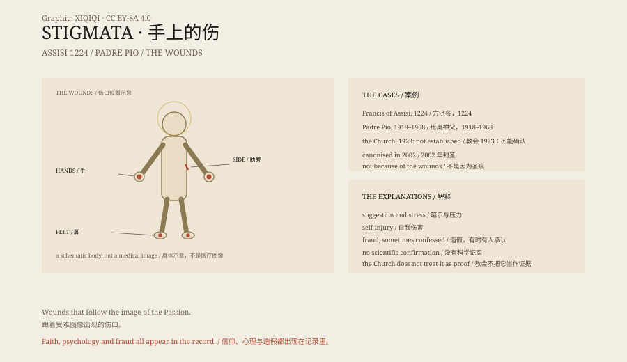

## 一、1224 年

意大利，阿西西附近的山上。方济各在祈祷。

他说，他看见一个六翼的天使，像基督被钉在十字架上。

然后，他的手上和脚上出现了伤口，像钉子的痕迹；肋旁也有一道伤。

这是最早被广泛记录的圣痕。

## 二、什么是圣痕

圣痕是指身上出现与基督受难相似的伤口：手、脚、肋旁，有时还有头上的荆棘痕。

天主教传统认为，这是一种神秘的恩典。但教会从来没有把圣痕当作封圣的证据。

## 三、比奥神父

20 世纪最有名的圣痕案例，是意大利的比奥神父。

1918 年，他的手上出现伤口。此后五十年，伤口一直在。

医生检查过，意见不一。有人说无法解释，有人说是自我暗示，有人怀疑他用碘维持伤口。

1923 年，教会宣布，不能确认这些伤口是超自然的。2002 年，他被封圣，依据的是他的德行和奇迹，不是圣痕。

## 四、医学

现代医学对圣痕有一些解释。

极端的宗教沉浸、暗示、心理压力，可能让皮肤出现反应。有的人会不自觉地抓伤自己。

也有明确的造假：16 世纪的西班牙修女玛丽亚·德·拉·克鲁斯承认，她的圣痕是假的。

## 五、为什么

圣痕之所以持续出现，可能不只是因为信仰。

在一个把基督受难作为核心图像的文化里，身体会成为表达痛苦的语言。

伤口是一种声明：我在这里，我看见了，我参与了他的痛苦。

## 六、手

今天，圣痕仍然有人报告。

教会谨慎地调查，医学界继续怀疑。

方济各的手上，后来也长出了肉垫一样的组织。他走路困难，眼睛几乎失明。

他死的时候，身上还带着那些伤。

*原创示意图：方济各、比奥神父与医学解释的分层。不是医疗照片。稀奇奇编辑部，CC BY-SA 4.0。*

---

**来源与许可**：本文的事实来源见条目底部来源台账 S1–S4。文字与原创示意图采用 CC BY-SA 4.0。文中把宗教传统、个案记录、教会立场与医学解释分开叙述；圣痕没有被科学证实为超自然现象。插图是场景复原，不是医疗照片。
