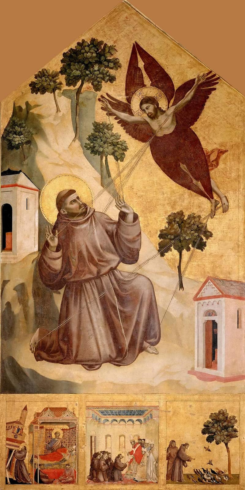
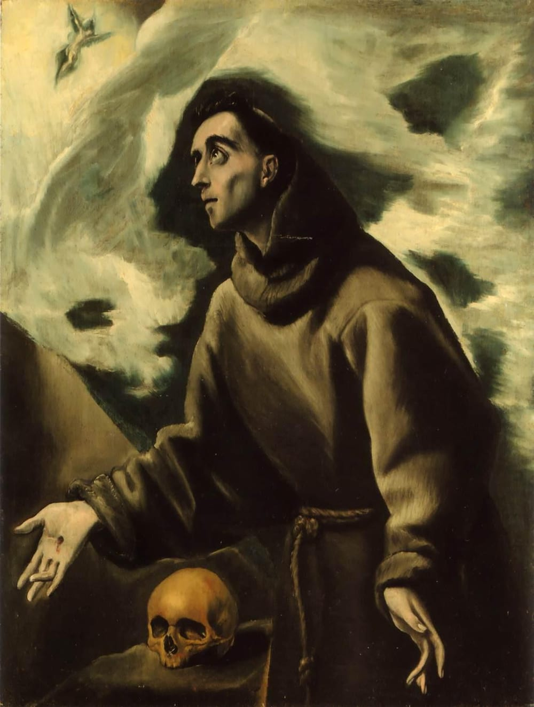
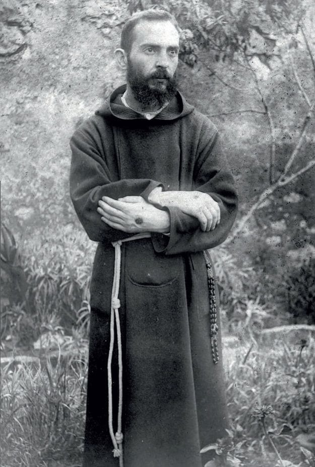
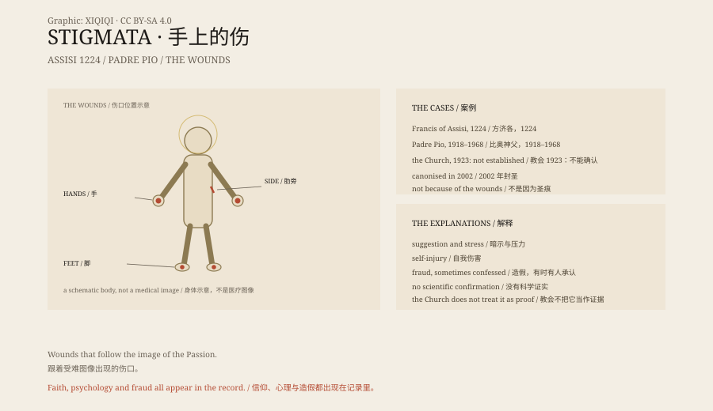

## 一、1224 年

意大利，阿西西附近的拉维纳山。方济各在祈祷。

那一年他四十二岁，几年前刚从圣地回来。他上山是为了守四十天斋。山很高，岩石裸露，雾从山谷里升上来。

一天早晨，接近十字架升高的节期，他说自己看见一个六翼的天使。天使张开翅膀，像基督被钉在十字架上。

方济各又喜又怕。天使消失后，他的手上和脚上出现了像钉子一样的伤口；肋旁也有一道伤，像被长矛刺过。

这是基督教历史上最早被广泛记录的圣痕。

*历史画作：乔托《圣方济各接受圣痕》，约 1295–1300 年，卢浮宫。公有领域（Wikimedia Commons）。画中六翼天使向方济各显现，伤口出现在他的手、脚和肋旁。*

## 二、什么是圣痕

“圣痕”（stigmata）来自希腊语 stigma，意思是印记、烙印。

在天主教传统里，它指身上出现与基督受难相对应的伤口：手腕和脚上的钉伤、肋旁的长矛伤，有时还有额头的荆棘痕、背上的鞭伤。有的案例还报告“血泪”或“汗血”。

这不是一个统一的医学诊断，而是一组现象。伤口的位置、形状、持续时间、是否流血，每个案例都不一样。

已知最早的候选案例，是七世纪鲁昂的圣安斯伯特（St. Ansbert）。他死后，目击者说他身上有伤，八世纪的一位匿名修士把这件事写进了传记。但在他之前，教会对“圣痕”这个概念还没有明确的说法。方济各通常被认为是第一个被广泛记录的圣痕者。

一个统计上的事实常被忽略：圣痕者绝大多数是女性。十九世纪法国医生安贝尔-古贝雷（Antoine Imbert-Goubeyre）编了一份从十三世纪到他那个时代的名单，280 名女性，41 名男性，女性占 87%。2019 年安特卫普大学的数据库收录 244 人，92% 是女性。

## 三、方济各

方济各的伤口，在他死后两天被很多人看过。

他的第一位传记作者切拉诺的托马斯（Thomas of Celano）在 1230 年的《圣方济各传》里写道：钉子一样的痕迹出现在他的手和脚上，手掌一面是圆的，另一面是长的；伤口里突出的小肉块，像弯过来的钉尖。他的右肋有一道大伤口，常常流血，把内衣和裤子都浸透。

方济各的身体一直不好。他眼睛有病，后来几乎失明；他还有疟疾，常发高烧。1935 年，医生爱德华·哈通（Edward Frederick Hartung）提出一个解释：方济各患的可能是沙眼和四日疟，疟疾引起的皮下出血（紫癜）可能被他自己抓破，形成了像圣痕一样的伤口。

1987 年，又有人提出他可能患了麻风。

这些解释都不能完全对上伤口的位置和形状。但它们提醒我们：方济各是一个病人，不是一个透明的神迹展示板。

方济各死于 1226 年。他死时身上还带着伤。

*历史画作：埃尔·格列柯《圣方济各接受圣痕》，约 1585–1590 年。公有领域（Wikimedia Commons）。方济各仰头看着天使，手上有发光的伤口。*

## 四、比奥神父

二十世纪最有名的圣痕案例，是意大利的比奥神父（Padre Pio of Pietrelcina）。

1918 年 9 月 20 日，他在圣乔瓦尼·罗通多的修道院里祈祷，手上出现伤口。此后五十年，伤口一直在。

医生检查过，意见不一。巴列塔市立医院的主治医生路易吉·罗曼内利（Luigi Romanelli）观察了大约一年；医生安杰洛·梅拉（Angelo Maria Merla）认为不是结核，但不敢下结论；外科医生乔治·费斯塔（Giorgio Festa）在 1920 年和 1925 年两次检查。有人说是无法解释，有人说是自我暗示，有人怀疑他用石炭酸维持伤口。

1922 年，医生阿戈斯蒂诺·杰梅利（Agostino Gemelli）去看他，但没有得到宗教裁判所的许可，不能直接检查伤口。杰梅利后来写道：比奥是一个歇斯底里者，伤口是自己造成的。

历史学家塞尔吉奥·卢扎托（Sergio Luzzatto）找到一份 1919 年的证词：当地药房的人说，年轻的比奥买过石炭酸和大量藜芦碱，没有处方。比奥的解释是，石炭酸用来消毒注射器；藜芦碱是别人和他开玩笑，混在鼻烟里，让他打喷嚏，他买来是为了报复。

比奥神父很少让人看伤口。他戴无指手套，用布包着手。对信徒来说，这是谦卑；对怀疑者来说，这是遮掩。

他在 1968 年去世。去世时，伤口消失了，皮肤上没有明显的伤痕。负责拍照的修士说，左掌上只看到一个小疤和一点痕迹。

2002 年，他被封圣。封圣依据的是他的德行和所谓的奇迹，不是圣痕。教会从来没有把圣痕本身当作封圣的证据。

*历史照片：1919 年的比奥神父，手上可见圣痕。公有领域（Wikimedia Commons）。他后来一直戴无指手套，遮住伤口。*

## 五、医学

现代医学对圣痕有一些解释，但没有一个能覆盖全部案例。

第一类是造假。十六世纪西班牙修女玛格达莱娜·德·拉·克鲁斯（Magdalena de la Cruz）在死前承认，她的圣痕是自己弄出来的。她用针和其他工具制造伤口，维持了很多年。

第二类是自我伤害。极端的宗教沉浸、暗示、心理压力，可能让人不自觉地抓伤自己，或者在仪式中把自己弄伤。饥饿、禁食和分离性精神状态，也被认为与自我伤害有关。厌食症患者有时会出现类似仪式性的自伤。

第三类是疾病。哈通提出的疟疾紫癜说，是一种尝试；1987 年的麻风说，是另一种。这些解释都只能对应部分症状。

第四类是心理机制。2002 年，一项针对德国圣痕者特蕾莎·诺伊曼（Therese Neumann）的精神分析研究认为，她的伤口来自创伤后应激，通过异常自我暗示，表现为无意识的自我伤害。

医学界没有承认过任何一例“超自然圣痕”。但医学界也无法证明每一例都是假的。

## 六、为什么

圣痕之所以持续出现，可能不只是因为信仰。

在一个把基督受难作为核心图像的文化里，身体会成为表达痛苦的语言。伤口是一种声明：我在这里，我看见了，我参与了他的痛苦。

神学家伊万·伊里奇（Ivan Illich）在《好客与痛苦》里写道：与基督的共情，是信仰如此强烈、如此深入肉身，以至于人把自己所凝视的痛苦，变成了自己身上的痛苦。

民俗学家和怀疑论者则看到另一面。

特德·哈里森（Ted Harrison）在《圣痕：现代的中世纪现象》里研究了当代案例，没有找到超自然证据，但他也认为，并非所有圣痕都是骗局。有的人是出于虔诚，自己弄伤自己；有的人是意外受伤，被旁人当成了圣痕。人的伤口可以引来真实的宗教反应。

调查者乔·尼克尔（Joe Nickell）更直接：他调查过的案例，与造假无法区分。

## 七、手

今天，圣痕仍然有人报告。

据法国历史学家的研究，近一百多年里，全世界记录到大约 200 名圣痕者。大多数人活到老年，没有特别的健康问题。1997 年，被天主教会封为圣人的圣痕者只有 7 位。

教会谨慎地调查，医学界继续怀疑。

方济各的手上，后来长出了肉垫一样的组织。他走路困难，眼睛几乎失明。他死的时候，身上还带着那些伤。

八百年过去了，人们还在争论：那些伤是从哪里来的。

*原创示意图：方济各、比奥神父与医学解释的分层。不是医疗照片。稀奇奇编辑部，CC BY-SA 4.0。*

---

**来源与许可**：本文的事实来源见条目底部来源台账 S1–S6。文字与原创示意图采用 CC BY-SA 4.0。文中把宗教传统、个案记录、教会立场与医学解释分开叙述；圣痕没有被科学证实为超自然现象，也没有被完全归为造假。插图是历史画作、历史照片、场景复原与示意图，不是医疗照片。
