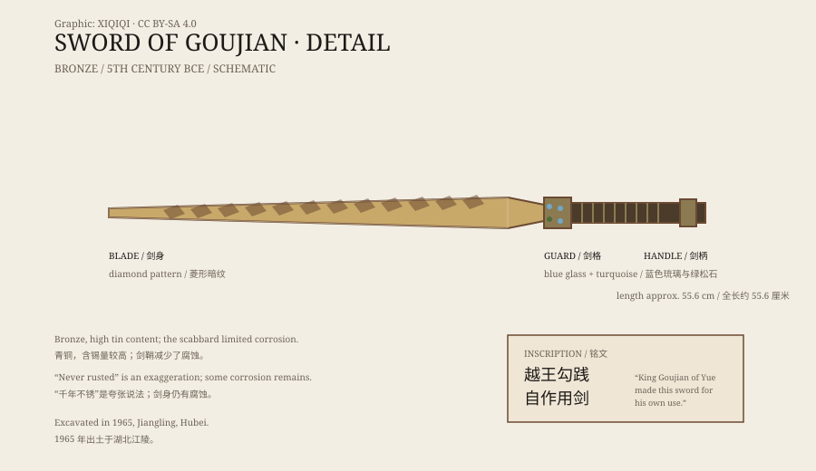

## 1. The tomb of 1965

In 1965, archaeologists excavated a Warring States tomb at Wangshan in Jiangling, Hubei.

Inside was a bronze sword in a lacquered wooden scabbard. By the time it was found, the scabbard had decayed, but the sword was still inside.

When it was cleaned, the blade emerged: long, straight, with a dark diamond pattern on the surface and two lines of bird-script inscription near the guard.

## 2. The sword

The sword is about 55 centimetres long. The guard is inlaid with blue glass and turquoise.

The edge is thin and remarkably well preserved. When excavated, it was still sharp enough to cut paper, and the diamond pattern had not flaked away.

It is now one of the signature objects of the Hubei Provincial Museum.

*Original schematic: the blade, guard, and position of the eight-character inscription on the Sword of Goujian. Not a photograph of the object. Oddity Archive, CC BY-SA 4.0.*

## 3. The eight characters

The inscription is in bird script. It reads:

“King Goujian of Yue made this sword for his own use.”

Goujian was a ruler of Yue in the late Spring and Autumn period. Defeated by King Fuchai of Wu, he endured humiliation and planned his revenge; he eventually destroyed Wu. This was his personal sword.

## 4. Why it is still sharp

“It never rusted” is a common claim, but it is not quite accurate.

Bronze does not rust the way iron does. Bronze is an alloy of copper and tin. Buried in soil, it forms a stable patina, but it does not corrode all the way through like iron rust.

Several things helped this sword: the scabbard kept out some air and moisture; the tomb environment was relatively stable; the blade has a high tin content, making the surface harder and more corrosion-resistant; and it was conserved promptly after excavation.

So it did not avoid corrosion entirely. It corroded very slowly in a favourable burial environment.

## 5. How did it reach Chu?

Why would a sword of the king of Yue be found in a Chu tomb?

There are several possibilities.

First, it may have been war booty. Yue and Chu fought, and a Chu soldier or noble may have captured it.

Second, it may have been a gift. Marriage alliances, treaties, and exchanges of objects were common in the Spring and Autumn and Warring States periods.

Third, it may have passed into a Chu noble's hands through trade or reward and been buried with him.

The identity of the tomb owner is debated. What is clear is that the sword's manufacture and inscription point to Goujian of Yue, while its final burial place was in Chu.

## 6. Now

The Sword of Goujian is one of the most popular objects in the Hubei Provincial Museum.

It sits in a climate-controlled case. Under the lights, the dark pattern on the blade shifts in tone. More than two thousand years later, it still looks like a weapon just drawn from its sheath.

---

**Sources and licenses**: the factual sources are listed in the source ledger S1–S3 at the bottom of this entry. Text and original diagrams are licensed under CC BY-SA 4.0. This article separates the excavation record, the inscription, the reasons for its preservation, and the speculation about how it reached Chu; “never rusted” is an exaggeration, and the blade shows normal bronze corrosion.
