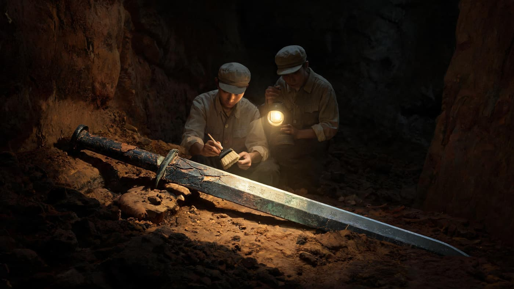
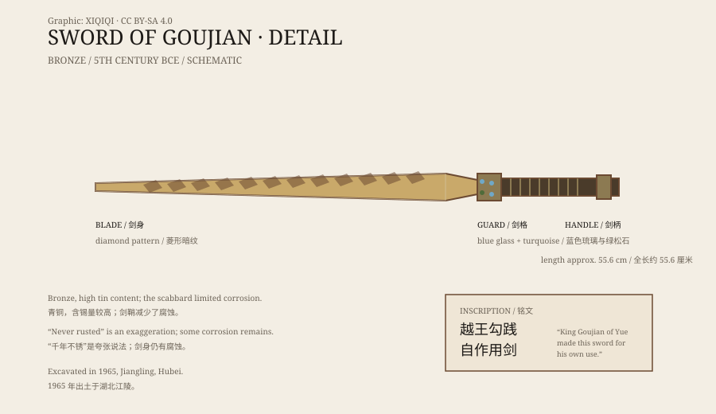

## 1. The tomb of 1965

In 1965, archaeologists excavated a Warring States tomb at Wangshan in Jiangling, Hubei.

Inside was a bronze sword in a lacquered wooden scabbard. By the time it was found, the scabbard had decayed, but the sword was still inside.

The tomb chamber was dark, and the lacquer on the scabbard had begun to lift. When the archaeologists lifted it from the earth, the first thing they saw was the hilt, not the blade.

When it was cleaned, the blade emerged: long, straight, with a dark diamond pattern on the surface and two lines of bird-script inscription near the guard.

*Reconstruction: the Sword of Goujian in the Chu tomb at Jiangling, 1965. Not a photograph of the object. Oddity Archive, CC BY-SA 4.0.*

## 2. The sword

The sword is about 55 centimetres long. The guard is inlaid with blue glass and turquoise.

The edge is thin and remarkably well preserved. When excavated, it was still sharp enough to cut paper, and the diamond pattern had not flaked away.

This is not the sharpness of a freshly ground blade. It is what bronze looks like when it has been kept in an oxygen-poor, stable environment.

It is now one of the signature objects of the Hubei Provincial Museum.

*Original schematic: the blade, guard, and position of the eight-character inscription on the Sword of Goujian. Not a photograph of the object. Oddity Archive, CC BY-SA 4.0.*

## 3. The eight characters

The inscription is in bird script. It reads:

“King Goujian of Yue made this sword for his own use.”

Eight characters turn a weapon into a person: a ruler who was defeated, and who later took his revenge.

Goujian was a ruler of Yue in the late Spring and Autumn period. Defeated by King Fuchai of Wu, he endured humiliation and planned his revenge; he eventually destroyed Wu. This was his personal sword.

## 4. Why it is still sharp

“It never rusted” is a common claim, but it is not quite accurate.

Bronze does not rust the way iron does. Bronze is an alloy of copper and tin. Buried in soil, it forms a stable patina, but it does not corrode all the way through like iron rust.

Several things helped this sword: the scabbard kept out some air and moisture; the tomb environment was relatively stable; the blade has a high tin content, making the surface harder and more corrosion-resistant; and it was conserved promptly after excavation.

So it did not avoid corrosion entirely. It corroded very slowly in a favourable burial environment.

## 5. How did it reach Chu?

Why would a sword of the king of Yue be found in a Chu tomb?

There are several possibilities.

First, it may have been war booty. Yue and Chu fought, and a Chu soldier or noble may have captured it.

Second, it may have been a gift. Marriage alliances, treaties, and exchanges of objects were common in the Spring and Autumn and Warring States periods.

Third, it may have passed into a Chu noble's hands through trade or reward and been buried with him.

The identity of the tomb owner is debated. What is clear is that the sword's manufacture and inscription point to Goujian of Yue, while its final burial place was in Chu.

## 6. Now

The Sword of Goujian is one of the most popular objects in the Hubei Provincial Museum.

It sits in a climate-controlled case. Under the lights, the dark pattern on the blade shifts in tone. More than two thousand years later, it still looks like a weapon just drawn from its sheath.

## Cemetery No. 1

The Viet Nam king has sabered the earth in the tomb of Chu, the mausoleum of Lake North River.

In 1965, the archaeology team found a box of swords in the grave. The sword was placed in the box, the body was almost complete, and the blade was painted with traces of wood. The master of the grave was not a conjure, but a noble or an official of Chu.

Why is a Viet Nam sword buried in Chu's grave? The most common explanation is spoils, gifts of marriage or diplomatic gifts. The country's relations with Chu are complex, fought and united. The sword can be taken away as a spoil or sent away as a gift.

## A diamond shadow

The sword has the rules of the diamond shadow.

These are not painted, but the fabrics of the metal tissue itself. The researchers look with microscopes and find that the tin content of the dark zone is high, different from the gold surrounding it. When casting, the craftsmen may use different alloys, different grinding methods, to form layers of the surface.

This process is called "composite metal" or "surface alloyation". It requires precise temperature, time and material control.

## Birdbird Book

The eight words on the sword are “the Viet King's knitting, self-acting swords”.

The word is a book of birds, a highly decorative bronze. The pen is like a bird, a worm, curled, stretched, and in some cases decorated. It is not a daily writing, but a "magic word" for weapons and rituals.

These eight words make the identity of the sword certain. Without an inscription, it is only a fine bronze sword; with it, it becomes a sword to thee.

## Why is it sharp?

When the sword came out of the ground, it was said to be capable of cutting fingers.

It is not rusty for a number of reasons: bronze itself is resistant to corrosion; the blades and swordcases separate it from the outside world; the graveyards are stable in the environment, with few moisture and oxygen; and the tin layers on the surface of the sword are also protective.

"No rust" is a relative term. The sword is rusty, but not rusty enough to destroy it. It's well preserved, but it's not new.

## Now

The Viet Wang's sword is now one of the treasures of the town halls of the Hubei Museum.

It is not often shown abroad because bronze swords are sensitive to humidity, vibrations, and light. When displayed, the booths are designed to control temperature control wet, and the lights filter ultraviolet.

A sword, from the cross-country battlefield, to the grave of Chu, to the museum's exhibition cabinet. It travels longer than its master.

## Swordstick

When the sword comes out of the ground, it is placed in a wooden box.

The sword box is corrupted, but the shape is still there. The blade is painted, with the edges, with the metal buttons. The sword is in the scaffold, the scaffold in the box, the box in the grave. The fourth layer is protected, and the sword is protected from water and air.

When the archaeology team opened the box, the sword was almost complete. There were two bumps on the handles of the sword, tied to the ropes. The sword was loaded with blue lily and green pine stones.

## An inscription

The eight words are also controversial.

Some say that the word is “the sword of the Viet Nam King”; others say that the last word is not the sword, but the “sword” or the “sword of the sword”. The sequence and interpretation of the words are different and divergent among scholars.

But the word "the Viet King" is basically uncontroversial. The master of the sword is the King of the Viet Nam. The inscription has changed the sword from an ancient sword to a named instrument.

## Copy

The researchers tried to copy this sword.

They use bronze, tin, and lead, which are made at the time of the match, and are then treated with the diamond shadow and surface. The replicas can be similar, but it is difficult to do exactly the same metal tissue.

The idea of copying experiments is not to build a fake sword, but to understand the process. Each failure shows what the craftsman at the time solved.

---

**Sources and licenses**: the factual sources are listed in the source ledger S1–S3 at the bottom of this entry. Text and original diagrams are licensed under CC BY-SA 4.0. This article separates the excavation record, the inscription, the reasons for its preservation, and the speculation about how it reached Chu; “never rusted” is an exaggeration, and the blade shows normal bronze corrosion.
