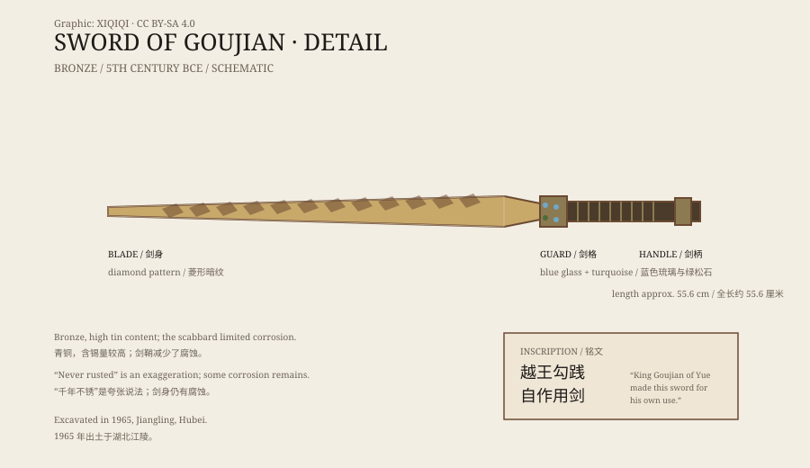

## 一、1965 年的墓

1965 年，湖北江陵望山，考古人员清理了一座战国时期的楚墓。

墓里有一把装在漆木剑鞘里的青铜剑。剑出土时，鞘身已经朽坏，但剑还在里面。

清理之后，剑身露了出来：细长、笔直，表面有深色的菱形暗纹，靠近剑格的地方刻着两行鸟篆铭文。

## 二、剑的样子

这把剑全长约五十五厘米，剑身修长，剑格（护手）上镶嵌着蓝色琉璃和绿松石。

剑刃很薄，保存得相当完整。出土时，刃部仍然锋利，能划开纸张；剑身的菱形暗纹也没有大面积脱落。

它现在藏在湖北省博物馆，是那里的代表性文物之一。

*原创示意图：越王勾践剑的剑身、剑格与八字铭文位置。不是文物照片。稀奇奇编辑部，CC BY-SA 4.0。*

## 三、八个字

铭文是鸟篆，读作：

“越王勾践，自作用剑。”

意思是：越王勾践为自己铸造的剑。

勾践是春秋晚期越国的君主。他被吴王夫差打败后，卧薪尝胆，最终灭吴。这把剑，就是他的佩剑。

## 四、为什么还锋利

“千年不锈”是一个常见的说法，但不完全准确。

青铜不会像铁那样生锈。青铜是铜和锡的合金，埋在土里会形成一层稳定的锈色，但不会像铁锈那样一路腐蚀到内部。

这把剑能保存得这么好，有几个原因：剑鞘隔绝了部分空气和水分；墓葬环境相对稳定；剑身含锡量较高，表面更硬、更耐腐蚀；再加上出土后及时保护。

所以，它不是“不会腐蚀”，而是在一个合适的埋藏环境里，腐蚀得非常慢。

## 五、它怎么到了楚国

一个越王的剑，为什么会出现在楚墓里？

有几种可能。

第一，它可能是战利品。越国和楚国之间有过战争，楚人可能缴获了这把剑。

第二，它可能是礼物。春秋战国时期，各国之间联姻、结盟、赠送器物很常见。

第三，它可能是陪葬品，通过交易或赏赐流入楚国贵族手中。

墓主人具体是谁，学界有不同看法。能确认的是：这把剑的制作年代和铭文指向越王勾践，而它最后的埋藏地在楚国。

## 六、现在

越王勾践剑是湖北省博物馆最受欢迎的展品之一。

它被放在恒温恒湿的展柜里，灯光打上去，剑身的暗纹会显出深浅不同的光泽。两千多年过去，它仍然像一件刚刚出鞘的兵器。

---

**来源与许可**：本文的事实来源见条目底部来源台账 S1–S3。文字与原创示意图采用 CC BY-SA 4.0。文中把出土记录、铭文释读、保存原因与流传猜测分开叙述；“千年不锈”是夸张说法，剑身仍有正常的青铜腐蚀。
