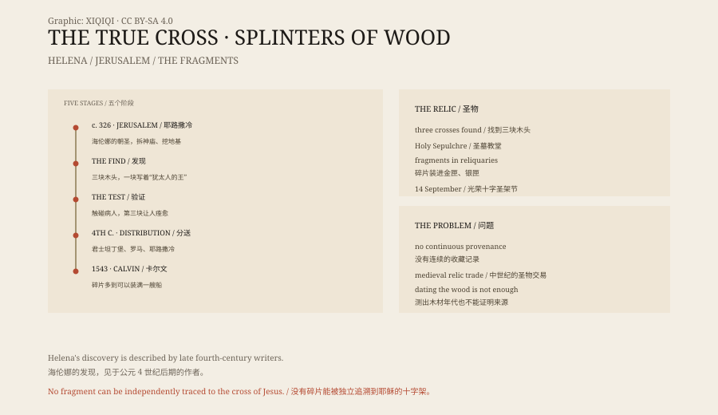

## 1. Helena

Helena was the mother of the Roman emperor Constantine.

She came from a modest background, said to have worked as an inn servant in her youth, and became the consort of Constantine's father, Constantius. When Constantine came to power he gave her the title Augusta.

Around 326 CE, when she was about eighty, she set out for Jerusalem.

## 2. Three pieces of wood

Jerusalem was already a Christian holy place.

Tradition says Helena had a Roman temple on Golgotha demolished and the ground beneath it excavated. She found three pieces of wood, and a board bearing the words “Jesus of Nazareth, King of the Jews”.

Which of the three was the true cross?

The legend supplies a test. The pieces were touched in turn to a seriously ill person. The first two had no effect. The third cured the patient. That piece was taken to be the True Cross.

## 3. Distribution

Helena divided the cross.

One part was sent to Constantine in Constantinople, one stayed in Jerusalem, and another was said to have been taken to Rome. The Jerusalem portion was placed in the Church of the Holy Sepulchre.

The church was built on Constantine's orders over Golgotha and the tomb. Today it contains a Chapel of St Helena, traditionally the place where she found the cross.

## 4. Fragments

In the Middle Ages fragments of the True Cross became the most sought-after relics in Europe.

Churches, monasteries and royal collections all wanted a piece. Fragments were set in gold and silver reliquaries, in cross-shaped cases, with labels recording their origin, and passed down for generations.

Some fragments are only a few millimetres long. Some were set inside larger crosses. Some were lost in wars, fires and revolutions, and reappeared somewhere else.

## 5. Calvin's complaint

In the sixteenth century the reformer John Calvin wrote a treatise on relics.

He counted the fragments claimed as the True Cross across Europe and concluded that if they were put together they would fill a ship.

His argument was simple: Jesus was crucified on one cross, so there could not be this much wood. He treated the fragments as evidence of greed and superstition in the church.

## 6. Testing

Can the fragments be tested scientifically?

In theory, the age and species of the wood can be measured. In practice, almost no fragment can be traced to a secure origin. Most have no continuous record of ownership, and many were repackaged in the Middle Ages.

Even if a piece of wood dates from the first century, that does not prove it came from that cross. Jerusalem had plenty of wood, and plenty of crosses.

## 7. Now

Fragments of the True Cross are still kept in churches across Europe and the Near East.

On 14 September the Catholic Church celebrates the Exaltation of the Holy Cross, commemorating Helena's discovery and the recovery of the cross. For believers, whether a fragment is “true” is ultimately a matter of faith, not carbon dating.

For historians, it is a story about relics, power and piety. One piece of wood was cut into countless pieces and became a network of belief across medieval Europe.

*Original schematic: Helena's discovery, the distribution of the cross and the spread of fragments. Not a photograph of the object. Oddity Archive, CC BY-SA 4.0.*

---

**Sources and licenses**: the factual sources are listed in the source ledger S1–S3 at the bottom of this entry. Text and original diagrams are licensed under CC BY-SA 4.0. This article separates the tradition of Helena's discovery, the distribution of fragments and Calvin's criticism; no fragment can be independently proved to come from the cross of Jesus. The illustration is a scene reconstruction, not a photograph of the object.
