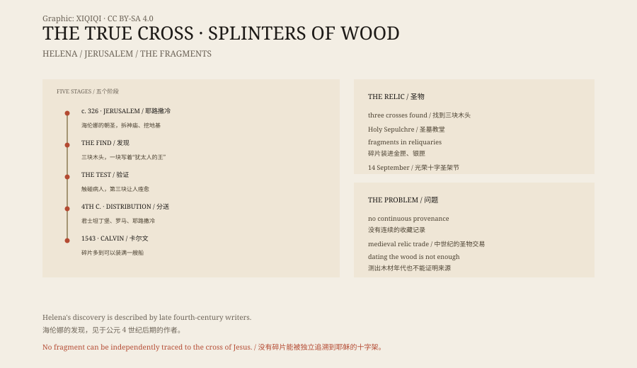

## 一、海伦娜

海伦娜是罗马皇帝君士坦丁的母亲。

她出身不高，年轻时做过旅店女仆，后来成为君士坦丁的父亲君士坦提乌斯的伴侣。君士坦丁掌权后，给了她“奥古斯塔”的头衔。

公元 326 年前后，她已经八十岁左右，出发去了耶路撒冷。

## 二、三块木头

当时的耶路撒冷，已经是基督教圣地。

传统说，海伦娜让人拆掉建在各各他上面的一座罗马神庙，往下挖。她找到了三块木头，还有一块写着“拿撒勒人耶稣，犹太人的王”的牌子。

三块木头，哪一块是真的？

传说给出了一个办法：把它们依次碰到一个重病的人身上。前两块没有反应，第三块让人痊愈了。于是，这一块被认作真十字架。

## 三、分送

海伦娜把十字架分成几份。

一份送到君士坦丁堡给君士坦丁，一份留在耶路撒冷，还有一份据说带到了罗马。耶路撒冷的那一份，被放在圣墓教堂里。

圣墓教堂是君士坦丁下令建的，建在各各他和耶稣墓的上方。今天，教堂里还有一个“圣海伦娜小堂”，传说是她发现十字架的地方。

## 四、碎片

中世纪，真十字架的碎片成了最抢手的圣物。

教堂、修道院、王室收藏都想有一块。碎片被装进金匣、银匣、十字形圣物盒，写上来源，代代相传。

有些碎片很小，只有几毫米。有些被镶在更大的十字架里。有些在战争、火灾和革命中丢失，又出现在另一个地方。

## 五、卡尔文的抱怨

16 世纪，宗教改革家约翰·卡尔文写了一篇《论圣物》。

他数了数当时欧洲各地声称是真十字架的碎片，得出结论：如果把这些木头拼起来，可以装满一艘船。

卡尔文的论点很简单：耶稣只被钉死在一个十字架上，不可能有这么多木头。他把这当成教会贪财和迷信的证据。

## 六、检验

真十字架的碎片，能不能用科学检验？

理论上，可以测木材的年代和种类。但实际上，几乎没有人能确定某一块碎片的来源。它们大多没有连续的收藏记录，很多是在中世纪被重新包装过的。

即使某块木头是公元 1 世纪的，也不能证明它就来自那个十字架。耶路撒冷当时有很多木头，很多十字架。

## 七、现在

今天，真十字架的碎片仍然保存在欧洲和近东的许多教堂里。

9 月 14 日，天主教会庆祝“光荣十字圣架节”，纪念海伦娜的发现和十字架的找回。对信徒来说，碎片是不是“真”的，最终不是靠碳十四，而是靠信仰。

对历史学家来说，这是一段关于圣物、权力和虔诚的故事。一块木头，被切成无数块，变成了整个中世纪欧洲的信仰网络。

*原创示意图：海伦娜的发现、分送与碎片流传路径。不是文物照片。稀奇奇编辑部，CC BY-SA 4.0。*

## 海伦娜

真十字架的故事，从君士坦丁的母亲海伦娜开始。

传说她在 326 年左右到耶路撒冷，寻找耶稣受难的地点。她让人挖开一座罗马神庙的地基，找到了三个十字架。为了判断哪一个是真十字架，她把它们分别碰到一个病人，病人碰到第三个时痊愈了。

这个故事最早出现在几百年后的文献里。同时代的记录没有这么详细。海伦娜确实去过耶路撒冷，也确实支持了当地的教堂建设，但“找到三个十字架”是后来的叙述。

## 分送

真十字架被发现后，被分成很多块，送往各地的教堂。

耶路撒冷保留了一部分，君士坦丁堡保留了一部分，罗马也有一块。中世纪的朝圣者把小块十字架带回欧洲，放进教堂的圣物箱。每一次分送，都会产生新的碎片。

碎片越多，问题越明显：一棵十字架，怎么能分出这么多块？

## 卡尔文

十六世纪的宗教改革家约翰·加尔文，写过一篇著名的批评。

他说，如果把所有声称是真十字架的碎片收集起来，足够装满一船。他的意思不是否认耶稣受难，而是批评圣物崇拜：碎片变成了商品，信仰变成了交易。

加尔文的批评，今天仍然有效。圣物市场里，真伪难辨，故事比木头更值钱。

## 检验

科学家试过用放射性碳定年。

但圣物碎片通常很小，取样会破坏文物。而且，木头可能被后来的人处理过，表面的涂层和保存材料会影响结果。碳定年能给出木头的年龄，不能证明它来自哪一棵树。

罗马有一种标记，叫“ROMA”或“OPPOSE”。有人说，这是早期教会对圣物的认证；也有人说，这是后来加的。标签本身也需要鉴定。

## 现在

真十字架的碎片，仍然分布在欧洲的教堂和博物馆里。

它们大多很小，放在银盒、十字架或圣物箱里。信徒来看，看到的是木头；研究者来看，看到的是材料、年代和流传记录。

一个木头碎片，能不能承载两千年的信仰？这个问题没有科学答案。它属于信仰，不属于考古。

## 圣墓

耶路撒冷的圣墓教堂，建在传说中的各各他。

海伦娜下令修建教堂，君士坦丁支持。教堂后来被波斯人毁坏，又被十字军重建。今天的建筑，是多个时代叠加的结果。

真十字架的发现，和这座教堂绑在一起。没有教堂，就没有“找到十字架”的故事。地点、建筑和圣物，互相证明。

## 朝圣

中世纪的朝圣者，会带回一小块十字架。

他们把它放在银盒里，挂在脖子上，或者放进教堂的圣物箱。朝圣是一种旅行，也是一种消费。圣物是旅行的纪念品，也是信仰的证据。

朝圣者越多，碎片越多。教堂需要圣物来吸引人，圣物需要故事来证明自己。这是一个循环。

## 科学

科学能做的，很有限。

碳定年可以测木头的年龄，不能证明它属于耶稣。DNA 不能从死木里提取。历史文献可以追踪流传，不能证明神迹。

真十字架的问题，不是一个科学问题。它属于信仰，属于传统，属于一个两千年的故事。科学可以参与，但不能裁决。

---

**来源与许可**：本文的事实来源见条目底部来源台账 S1–S3。文字与原创示意图采用 CC BY-SA 4.0。文中把海伦娜的发现传统、碎片分送与卡尔文的批评分开叙述；没有一块碎片能被独立证明来自耶稣的十字架。插图是场景复原，不是文物照片。
