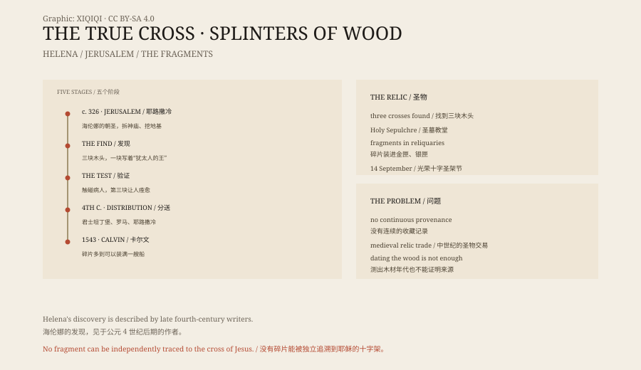

## 一、海伦娜

海伦娜是罗马皇帝君士坦丁的母亲。

她出身不高，年轻时做过旅店女仆，后来成为君士坦丁的父亲君士坦提乌斯的伴侣。君士坦丁掌权后，给了她“奥古斯塔”的头衔。

公元 326 年前后，她已经八十岁左右，出发去了耶路撒冷。

## 二、三块木头

当时的耶路撒冷，已经是基督教圣地。

传统说，海伦娜让人拆掉建在各各他上面的一座罗马神庙，往下挖。她找到了三块木头，还有一块写着“拿撒勒人耶稣，犹太人的王”的牌子。

三块木头，哪一块是真的？

传说给出了一个办法：把它们依次碰到一个重病的人身上。前两块没有反应，第三块让人痊愈了。于是，这一块被认作真十字架。

## 三、分送

海伦娜把十字架分成几份。

一份送到君士坦丁堡给君士坦丁，一份留在耶路撒冷，还有一份据说带到了罗马。耶路撒冷的那一份，被放在圣墓教堂里。

圣墓教堂是君士坦丁下令建的，建在各各他和耶稣墓的上方。今天，教堂里还有一个“圣海伦娜小堂”，传说是她发现十字架的地方。

## 四、碎片

中世纪，真十字架的碎片成了最抢手的圣物。

教堂、修道院、王室收藏都想有一块。碎片被装进金匣、银匣、十字形圣物盒，写上来源，代代相传。

有些碎片很小，只有几毫米。有些被镶在更大的十字架里。有些在战争、火灾和革命中丢失，又出现在另一个地方。

## 五、卡尔文的抱怨

16 世纪，宗教改革家约翰·卡尔文写了一篇《论圣物》。

他数了数当时欧洲各地声称是真十字架的碎片，得出结论：如果把这些木头拼起来，可以装满一艘船。

卡尔文的论点很简单：耶稣只被钉死在一个十字架上，不可能有这么多木头。他把这当成教会贪财和迷信的证据。

## 六、检验

真十字架的碎片，能不能用科学检验？

理论上，可以测木材的年代和种类。但实际上，几乎没有人能确定某一块碎片的来源。它们大多没有连续的收藏记录，很多是在中世纪被重新包装过的。

即使某块木头是公元 1 世纪的，也不能证明它就来自那个十字架。耶路撒冷当时有很多木头，很多十字架。

## 七、现在

今天，真十字架的碎片仍然保存在欧洲和近东的许多教堂里。

9 月 14 日，天主教会庆祝“光荣十字圣架节”，纪念海伦娜的发现和十字架的找回。对信徒来说，碎片是不是“真”的，最终不是靠碳十四，而是靠信仰。

对历史学家来说，这是一段关于圣物、权力和虔诚的故事。一块木头，被切成无数块，变成了整个中世纪欧洲的信仰网络。

*原创示意图：海伦娜的发现、分送与碎片流传路径。不是文物照片。稀奇奇编辑部，CC BY-SA 4.0。*

---

**来源与许可**：本文的事实来源见条目底部来源台账 S1–S3。文字与原创示意图采用 CC BY-SA 4.0。文中把海伦娜的发现传统、碎片分送与卡尔文的批评分开叙述；没有一块碎片能被独立证明来自耶稣的十字架。插图是场景复原，不是文物照片。
