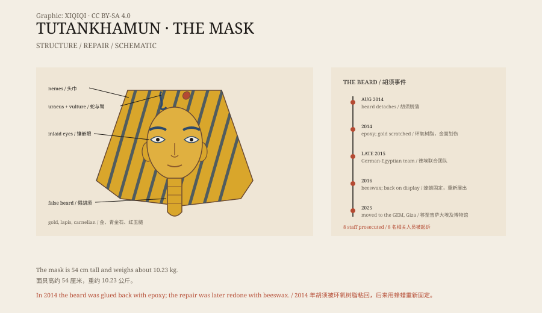

## 1. The tomb in 1925

On 28 October 1925, Howard Carter opened Tutankhamun's coffin.

The mask lay over the king's head and shoulders. The gold was bright, the eyes were inlaid with quartz and obsidian, and the eyebrows and eyeliner were dark blue glass. Carter later wrote that the face was calm, like a sleeping child.

Tutankhamun died at about eighteen or nineteen. He was not a famous pharaoh, and his tomb was small, but it had escaped robbery and its contents survived.

## 2. The mask

The mask is about 54 centimetres tall and weighs about 10.23 kilograms.

It was beaten from two layers of gold, with lapis lazuli, carnelian, quartz, and obsidian set into the face and headdress. The headdress is the striped nemes of a pharaoh, with a cobra and a vulture on the brow and a long false beard hanging from the chin.

In ancient Egypt, a mask was not decoration. It protected the face of the dead, helped the soul find its way, and kept the pharaoh looking like a king in the next world.

*Original schematic: the main parts of the mask and the repair of the beard in 2014–2016. Not a photograph of the object. Oddity Archive, CC BY-SA 4.0.*

## 3. The beard came off

In August 2014, the display case light at the Egyptian Museum needed repair.

Staff took the mask out of the case. While it was being moved, the beard on the chin came off.

What happened next turned into an accident. Staff reattached the beard with epoxy, a strong glue that sets fast and is almost impossible to dissolve. Too much was used; it spilled onto the mask, and when it dried, someone scraped it off with a tool, leaving scratches in the gold.

The museum did not announce the incident at once. Months later, photographs and reports came out, and the public reacted with anger. Egypt's antiquities ministry opened an investigation, and eight people were prosecuted.

## 4. The repair

At the end of 2015, a German-Egyptian conservation team began work on the mask.

They did not attack the epoxy with solvents. They warmed it to soften it and removed it piece by piece with wooden tools. Once the glue was gone, the beard was fixed with beeswax, a natural material the ancient Egyptians themselves had used.

The mask went back on display. The beard was in place, but the fine scratches on the gold could not be completely removed.

## 5. The curse

After Tutankhamun's tomb was opened, its patron Lord Carnarvon died in 1923.

The newspapers linked his death to the “curse of the pharaohs”. A clay tablet was said to have been found in the tomb, warning that death would come to anyone who disturbed the king's rest.

There is no reliable record of such a tablet. Carnarvon had been bitten by a mosquito; the wound became infected and led to pneumonia. Many members of the excavation team lived to old age. The curse story spread widely, but there is no evidence for it.

## 6. Now

In October 2025, the mask was moved from the Egyptian Museum in Cairo to the Grand Egyptian Museum in Giza.

It has a gallery of its own. The light is low, and the mask is lit separately. Visitors look at it through glass and move on quickly.

A king who died at eighteen or nineteen still has a gold face three thousand years later. Someone broke his beard while fixing a lamp and glued it back with the wrong adhesive. Those marks are now part of its history too.

---

**Sources and licenses**: the factual sources are listed in the source ledger S1–S3 at the bottom of this entry. Text and original diagrams are licensed under CC BY-SA 4.0. This article separates the excavation record, the structure of the mask, the repair accident, and the curse legend; there is no reliable evidence for the “curse”, and the scratches on the mask cannot be fully repaired.
