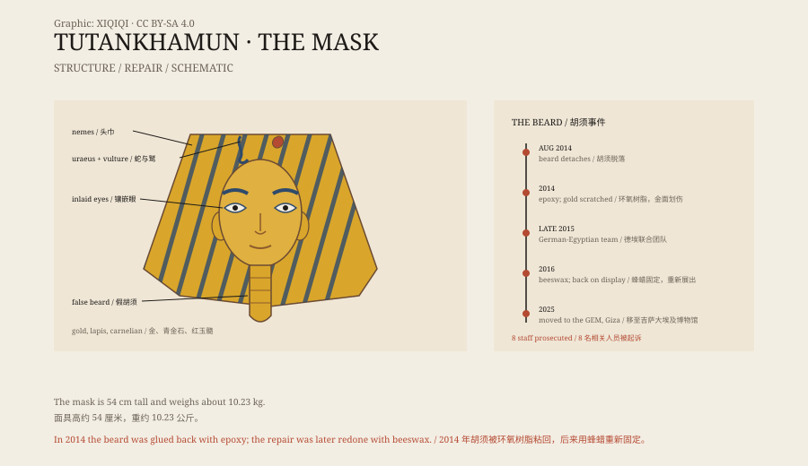

## 1. The tomb in 1925

On 28 October 1925, Howard Carter opened Tutankhamun's coffin.

The mask lay over the king's head and shoulders. The gold was bright, the eyes were inlaid with quartz and obsidian, and the eyebrows and eyeliner were dark blue glass. Carter later wrote that the face was calm, like a sleeping child.

Tutankhamun died at about eighteen or nineteen. He was not a famous pharaoh, and his tomb was small, but it had escaped robbery and its contents survived.

## 2. The mask

The mask is about 54 centimetres tall and weighs about 10.23 kilograms.

It was beaten from two layers of gold, with lapis lazuli, carnelian, quartz, and obsidian set into the face and headdress. The headdress is the striped nemes of a pharaoh, with a cobra and a vulture on the brow and a long false beard hanging from the chin.

In ancient Egypt, a mask was not decoration. It protected the face of the dead, helped the soul find its way, and kept the pharaoh looking like a king in the next world.

*Original schematic: the main parts of the mask and the repair of the beard in 2014–2016. Not a photograph of the object. XIQIQI Editorial, CC BY-SA 4.0.*

## 3. The beard came off

In August 2014, the display case light at the Egyptian Museum needed repair.

Staff took the mask out of the case. While it was being moved, the beard on the chin came off.

What happened next turned into an accident. Staff reattached the beard with epoxy, a strong glue that sets fast and is almost impossible to dissolve. Too much was used; it spilled onto the mask, and when it dried, someone scraped it off with a tool, leaving scratches in the gold.

The museum did not announce the incident at once. Months later, photographs and reports came out, and the public reacted with anger. Egypt's antiquities ministry opened an investigation, and eight people were prosecuted.

## 4. The repair

At the end of 2015, a German-Egyptian conservation team began work on the mask.

They did not attack the epoxy with solvents. They warmed it to soften it and removed it piece by piece with wooden tools. Once the glue was gone, the beard was fixed with beeswax, a natural material the ancient Egyptians themselves had used.

The mask went back on display. The beard was in place, but the fine scratches on the gold could not be completely removed.

## 5. The curse

After Tutankhamun's tomb was opened, its patron Lord Carnarvon died in 1923.

The newspapers linked his death to the “curse of the pharaohs”. A clay tablet was said to have been found in the tomb, warning that death would come to anyone who disturbed the king's rest.

There is no reliable record of such a tablet. Carnarvon had been bitten by a mosquito; the wound became infected and led to pneumonia. Many members of the excavation team lived to old age. The curse story spread widely, but there is no evidence for it.

## 6. Now

In October 2025, the mask was moved from the Egyptian Museum in Cairo to the Grand Egyptian Museum in Giza.

It has a gallery of its own. The light is low, and the mask is lit separately. Visitors look at it through glass and move on quickly.

A king who died at eighteen or nineteen still has a gold face three thousand years later. Someone broke his beard while fixing a lamp and glued it back with the wrong adhesive. Those marks are now part of its history too.

## Tomb

In 1925, Howard Carter opened Tutankhamun's tomb in the Valley of the Kings.

The mask was placed over the mummy's head, facing upward. It is made of gold leaf and inlaid with glass, lapis lazuli, turquoise and carnelian. Weighs more than ten kilograms.

The mask is not a separate piece of art, it is part of the funeral. It covers the face and accompanies the deceased into another world. Its eyes are painted with black and white eyeliner, like the eyes of a living person.

## Material

The main material of the mask is gold.

The gold leaf is supported by plaster and wood. The gold content in different parts is not exactly the same, some are of higher purity and some have more alloys. The inlaid stones are also particular: lapis lazuli comes from Afghanistan, turquoise comes from Sinai, and carnelian comes from the eastern desert of Egypt.

These materials show that Egypt's trade network was farther than many people imagined. A pharaoh's funeral included stones from several countries.

## Beard

The mask has a fake beard on its chin.

In 2014, museum staff broke the beard while transporting it. The accident was filmed and became international news. The restorer used epoxy to glue the beard back on, but it left a noticeable mark.

Later restoration teams reworked the process, removing the epoxy and replacing it with more suitable materials. The mask was put back into the display case, but the accident became a negative example of cultural relic protection.

## Repair

Mask repair is not just about gluing the broken parts back together.

The gold foil is very thin and easily deformed; the inlaid stones will loosen; ordinary cleaners cannot be used to remove dust on the surface. Restorers use microscopes, soft brushes and custom tools.

Every repair will leave a record: what materials were used, what treatment was done, and which areas were left untouched. These records are more important than the restoration itself, because subsequent researchers will need to know which parts were original and which were interventions.

## Now

The Tutankhamun mask is on display at the Egyptian Museum in Cairo.

It doesn’t go abroad often. In 2019, it was scheduled to be exhibited in Germany, but was later canceled due to a restoration controversy. Egypt says the masks require a more stable environment.

A mask, from the face of a young pharaoh, to a glass cabinet. It is still looking ahead, but it is no longer the Nile, but tourists.

## Gold Leaf

The gold foil of the mask is very thin.

Craftsmen hammered the gold nuggets into thin slices, then cut, shaped and set them. The thickness of the gold foil is uneven, thick in some places and thin in others. This is not a mistake, but evidence of handiwork.

The plaster and wood underneath the gold leaf determine the shape of the mask. The gold foil is just the skin, the skeleton is inside. Over time, the skeleton will deform and the gold foil will crack.

## Exhibition

The mask is on display at the Egyptian Museum in Cairo.

It is placed in a separate display case, with light coming from the side. Tourists are not allowed to get close, nor are they allowed to take photos or flash their lights. There are temperature and humidity sensors in the display cabinets, which are checked by staff every day.

The mask booth was closed for a period of time due to a restoration dispute. It later reopened, but with stricter visiting rules.

## Protect

Cultural relic protection is not just about repairing something.

It also includes recording, monitoring, restricting access, and training personnel. Every movement of the mask must be approved. Every time you clean, use the softest tools possible.

A mask has been buried, discovered, transported, restored, and exhibited for more than three thousand years. Its history is longer than that of Pharaoh.

---

**Sources and licenses**: the factual sources are listed in the source ledger S1–S3 at the bottom of this entry. Text and original diagrams are licensed under CC BY-SA 4.0. This article separates the excavation record, the structure of the mask, the repair accident, and the curse legend; there is no reliable evidence for the “curse”, and the scratches on the mask cannot be fully repaired.
