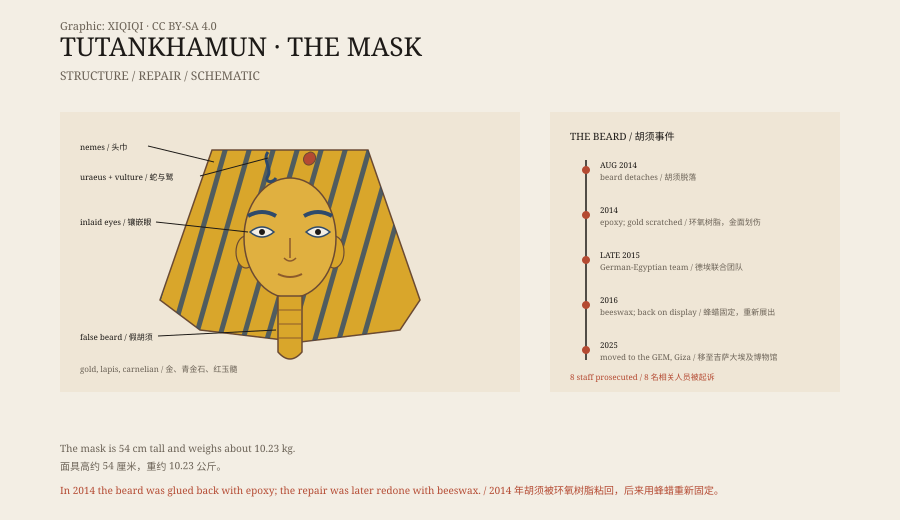

## 一、1925 年的墓室

1925 年 10 月 28 日，霍华德·卡特打开图坦卡蒙的棺椁。

面具盖在法老的头部和肩膀上。金子的颜色很亮，眼睛镶着石英和黑曜石，眉毛和眼线是深蓝色的玻璃。卡特后来写道，面具的表情很安静，像一个睡着的孩子。

图坦卡蒙死时大约十八九岁。他不是一个有名的法老，陵墓也很小，但这座墓几乎没有被盗，里面的东西保存了下来。

## 二、面具

面具高约五十四厘米，重约十点二三公斤。

它由两层黄金打成，脸上和头巾上镶着青金石、红玉髓、石英和黑曜石。头巾是法老特有的条纹头巾，额头上有眼镜蛇和秃鹫，下巴上挂着一条长长的假胡须。

在古埃及，面具不是为了好看。它要保护死者的脸，让灵魂能够认出路，也让法老在另一个世界保持王的形象。

*原创示意图：面具的主要结构与 2014–2016 年的胡须修复经过。不是文物照片。稀奇奇编辑部，CC BY-SA 4.0。*

## 三、胡须断了

2014 年 8 月，埃及博物馆的展柜灯需要维修。

工作人员把面具从展柜里取出来。就在移动的过程中，下巴上的胡须脱落了。

接下来的处理，成了事故。工作人员用环氧树脂把胡须粘回去。这种胶强度高、干得快，而且几乎无法溶解。胶水用多了，溢到面具表面，干了以后被人用工具刮掉，留下了划痕。

博物馆没有马上公布这件事。几个月后，照片和消息流出，引发了公众愤怒。埃及文物部门成立调查组，八名相关人员被起诉。

## 四、修复

2015 年底，一支德国和埃及的修复团队开始处理面具。

他们没有用溶剂硬洗，而是先用加热的方式软化环氧树脂，再用木制工具一点点清除。胶水去掉后，胡须用蜂蜡重新固定。蜂蜡是古埃及人本来就会使用的天然材料。

修复完成后，面具重新展出。胡须回到了原位，但面具上的细小划痕无法完全消失。

## 五、诅咒

图坦卡蒙的墓打开后，资助人卡那封勋爵在 1923 年去世。

当时的报纸把这件事和“法老的诅咒”联系在一起。据说墓里有一块泥板，写着“谁打扰法老的安宁，死亡就会降临”。

这块泥板没有可靠记录。卡那封死前被蚊子咬过，伤口感染，后来发展成肺炎。参与发掘的人里，很多人活到了老年。诅咒的说法流传很广，但没有证据支持。

## 六、现在

2025 年 10 月，面具从开罗的埃及博物馆转移到吉萨的大埃及博物馆。

它被放在单独的展厅里，灯光很暗，面具被单独照亮。游客隔着玻璃看它，停留的时间很短。

一个十八九岁的法老，死后三千年，脸还被金子盖着。有人为了修一盏灯，把胡须碰掉了，又用错误的胶水粘了回去。这些痕迹现在也成了它历史的一部分。

---

**来源与许可**：本文的事实来源见条目底部来源台账 S1–S3。文字与原创示意图采用 CC BY-SA 4.0。文中把出土记录、面具结构、修复事故与诅咒传说分开叙述；“法老的诅咒”没有可靠证据，面具上的划痕也无法完全修复。
