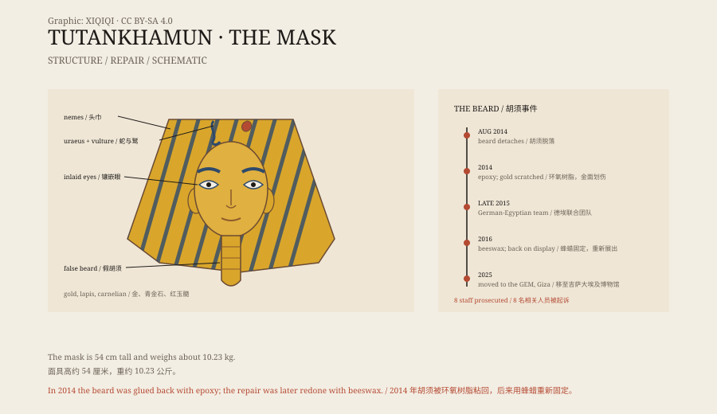

## 一、1925 年的墓室

1925 年 10 月 28 日，霍华德·卡特打开图坦卡蒙的棺椁。

面具盖在法老的头部和肩膀上。金子的颜色很亮，眼睛镶着石英和黑曜石，眉毛和眼线是深蓝色的玻璃。卡特后来写道，面具的表情很安静，像一个睡着的孩子。

图坦卡蒙死时大约十八九岁。他不是一个有名的法老，陵墓也很小，但这座墓几乎没有被盗，里面的东西保存了下来。

## 二、面具

面具高约五十四厘米，重约十点二三公斤。

它由两层黄金打成，脸上和头巾上镶着青金石、红玉髓、石英和黑曜石。头巾是法老特有的条纹头巾，额头上有眼镜蛇和秃鹫，下巴上挂着一条长长的假胡须。

在古埃及，面具不是为了好看。它要保护死者的脸，让灵魂能够认出路，也让法老在另一个世界保持王的形象。

*原创示意图：面具的主要结构与 2014–2016 年的胡须修复经过。不是文物照片。稀奇奇编辑部，CC BY-SA 4.0。*

## 三、胡须断了

2014 年 8 月，埃及博物馆的展柜灯需要维修。

工作人员把面具从展柜里取出来。就在移动的过程中，下巴上的胡须脱落了。

接下来的处理，成了事故。工作人员用环氧树脂把胡须粘回去。这种胶强度高、干得快，而且几乎无法溶解。胶水用多了，溢到面具表面，干了以后被人用工具刮掉，留下了划痕。

博物馆没有马上公布这件事。几个月后，照片和消息流出，引发了公众愤怒。埃及文物部门成立调查组，八名相关人员被起诉。

## 四、修复

2015 年底，一支德国和埃及的修复团队开始处理面具。

他们没有用溶剂硬洗，而是先用加热的方式软化环氧树脂，再用木制工具一点点清除。胶水去掉后，胡须用蜂蜡重新固定。蜂蜡是古埃及人本来就会使用的天然材料。

修复完成后，面具重新展出。胡须回到了原位，但面具上的细小划痕无法完全消失。

## 五、诅咒

图坦卡蒙的墓打开后，资助人卡那封勋爵在 1923 年去世。

当时的报纸把这件事和“法老的诅咒”联系在一起。据说墓里有一块泥板，写着“谁打扰法老的安宁，死亡就会降临”。

这块泥板没有可靠记录。卡那封死前被蚊子咬过，伤口感染，后来发展成肺炎。参与发掘的人里，很多人活到了老年。诅咒的说法流传很广，但没有证据支持。

## 六、现在

2025 年 10 月，面具从开罗的埃及博物馆转移到吉萨的大埃及博物馆。

它被放在单独的展厅里，灯光很暗，面具被单独照亮。游客隔着玻璃看它，停留的时间很短。

一个十八九岁的法老，死后三千年，脸还被金子盖着。有人为了修一盏灯，把胡须碰掉了，又用错误的胶水粘了回去。这些痕迹现在也成了它历史的一部分。

## 墓室

1925 年，霍华德·卡特在帝王谷打开图坦卡蒙的墓室。

面具盖在木乃伊的头上，面朝上。它由金箔制成，镶嵌着玻璃、青金石、绿松石和红玉髓。重量超过十公斤。

面具不是单独的艺术品，它是葬礼的一部分。它盖在脸上，陪死者进入另一个世界。它的眼睛画着黑白的眼线，像活人的眼睛。

## 材料

面具的主料是金。

金箔下面有石膏和木头的支撑。不同部位的金含量不完全一样，有的纯度高，有的合金多。镶嵌的石头也有讲究：青金石来自阿富汗，绿松石来自西奈，红玉髓来自埃及东部沙漠。

这些材料说明，埃及的贸易网络比很多人想象的更远。一个法老的葬礼，动用了来自几个国家的石头。

## 胡须

面具的下巴上有一根假胡须。

2014 年，博物馆工作人员在搬运时碰断了胡须。事故被拍下来，成了国际新闻。修复者用环氧树脂把胡须粘回去，但留下了明显的痕迹。

后来的修复团队重新处理，把环氧树脂清除，改用更合适的材料。面具被放回展柜，但那次事故成了文物保护的反面教材。

## 修复

面具的修复，不只是把断掉的部分粘回去。

金箔很薄，容易变形；镶嵌的石头会松动；表面的灰尘不能用普通清洁剂。修复者要用显微镜、软刷和定制工具。

每次修复都会留下记录：用了什么材料，做了什么处理，哪些地方没有动。这些记录比修复本身更重要，因为后来的研究者需要知道，哪些是原物，哪些是干预。

## 现在

图坦卡蒙面具在开罗的埃及博物馆展出。

它不常出国。2019 年，它原定去德国展览，后来因为修复争议被取消。埃及方面说，面具需要更稳定的环境。

一个面具，从一个少年法老的脸上，到一个玻璃柜里。它仍然在看着前方，只是前方不再是尼罗河，而是游客。

## 金箔

面具的金箔很薄。

工匠把金块锤成薄片，再切割、塑形、镶嵌。金箔的厚度不均匀，有的地方厚，有的地方薄。这不是失误，而是手工的证据。

金箔下面的石膏和木头，决定了面具的形状。金箔只是皮肤，骨架在里面。时间长了，骨架会变形，金箔会开裂。

## 展览

面具在开罗的埃及博物馆展出。

它被放在一个独立的展柜里，灯光从侧面打过来。游客不能靠近，也不能拍照闪光。展柜里有温湿度传感器，工作人员每天检查。

面具的展位，曾经因为修复争议关闭过一段时间。后来重新开放，但参观规则更严了。

## 保护

文物保护，不只是修好一件东西。

它还包括记录、监测、限制访问、培训人员。面具的每一次移动，都要经过审批。每一次清洁，都要用最软的工具。

一个面具，三千多年，经历了埋葬、发现、搬运、修复、展览。它的历史，比法老的历史更长。

---

**来源与许可**：本文的事实来源见条目底部来源台账 S1–S3。文字与原创示意图采用 CC BY-SA 4.0。文中把出土记录、面具结构、修复事故与诅咒传说分开叙述；“法老的诅咒”没有可靠证据，面具上的划痕也无法完全修复。
