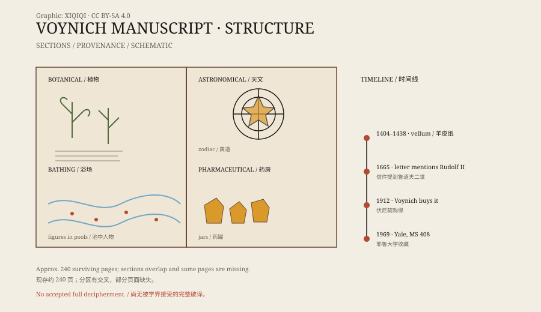

## 1. A book without a title

The book is now called the Voynich manuscript, after the twentieth-century bookseller Wilfrid Voynich.

In 1912 he bought a collection of old books in Italy, and this was among them. It has no title page and no author's name. The cover is vellum, and so are the pages.

In 2009, the University of Arizona radiocarbon-dated several pages. The results fell between 1404 and 1438. The manuscript really is an early fifteenth-century object, not a modern forgery.

## 2. What is inside

The manuscript has about 240 pages, small in format, with many illustrations.

Some pages show plants. The leaves, roots, and flowers are drawn in detail, but many do not match any known species. Some look like several plants combined; some do not exist at all.

Other pages are astronomical or astrological. Circular diagrams contain stars, zodiac symbols, and naked women standing in pools connected by pipes. There are also jars, herbs, and containers of unclear purpose.

Text and images are mixed. Some pages are almost all text; some are almost all picture.

*Original schematic: the common sections and page structure of the Voynich manuscript. Not a facsimile. Oddity Archive, CC BY-SA 4.0.*

## 3. The writing

The script is called “Voynichese.”

It runs left to right. The letter shapes are fluent, some resembling variants of Latin letters, but the combinations do not fit. There is little punctuation, and words are separated by spaces. Word lengths and repetition frequencies look like a natural language rather than random characters.

The problem is that no one can match it to any known language.

Researchers have found that the word frequencies follow Zipf's law, and analyses of character entropy do not look like a simple substitution cipher. Some suggest it is a constructed language, a cipher, religious glossolalia, or an elaborate hoax.

## 4. Who wrote it

The author is unknown.

A letter from 1665 says the manuscript once belonged to Rudolf II, Holy Roman Emperor, who supposedly paid 600 ducats for it. But the letter itself is disputed and cannot be treated as proof.

It later passed through Jesuits and collectors before reaching Voynich. In 1969, Yale's Beinecke Library acquired it as MS 408.

## 5. Attempts to decipher it

Decipherment attempts have not stopped for more than a century.

Some treat it as a variant of a medieval European language, some as Arabic, Hebrew, or Armenian, some as a cipher, and some as a “fake book” written to impress outsiders, with text that means nothing.

Most of these explanations account for only part of the evidence. People have announced complete translations, but scholars usually point out the same problems: unnatural readings, methods that cannot be repeated, and illustrations that do not fit. No decipherment is widely accepted.

## 6. Now

The manuscript is held at Yale, and high-resolution images are available online. Anyone can download it and try to read it.

It may be a cipher, a lost language, or a book that was never meant to be understood. What is certain is that it has existed for six hundred years and has still not given up its answer.

---

**Sources and licenses**: the factual sources are listed in the source ledger S1–S3 at the bottom of this entry. Text and original diagrams are licensed under CC BY-SA 4.0. This article separates the radiocarbon dating, the ownership history, the contents, and the various decipherment hypotheses; no unaccepted translation is presented as a conclusion.
