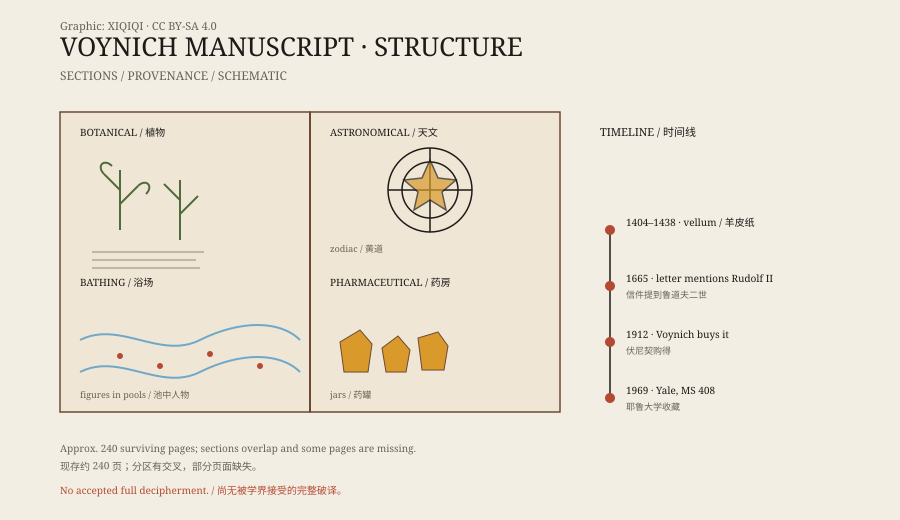

## 一、一本没有名字的书

这本书现在叫“伏尼契手稿”，名字来自二十世纪的书商威尔弗里德·伏尼契。

1912 年，他在意大利买下了一批旧书，其中就有这本。书没有标题页，也没有作者署名。封面是羊皮纸，里面的纸页也是羊皮纸。

2009 年，亚利桑那大学对几页羊皮纸做了碳定年，结果落在公元 1404 到 1438 年之间。也就是说，它确实是一本十五世纪初的书，不是现代人伪造的。

## 二、里面有什么

手稿大约有二百四十页，开本不大，里面有很多插图。

一部分画的是植物。叶子、根、花都画得很细，但很多植物对不上现实中的物种。有的像是把几种植物拼在一起，有的根本不存在。

一部分是天文或占星图。圆形图里有星星、星座符号，还有一些裸体女人站在池子里，池水通过管道相连。还有一部分画着药罐、草药和不知用途的容器。

文字和插图混在一起。有的页几乎全是字，有的页只有图。

*原创示意图：伏尼契手稿的常见分区与页面结构。不是手稿影印。稀奇奇编辑部，CC BY-SA 4.0。*

## 三、文字

手稿的文字叫“伏尼契文”。

它从左往右写，字母形状流畅，有些像拉丁字母的变体，但组合方式不对。整篇文字没有明显的标点，词与词之间用空格分开。词的长度和重复频率，看起来像自然语言，而不像随机字符。

问题在于：没有人能把它和任何已知语言对应起来。

有人统计过词频，发现它符合齐夫定律；有人分析过字符的熵，认为它不像简单的替换密码。也有研究者认为，它可能是一种构造语言、一种密码、一种宗教性的胡言乱语，或者干脆是一场精心设计的骗局。

## 四、谁写的

作者不明。

手稿上有一封 1665 年的信，提到它曾经属于神圣罗马帝国皇帝鲁道夫二世，据说皇帝花了六百金币买下它。但这封信本身也有争议，不能当作确证。

后来它经过耶稣会士、收藏家之手，最后到了伏尼契手里。1969 年，耶鲁大学贝内克图书馆买下了它，编号 MS 408。

## 五、破译尝试

一百多年来，破译尝试没有停过。

有人把它当成中世纪欧洲语言的变体，有人把它当成阿拉伯语、希伯来语、亚美尼亚语，有人把它当成某种密码，还有人认为它是一本“写给外人看的假书”，文字本身没有意义。

这些说法大多只能解释一部分特征。有人宣称找到了完整的翻译，但学界通常很快指出问题：译文不自然、方法无法重复、无法解释插图。到目前为止，没有一种破译被广泛接受。

## 六、现在

手稿保存在耶鲁大学，高清图像可以在网上查看。任何人都可以下载，自己试着读。

它可能是密码，可能是失传的语言，也可能是一本没有人打算让人读懂的书。唯一确定的是：它已经存在了六百年，仍然没有给出答案。

---

**来源与许可**：本文的事实来源见条目底部来源台账 S1–S3。文字与原创示意图采用 CC BY-SA 4.0。文中把碳定年、收藏史、内容描述与各种破译假说分开叙述；没有把任何一种未经学界接受的译文当作结论。
