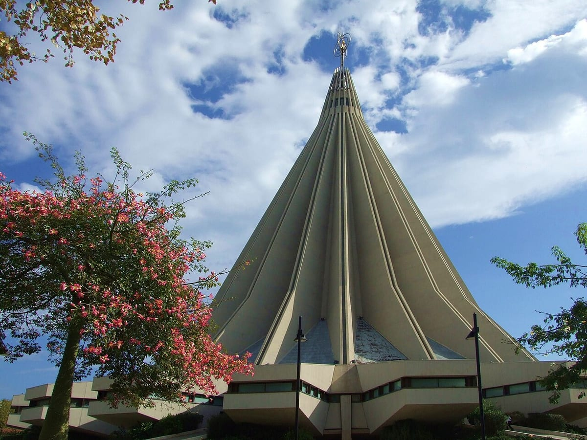
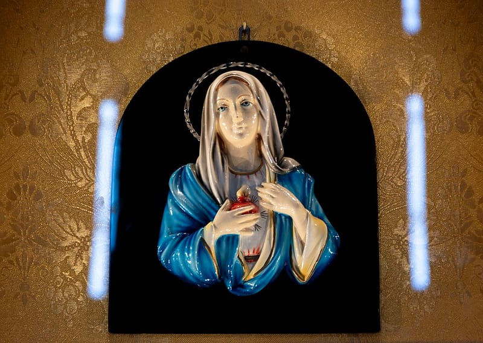
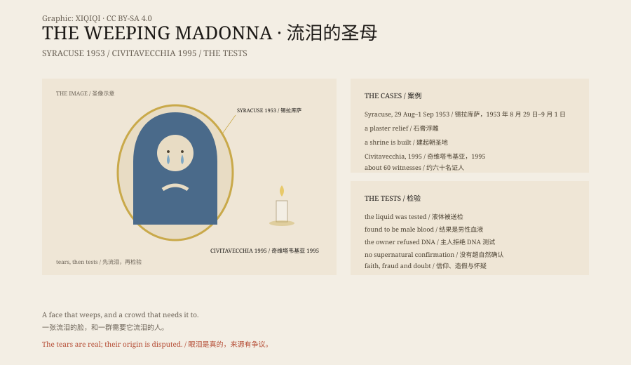

## 1. The Room on Via Orti di San Giorgio

At the end of August 1953, in Syracuse, Sicily, a young couple lived at Via degli Orti di San Giorgio 11. Angelo Iannuso and his wife Antonina Lucia Giusto were expecting their first child, and the pregnancy had not gone smoothly. On the wall beside the bed hung a small plaster relief of the Virgin of the Immaculate Heart. There may have been candles beneath it.

On the morning of 29 August Antonina saw water in the eyes of the relief. She said afterwards that she thought it was a hallucination, her body weakened by pregnancy and illness. The water stayed. It came out of the eyes and ran down the plaster face.

Neighbours were called in. Someone held a handkerchief to the eyes. The handkerchief came away wet.

## 2. Four Days

The tears ran from 29 August to 1 September, on and off, four days in all. Word moved through the city; the lane outside filled with people. Some brought sick children. Some came only to look. The photographer Giuseppe "Pippo" Saraceno took the picture of the weeping image that later went into newspapers and postcards.

Those were hot days in Syracuse. Some said it was damp returning, some said water was seeping through the plaster. The people catching the tears said the water came out of the eyes, not down from the wall.

## 3. The Sample

On 1 September the archdiocese of Syracuse formed a commission. Doctors and analysts were present. They took about thirty drops from the eyes of the image, put them in a bottle and sent them to a laboratory.

The result: the liquid had the composition of human tears. The sample contained proteins and urates, no plaster dust and no paint. The commission compared it with the tears of an adult and of a two-and-a-half-year-old child, and concluded that it was the same kind of secretion.

After the sample was taken, the image stopped crying. Four days, and then nothing.

The order of events has been repeated ever since: first the tears, then the sample, then silence. Believers say the image allowed itself to be tested. Sceptics say the people taking the sample disturbed the image and closed whatever seam had been letting water through.

## 4. What the Church Approved

On 13 December 1953 the Archbishop of Syracuse approved devotion to the image. A sanctuary was later built for it, the Santuario della Madonna delle Lacrime, and the image was placed behind glass.

It matters what was approved. Devotion was approved: permission for the faithful to pray there. The origin of the tears was not settled. The Church moves carefully in these cases. A local bishop can permit devotion; declaring a phenomenon supernatural is a separate and much rarer act.

The usual procedure runs like this. The parish priest reports; the bishop forms a commission; doctors, chemists and theologians examine the case separately; the bishop decides whether public devotion is allowed. Most cases stop at that door.

## 5. Civitavecchia, 1995

On 2 February 1995, in Pantano, a suburb of Civitavecchia north of Rome, a 43 cm statue of the Virgin stood in a garden. Jessica, the six-year-old daughter of the owner, Fabio Gregori, was the first to see red liquid on the statue's face.

It happened again. Neighbours came, then the parish priest, then the bishop of the diocese, Girolamo Grillo. According to those present, the bishop was reciting a prayer when blood ran from the statue's eyes. Word spread; dozens of people said they had seen it.

The blood was tested. It was human, and male. X-rays and CT scans showed the statue solid inside, with no tube or reservoir. Gregori refused a DNA test. The Church never approved the case.

## 6. How to Make a Statue Cry

Making a statue weep is easier than it sounds. Plaster is porous; liquid injected inside will seep out where the wall is thinnest, at the eyes. Oil mixed with fat and smeared on the eyelids will run when the chapel warms up. A simpler explanation exists too: plaster of uneven density condenses moisture on its colder parts, and the eyes are often the coldest.

Plenty of cases have collapsed. In 1985 a statue in Montreal was said to weep and bleed; it turned out to have been smeared with the owner's blood and shaving cream. In 2002 a statue of Padre Pio in Messina produced a red liquid; the blood was found to belong to a woman, and the case was dismissed. In 2008 a church custodian in northern Italy stood trial for faking blood on a statue of the Virgin; his own DNA matched. In 2012 a "weeping" statue of Jesus was used as holy water until a sewage pipe was found dripping through its feet. In 2018 a statue of Our Lady of Guadalupe in Hobbs, New Mexico, was reported to be in tears; the diocese had the liquid tested and announced that it was rose-scented olive oil.

These cases do not prove that every case is fake. They show that tears can be made by a person, and by a building.

## 7. Behind Glass

The image in Syracuse is still in the sanctuary, behind glass, under light. It no longer weeps.

A chemist at the University of Pavia once proposed an explanation: a fault in the glaze let moisture reach the eyes by capillary action. He never examined the image behind the glass. His explanation therefore sits at "possible", in the same place as the word miracle.

The tears collected over four days were analysed and found to be human. Where they came from no one can now prove. One thing can be proved: on 1 September 1953 the commission came with its bottle, and the image stopped crying.

*Site photograph: the Sanctuary of Our Lady of the Tears in Syracuse, 2007. Salvo Cannizzaro, CC BY-SA 3.0 (Wikimedia Commons). The sanctuary was built to house the weeping image.*

*Site photograph: the image of the Immaculate Heart on display in the sanctuary at Syracuse, 2025. Julian Lupyan, CC0 (Wikimedia Commons). The image stands in a glass case against gold fabric.*

*Original schematic: Syracuse 1953, Civitavecchia 1995 and the tests used. Not a historical photograph. Oddity Archive, CC BY-SA 4.0.*

---

**Sources and licenses**: sources are listed in the ledger S1–S6 at the foot of this entry. Text and original diagrams are CC BY-SA 4.0. The article keeps apart the Syracuse case, the Civitavecchia dispute, the Church's procedure and the exposed hoaxes; the Syracuse tears have a laboratory record but no settled origin, and most other cases were rejected. The photographs are of the sanctuary and the image on display; the schematic is not a historical photograph.
