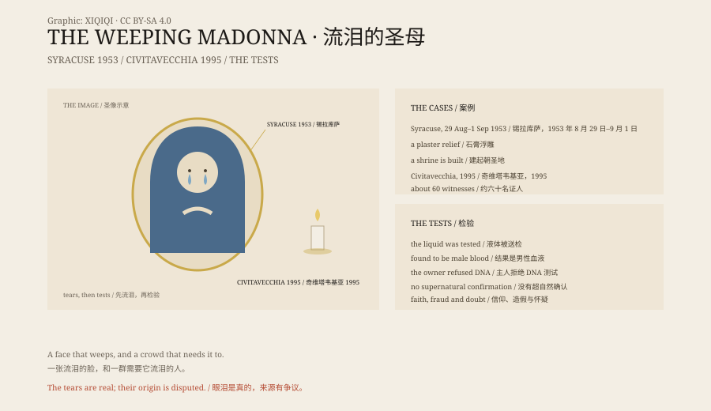

## 1. Syracuse, 1953

Syracuse, Sicily. In the home of a young couple hung a plaster relief of the Immaculate Heart of Mary.

On 29 August 1953 the wife saw water in the image's eyes.

It was not condensation. It was tears.

The tears returned several times over the following days. The news spread, and crowds gathered.

## 2. The Church

The Church set up a commission to examine the tears and to examine people who claimed to have been healed.

The local Church permitted veneration of the image, and a shrine, Our Lady of Tears, was built in Syracuse.

## 3. Civitavecchia, 1995

In Civitavecchia, central Italy, a six-year-old girl saw blood coming from the eyes of a Madonna statue in her home.

Over the following months the statue "bled" in front of many people, including the local bishop.

About sixty witnesses testified. The bishop said he saw it himself.

## 4. The Tests

The blood was tested. It was found to be male blood.

The owner of the statue refused a DNA test.

The Church did not confirm the phenomenon as supernatural.

## 5. Other Cases

Akita, Echizen, Syria, the United States: there are reports of weeping Madonnas in many places.

Some have been accepted by the Church, some rejected, some left without a conclusion.

## 6. Tears

A plaster statue does not cry.

People do.

In a place that needs signs, tears are the easiest language to read: they say, I see you.

*Original schematic: Syracuse 1953, Civitavecchia 1995 and the testing process. Not a photograph of an artefact. Oddity Archive, CC BY-SA 4.0.*

---

**Sources and licenses**: the factual sources are listed in the source ledger S1–S3 at the bottom of this entry. Text and original diagrams are licensed under CC BY-SA 4.0. This article separates the case records, the Church's position and the test results; no case has been scientifically confirmed as supernatural. The illustration is a scene reconstruction, not a photograph of an artefact.
